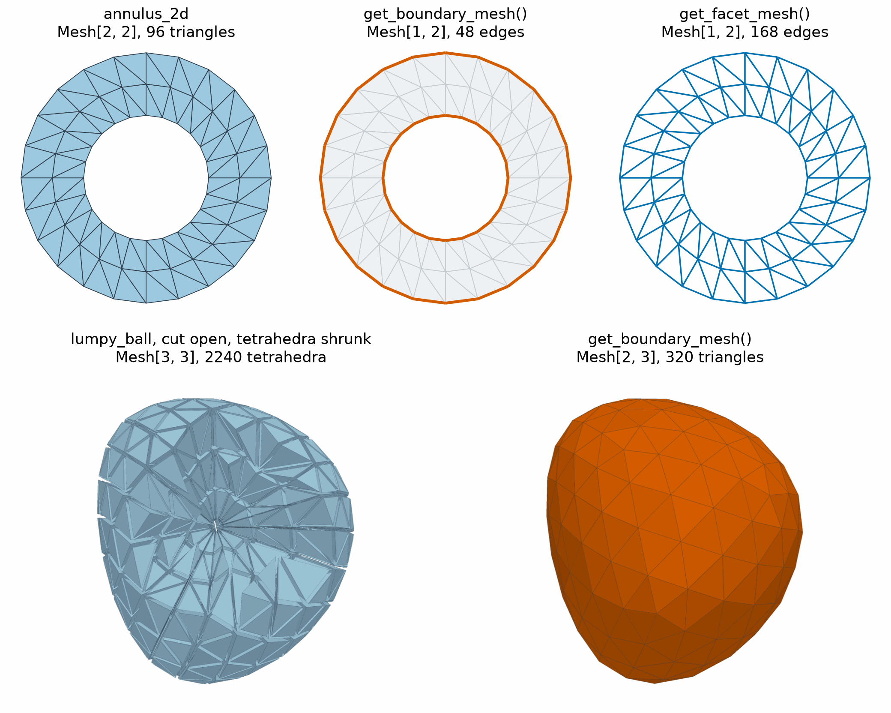

Boundaries and Topology
=======================

.. currentmodule:: physicsnemo.mesh.boundaries

``physicsnemo.mesh.boundaries`` finds the boundary of a mesh, extracts its
facets, and checks its topology. Its results are masks, index pairs, booleans,
or new meshes that keep the point indices of the parent.

:bdg-success:`GPU` :bdg-secondary:`any dimension`

         and inner circles drawn in thick orange, and all of the ring's edges
         drawn as lines. Bottom row: a ball cut open, with its tetrahedra
         shrunk apart, and its triangulated boundary surface in orange.
   :align: center
   :width: 100%

   Top: an annulus, its boundary mesh of 48 edges (the outer and inner
   circles), and its facet mesh of all 168 edges. Bottom: a tetrahedral ball,
   cut open with its tetrahedra shrunk, and its boundary surface of 320
   triangles.

.. rubric:: Most Used

.. grid:: 1 1 2 2
   :gutter: 2

   .. grid-item-card:: Boundary Mesh
      :link: physicsnemo.mesh.mesh.Mesh.get_boundary_mesh
      :link-type: any
      :shadow: md
      :class-card: sd-card-hover

      ``mesh.get_boundary_mesh()`` returns the boundary facets as a mesh.

   .. grid-item-card:: Facet Mesh
      :link: physicsnemo.mesh.mesh.Mesh.get_facet_mesh
      :link-type: any
      :shadow: md
      :class-card: sd-card-hover

      ``mesh.get_facet_mesh()`` returns all facets, or only some of them.

   .. grid-item-card:: Watertight
      :link: physicsnemo.mesh.boundaries.is_watertight
      :link-type: any
      :shadow: md
      :class-card: sd-card-hover

      ``mesh.is_watertight()`` is ``True`` when no facet is on the boundary.

   .. grid-item-card:: Manifold
      :link: physicsnemo.mesh.boundaries.is_manifold
      :link-type: any
      :shadow: md
      :class-card: sd-card-hover

      ``mesh.is_manifold()`` is ``True`` when the mesh is locally Euclidean.

A facet is a face of a cell with one dimension less than the cell. The facets
of a triangle are its three edges, and the facets of a tetrahedron are its
four triangles. A boundary facet belongs to exactly one cell. Two cells share
an interior facet. The module has three groups of functions:

- Boundary detection: the points, edges, or cells on the boundary.
- Facet extraction: a new mesh of the facets, with data aggregated from the
  parent cells.
- Topology checks: whether a mesh is
  `watertight <https://en.wikipedia.org/wiki/Watertight_(3D_modeling)>`_ or
  `manifold <https://en.wikipedia.org/wiki/Manifold>`_. A watertight mesh has
  no boundary facets. A manifold mesh looks locally like Euclidean space, so
  that, for example, each facet belongs to one or two cells.

Example
-------

The following example finds the boundaries of a square and of a cube:

.. code:: python

    from physicsnemo.mesh.boundaries import get_boundary_edges, get_boundary_vertices
    from physicsnemo.mesh.primitives.planar import unit_square
    from physicsnemo.mesh.primitives.volumes import cube_volume

    square = unit_square.load(subdivisions=2)  # 25 points, 32 triangles
    print(get_boundary_vertices(square).sum().item())  # 16 boundary points
    print(get_boundary_edges(square).shape)  # torch.Size([16, 2])

    boundary = square.get_boundary_mesh()  # 16 boundary edges
    edges = square.get_facet_mesh()  # all 56 edges
    print(square.is_watertight(), square.is_manifold())  # False True

    # The boundary of a tetrahedral mesh is a closed triangle surface.
    cube = cube_volume.load(subdivisions=2)
    surface = cube.get_boundary_mesh()
    print(surface.n_manifold_dims, surface.n_spatial_dims)  # 2 3
    print(surface.is_watertight())  # True

The boundary mesh and the facet mesh keep every point of the parent mesh, so
their point indices match the parent's. By default, each facet takes the
mean of the ``cell_data`` of its parent cells. Set ``data_aggregation`` to
``"area_weighted"`` or ``"inverse_distance"`` for other weights, or set
``data_source="points"`` to carry ``point_data`` instead.

The most common operations are both ``Mesh`` methods and functions in this
module. The following code is the function form of the check above:

.. code:: python

    from physicsnemo.mesh.boundaries import is_manifold, is_watertight

    print(is_watertight(square), is_manifold(square))  # False True

Choosing a Function
-------------------

Use the following guidelines to choose a function:

- For a mesh of the boundary, use ``mesh.get_boundary_mesh()``. For a mesh of
  all facets, use ``mesh.get_facet_mesh()``. With ``target_counts``, the facet
  mesh can keep only the boundary (``"boundary"``), shared (``"shared"``), or
  interior (``"interior"``) facets. With ``manifold_codimension=2``, it
  gives the edges of a tetrahedral mesh.
- For a mask, use :func:`get_boundary_vertices` or :func:`get_boundary_cells`.
  :func:`get_boundary_edges` returns point index pairs.
- :func:`extract_candidate_facets`, :func:`categorize_facets_by_count`,
  :func:`compute_aggregation_weights`, :func:`deduplicate_and_aggregate_facets`,
  and :func:`extract_facet_mesh_data` are the steps of facet extraction. Use
  them only to build a custom extraction.

Summary
-------

.. autosummary::
   :nosignatures:

   get_boundary_vertices
   get_boundary_edges
   get_boundary_cells
   is_watertight
   is_manifold
   extract_facet_mesh_data
   extract_candidate_facets
   categorize_facets_by_count
   compute_aggregation_weights
   deduplicate_and_aggregate_facets

Related Topics
--------------

For more information, refer to the following resources:

- :doc:`neighbors` for adjacency between points and cells.
- :doc:`repair` for hole filling and orientation fixes.
- Tutorials: `Mesh Operations
  <https://github.com/NVIDIA/physicsnemo/blob/main/examples/minimal/mesh/tutorial_4_operations.ipynb>`_
  and `Quality, Validation, and Repair
  <https://github.com/NVIDIA/physicsnemo/blob/main/examples/minimal/mesh/tutorial_7_quality_repair.ipynb>`_

API Reference
-------------

.. autofunction:: get_boundary_vertices

.. autofunction:: get_boundary_edges

.. autofunction:: get_boundary_cells

.. autofunction:: is_watertight

.. autofunction:: is_manifold

.. autofunction:: extract_facet_mesh_data

.. autofunction:: extract_candidate_facets

.. autofunction:: categorize_facets_by_count

.. autofunction:: compute_aggregation_weights

.. autofunction:: deduplicate_and_aggregate_facets
