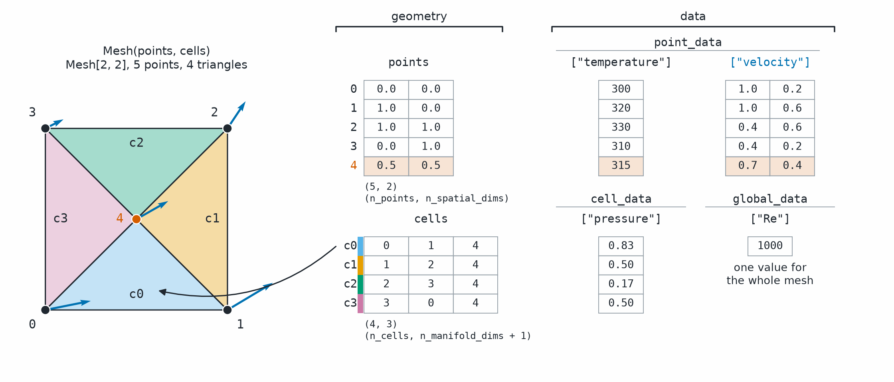

Mesh
====

.. currentmodule:: physicsnemo.mesh.mesh

:class:`Mesh` is the central data structure of PhysicsNeMo-Mesh. One type
holds point clouds, curves, surfaces, and volumes in any number of dimensions,
and :class:`~physicsnemo.mesh.domain_mesh.DomainMesh` groups an interior mesh
with named boundary meshes.

:bdg-success:`CPU and GPU` :bdg-info:`autograd` :bdg-secondary:`any dimension`
:bdg-secondary:`TensorDict API`

         The points table has five rows of coordinates. The cells table has
         four rows of point indices, with an arrow from the first row to its
         triangle. Data columns sit beside each table, and one box holds the
         global data.
   :align: center
   :width: 100%

   A ``Mesh`` is five tensors. ``points`` and ``cells`` carry the geometry,
   and ``point_data``, ``cell_data``, and ``global_data`` carry the fields.

The five fields have the following shapes:

.. list-table::
   :header-rows: 1
   :widths: 22 38 40

   * - Field
     - Shape
     - Holds
   * - ``points``
     - ``(n_points, n_spatial_dims)``
     - The coordinates of each point
   * - ``cells``
     - ``(n_cells, n_manifold_dims + 1)``, integer
     - The point indices of each simplex
   * - ``point_data``
     - ``(n_points, ...)`` for each field
     - Fields with one value for each point
   * - ``cell_data``
     - ``(n_cells, ...)`` for each field
     - Fields with one value for each cell
   * - ``global_data``
     - ``(...)`` for each field
     - Fields with one value for the whole mesh

The manifold dimension (``n_manifold_dims``) is the dimension of the cells: 0
for points, 1 for edges, 2 for triangles, and 3 for tetrahedra. The spatial
dimension (``n_spatial_dims``) is the number of coordinates of each point, and
it is never smaller. The three data containers are ``TensorDict`` objects that
hold fields of any rank with nested keys. Refer to :doc:`fields` for details.

.. tip::

   ``Mesh`` and ``DomainMesh`` are
   `tensorclasses <https://pytorch.org/tensordict/stable/reference/tensorclass.html>`_.
   One ``mesh.to("cuda")`` call moves all points, cells, and data, and
   ``.clone()`` and ``.detach()`` work as they do on a ``TensorDict``. To
   batch meshes, use ``Mesh.merge``, and pad them to a fixed size with
   ``Mesh.pad``.

The most-used members are the following:

.. grid:: 1 2 4 4
   :gutter: 2

   .. grid-item-card:: Mesh.merge
      :link: physicsnemo.mesh.mesh.Mesh.merge
      :link-type: any
      :shadow: md
      :class-card: sd-card-hover

      Join meshes into one, for example to batch them.

   .. grid-item-card:: Mesh.get_facet_mesh
      :link: physicsnemo.mesh.mesh.Mesh.get_facet_mesh
      :link-type: any
      :shadow: md
      :class-card: sd-card-hover

      Faces, edges, or vertices of the cells as a new mesh.

   .. grid-item-card:: Mesh.compute_point_derivatives
      :link: physicsnemo.mesh.mesh.Mesh.compute_point_derivatives
      :link-type: any
      :shadow: md
      :class-card: sd-card-hover

      Gradients of point fields, stored as new fields.

   .. grid-item-card:: Mesh.with_data
      :link: physicsnemo.mesh.mesh.Mesh.with_data
      :link-type: any
      :shadow: md
      :class-card: sd-card-hover

      A new mesh with new fields that keeps the cached geometry.

Example
-------

.. code:: python

    import torch
    from physicsnemo.mesh import Mesh

    points = torch.tensor([[0.0, 0.0], [1.0, 0.0], [0.5, 1.0]])
    cells = torch.tensor([[0, 1, 2]])
    mesh = Mesh(points=points, cells=cells)

    # Geometric properties (computed on first access, then cached)
    print(mesh.cell_centroids)   # shape (1, 2)
    print(mesh.cell_areas)       # tensor([0.5000])

    # Fields of any rank, at three levels
    mesh.point_data["T"] = torch.tensor([1.0, 2.0, 3.0])              # scalar
    mesh.point_data["velocity"] = torch.zeros(3, 2)                    # vector
    mesh.cell_data["stress"] = torch.eye(2).unsqueeze(0)               # rank-2 tensor
    mesh.global_data["reynolds_number"] = torch.tensor(1.0e6)          # one value

    # Derivatives are stored as new point fields
    mesh = mesh.compute_point_derivatives(keys="T", method="lsq")
    print(mesh.point_data["T_gradient"].shape)  # torch.Size([3, 2])

``Mesh`` computes geometric quantities, such as centroids, areas, normals,
and curvature, on first access and caches them. Most operations are both a
``Mesh`` method and a function in a submodule, so ``mesh.rotate(...)`` is
``rotate(mesh, ...)`` from :doc:`transformations`. To build a triangle mesh
from a surface whose cells are arbitrary polygons, use
:meth:`Mesh.from_polygons`, described in :doc:`tessellation`.

.. important::

   :attr:`Mesh.cell_normals` and :attr:`Mesh.point_normals` need codimension 1,
   such as triangles in 3D or edges in 2D. On any other mesh, they raise
   ``ValueError``.

.. _mesh-orientation-conventions:

Orientation Conventions
-----------------------

The order of the points in a cell sets its orientation. Cell normals and
signed volumes follow from this order, and so do the quantities that use
them, such as the sign of the mean curvature. The library and its primitives
follow these conventions:

- Every cell of a ``Mesh[n, n]``, such as a triangle in 2D or a tetrahedron
  in 3D, has a positive signed volume, ``det(v1 - v0, ..., vn - v0) > 0``. In
  2D, this means that each triangle is wound counterclockwise.
- A closed ``Mesh[2, 3]`` has outward normals. Seen from outside, each
  triangle is wound counterclockwise.
- A triangle in the xy plane that is wound counterclockwise has the normal
  +z.
- A closed curve, ``Mesh[1, 2]``, has no outward rule. The normal of an edge
  is its tangent rotated 90 degrees counterclockwise, so a counterclockwise
  curve has inward normals. ``curves.circle_2d`` and ``curves.ellipse_2d``
  run counterclockwise.
- The facets from :meth:`Mesh.get_boundary_mesh` carry no orientation. Their
  point order does not depend on the winding of the parent cells.

To check and fix the orientation of a mesh, use the following methods:

- ``mesh.validate(check_inverted_cells=True)`` counts the cells with a
  negative signed volume in ``n_inverted_cells``. It checks a ``Mesh[n, n]``
  with a manifold dimension of 2 or more.
- :func:`~physicsnemo.mesh.repair.fix_orientation` makes each cell agree with
  its neighbors. On a ``Mesh[n, n]``, it then reverses each connected
  component whose total signed volume is negative. On a surface in 3D, it
  makes the winding consistent but does not choose outward normals.
- ``repair_mesh(mesh, fix_orientation=True)`` runs
  :func:`~physicsnemo.mesh.repair.fix_orientation` as one step of
  :func:`~physicsnemo.mesh.repair.repair_mesh`.

Choosing an Update Method
-------------------------

Use the cache-aware replacement methods to make a mesh that keeps the same
point or cell indexing. Each method returns a new ``Mesh`` with independent
``TensorDict`` containers that share their tensor leaves. Pick the method by
what changes:

.. list-table::
   :header-rows: 1

   * - Method
     - Intended Change
     - Default Cache Policy
   * - :meth:`Mesh.with_data`
     - Replace point, cell, or global field data
     - Retain every geometry and topology cache
   * - :meth:`Mesh.with_points`
     - Replace coordinates without changing point indexing or connectivity
     - Retain topology and clear geometry caches
   * - :meth:`Mesh.with_cells`
     - Replace connectivity without changing cell indexing or simplex type
     - Clear every cache
   * - :meth:`Mesh.strip_caches`
     - Remove cached values without changing the mesh
     - Clear every cache

.. dropdown:: Retaining Caches with ``keep``

   The ``keep`` override accepts any of the following:

   - A top-level string such as ``"topology"``
   - A single nested-key tuple such as ``("cell", "areas")``
   - A sequence of keys

   Use a list to retain several keys, for example
   ``["topology", ("cell", "areas")]``. Retaining a cache that depends on
   replaced geometry or connectivity is an expert operation. You are
   responsible for the validity of the retained cache.

Summary
-------

.. rubric:: Classes

.. autosummary::
   :nosignatures:

   Mesh
   ~physicsnemo.mesh.domain_mesh.DomainMesh

.. rubric:: Construction and Data

.. autosummary::
   :nosignatures:

   Mesh.from_polygons
   Mesh.merge
   Mesh.slice_points
   Mesh.slice_cells
   Mesh.pad
   Mesh.pad_to_next_power
   Mesh.with_points
   Mesh.with_cells
   Mesh.with_data
   Mesh.strip_caches
   Mesh.cell_data_to_point_data
   Mesh.point_data_to_cell_data
   Mesh.to
   Mesh.clone
   Mesh.load

``Mesh.save`` writes a mesh to disk as memory-mapped tensors, and
:meth:`Mesh.load` reads it back. ``DomainMesh.save`` and
:meth:`DomainMesh.load <physicsnemo.mesh.domain_mesh.DomainMesh.load>` do the
same for a domain.

.. rubric:: Dimensions and Geometry

.. autosummary::
   :nosignatures:

   Mesh.n_points
   Mesh.n_cells
   Mesh.n_spatial_dims
   Mesh.n_manifold_dims
   Mesh.codimension
   Mesh.cell_centroids
   Mesh.cell_areas
   Mesh.cell_normals
   Mesh.point_normals
   Mesh.compute_point_normals
   Mesh.gaussian_curvature_vertices
   Mesh.gaussian_curvature_cells
   Mesh.mean_curvature_vertices

.. rubric:: Topology and Conversion

.. autosummary::
   :nosignatures:

   Mesh.get_facet_mesh
   Mesh.get_boundary_mesh
   Mesh.is_manifold
   Mesh.is_watertight
   Mesh.get_point_to_points_adjacency
   Mesh.get_point_to_cells_adjacency
   Mesh.get_cell_to_cells_adjacency
   Mesh.get_cell_to_points_adjacency
   Mesh.to_edge_graph
   Mesh.to_dual_graph
   Mesh.to_point_cloud

.. rubric:: Calculus, Integration, and Sampling

.. autosummary::
   :nosignatures:

   Mesh.compute_point_derivatives
   Mesh.compute_cell_derivatives
   Mesh.gradient
   Mesh.divergence
   Mesh.curl
   Mesh.laplacian
   Mesh.integrate
   Mesh.integrate_samples
   Mesh.integrate_flux
   Mesh.integrate_moment
   Mesh.sample_random_points_on_cells
   Mesh.sample_data_at_points

.. rubric:: Transformations and Deformations

.. autosummary::
   :nosignatures:

   Mesh.translate
   Mesh.rotate
   Mesh.scale
   Mesh.transform
   Mesh.displace
   Mesh.sobolev_deform
   Mesh.morph
   Mesh.radial_basis_function_deform
   Mesh.free_form_deform
   Mesh.shrinkwrap

.. rubric:: Editing, Checking, and Viewing

.. autosummary::
   :nosignatures:

   Mesh.subdivide
   Mesh.remesh
   Mesh.clean
   Mesh.validate
   Mesh.quality_metrics
   Mesh.statistics
   Mesh.draw

Related Topics
--------------

For more information, refer to the following resources:

- User Guide: `Concepts and Data Model
  <https://docs.nvidia.com/physicsnemo/latest/user-guide/mesh/concepts.html>`_
  and `Simulation Domains with DomainMesh
  <https://docs.nvidia.com/physicsnemo/latest/user-guide/mesh/domain_mesh.html>`_
- Tutorials: `Getting Started
  <https://github.com/NVIDIA/physicsnemo/blob/main/examples/minimal/mesh/tutorial_1_getting_started.ipynb>`_
  and `Simulation Domains with DomainMesh
  <https://github.com/NVIDIA/physicsnemo/blob/main/examples/minimal/mesh/tutorial_8_domain_mesh.ipynb>`_

API Reference
-------------

.. autoclass:: Mesh
   :show-inheritance:

The members of ``Mesh`` follow, in the groups of the Summary.

.. _mesh-api-construction:

Construction and Data
^^^^^^^^^^^^^^^^^^^^^

.. automethod:: Mesh.from_polygons

.. automethod:: Mesh.merge

.. automethod:: Mesh.slice_points

.. automethod:: Mesh.slice_cells

.. automethod:: Mesh.pad

.. automethod:: Mesh.pad_to_next_power

.. automethod:: Mesh.with_points

.. automethod:: Mesh.with_cells

.. automethod:: Mesh.with_data

.. automethod:: Mesh.strip_caches

.. automethod:: Mesh.cell_data_to_point_data

.. automethod:: Mesh.point_data_to_cell_data

.. automethod:: Mesh.to

.. automethod:: Mesh.clone

.. automethod:: Mesh.load

.. _mesh-api-geometry:

Dimensions and Geometry
^^^^^^^^^^^^^^^^^^^^^^^

.. autoproperty:: Mesh.n_points

.. autoproperty:: Mesh.n_cells

.. autoproperty:: Mesh.n_spatial_dims

.. autoproperty:: Mesh.n_manifold_dims

.. autoproperty:: Mesh.codimension

.. autoproperty:: Mesh.cell_centroids

.. autoproperty:: Mesh.cell_areas

.. autoproperty:: Mesh.cell_normals

.. autoproperty:: Mesh.point_normals

.. automethod:: Mesh.compute_point_normals

.. autoproperty:: Mesh.gaussian_curvature_vertices

.. autoproperty:: Mesh.gaussian_curvature_cells

.. autoproperty:: Mesh.mean_curvature_vertices

.. _mesh-api-topology:

Topology and Conversion
^^^^^^^^^^^^^^^^^^^^^^^

.. automethod:: Mesh.get_facet_mesh

.. automethod:: Mesh.get_boundary_mesh

.. automethod:: Mesh.is_manifold

.. automethod:: Mesh.is_watertight

.. automethod:: Mesh.get_point_to_points_adjacency

.. automethod:: Mesh.get_point_to_cells_adjacency

.. automethod:: Mesh.get_cell_to_cells_adjacency

.. automethod:: Mesh.get_cell_to_points_adjacency

.. automethod:: Mesh.to_edge_graph

.. automethod:: Mesh.to_dual_graph

.. automethod:: Mesh.to_point_cloud

.. _mesh-api-calculus:

Calculus, Integration, and Sampling
^^^^^^^^^^^^^^^^^^^^^^^^^^^^^^^^^^^

.. automethod:: Mesh.compute_point_derivatives

.. automethod:: Mesh.compute_cell_derivatives

.. automethod:: Mesh.gradient

.. automethod:: Mesh.divergence

.. automethod:: Mesh.curl

.. automethod:: Mesh.laplacian

.. automethod:: Mesh.integrate

.. automethod:: Mesh.integrate_samples

.. automethod:: Mesh.integrate_flux

.. automethod:: Mesh.integrate_moment

.. automethod:: Mesh.sample_random_points_on_cells

.. automethod:: Mesh.sample_data_at_points

.. _mesh-api-transformations:

Transformations and Deformations
^^^^^^^^^^^^^^^^^^^^^^^^^^^^^^^^

.. automethod:: Mesh.translate

.. automethod:: Mesh.rotate

.. automethod:: Mesh.scale

.. automethod:: Mesh.transform

.. automethod:: Mesh.displace

.. automethod:: Mesh.sobolev_deform

.. automethod:: Mesh.morph

.. automethod:: Mesh.radial_basis_function_deform

.. automethod:: Mesh.free_form_deform

.. automethod:: Mesh.shrinkwrap

.. _mesh-api-editing:

Editing, Checking, and Viewing
^^^^^^^^^^^^^^^^^^^^^^^^^^^^^^

.. automethod:: Mesh.subdivide

.. automethod:: Mesh.remesh

.. automethod:: Mesh.clean

.. automethod:: Mesh.validate

.. autoproperty:: Mesh.quality_metrics

.. autoproperty:: Mesh.statistics

.. automethod:: Mesh.draw

DomainMesh
^^^^^^^^^^

.. currentmodule:: physicsnemo.mesh.domain_mesh

:class:`DomainMesh` groups an ``interior`` mesh with named ``boundaries``
meshes and domain-level ``global_data``. Operations such as :meth:`DomainMesh.morph` and
:meth:`DomainMesh.radial_basis_function_deform` apply one geometry change to
every component and return a new domain. The following example builds a
domain from a mesh and its boundary:

.. code:: python

    from physicsnemo.mesh import DomainMesh

    wall = mesh.get_boundary_mesh()
    domain = DomainMesh(interior=mesh, boundaries={"wall": wall})
    print(domain.boundary_names)  # ['wall']

.. autoclass:: DomainMesh
   :members:
   :show-inheritance:

.. automethod:: DomainMesh.clone
