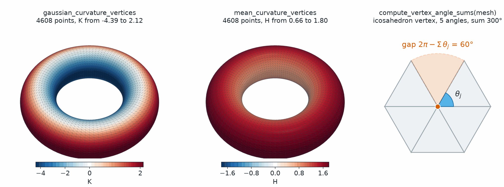

Curvature
=========

.. currentmodule:: physicsnemo.mesh.curvature

``physicsnemo.mesh.curvature`` computes discrete curvature at the points and
cells of a simplicial mesh. Each function takes a mesh and returns one value
for each point or cell, and the same values are cached ``Mesh`` properties.

:bdg-success:`GPU` :bdg-info:`autograd` :bdg-secondary:`any dimension` :bdg-warning:`mean curvature needs codimension 1`

         the top and bottom, and red on the outer rim, labeled
         gaussian_curvature_vertices, K from -4.39 to 2.12. Middle, the same
         torus colored red everywhere, labeled mean_curvature_vertices, H from
         0.66 to 1.80. Right, five triangles laid flat around a vertex, with a
         shaded gap of 60 degrees labeled 2 pi minus the sum of the angles
         equals 60 degrees.
   :align: center
   :width: 100%

   Gaussian and mean curvature on a torus, and the angle defect behind the
   Gaussian curvature. The Gaussian curvature changes sign. It is positive on
   the outer rim and negative on the inner rim. It is zero on the top and
   bottom circles. The mean curvature is positive everywhere on this torus,
   because the bend around the thin tube outweighs the opposite bend on the
   inner rim. At a vertex of an
   icosahedron, five angles of 60 degrees sum to 300 degrees, which leaves a
   gap of :math:`\pi/3`.

.. rubric:: Most Used

.. grid:: 1 1 2 2
   :gutter: 2

   .. grid-item-card:: Gaussian Curvature
      :link: physicsnemo.mesh.curvature.gaussian_curvature_vertices
      :link-type: any
      :shadow: md
      :class-card: sd-card-hover

      ``mesh.gaussian_curvature_vertices`` gives :math:`K` at each point.
      ``mesh.gaussian_curvature_cells`` gives it at each cell.

   .. grid-item-card:: Mean Curvature
      :link: physicsnemo.mesh.curvature.mean_curvature_vertices
      :link-type: any
      :shadow: md
      :class-card: sd-card-hover

      ``mesh.mean_curvature_vertices`` gives :math:`H` at each point of a
      surface in 3D or a curve in 2D.

Example
-------

The following example checks both curvatures on a sphere of radius 2:

.. code:: python

    from physicsnemo.mesh.curvature import gaussian_curvature_vertices, mean_curvature_vertices
    from physicsnemo.mesh.primitives.surfaces import sphere_icosahedral

    # A sphere of radius r has K = 1 / r**2 and H = 1 / r.
    mesh = sphere_icosahedral.load(radius=2.0, subdivisions=3)
    K = gaussian_curvature_vertices(mesh)  # (n_points,)
    H = mean_curvature_vertices(mesh)  # (n_points,)
    print(K.mean().item(), H.mean().item())  # about 0.25 and 0.5

    # The cached Mesh properties give the same values.
    K = mesh.gaussian_curvature_vertices
    H = mesh.mean_curvature_vertices

Choosing a Curvature
--------------------

The two kinds of curvature answer different questions:

.. list-table::
   :header-rows: 1
   :widths: 20 40 40

   * - Property
     - Gaussian Curvature :math:`K`
     - Mean Curvature :math:`H`
   * - Depends on
     - Lengths measured in the mesh only (intrinsic, after Gauss's Theorema
       Egregium)
     - How the mesh bends in its ambient space (extrinsic)
   * - Formula
     - `Angle defect <https://en.wikipedia.org/wiki/Angular_defect>`_,
       :math:`K_i = (\theta_{\text{full}} - \sum_j \theta_{ij}) / A_i^*`
     - `Cotangent Laplacian <https://en.wikipedia.org/wiki/Discrete_Laplace_operator#Mesh_Laplacians>`_
       of the positions, :math:`H_i = \|L \mathbf{x}\|_i / (2 A_i^*)`
   * - Works on
     - Any codimension
     - Codimension 1 only, such as a surface in 3D or a curve in 2D
   * - At
     - Points and cells
     - Points
   * - Sign
     - Positive on a sphere, negative on a saddle
     - Follows the normals, positive where the surface bulges toward them

In both formulas, :math:`\theta_{ij}` are the angles of the cells at point
:math:`i`, and :math:`A_i^*` is the dual (Voronoi) area of the point.

.. note::

   Mean curvature is ``NaN`` at boundary points, because their neighborhood
   is one-sided. Pass ``include_boundary=True`` to compute it there anyway.

Summary
-------

.. autosummary::
   :nosignatures:

   gaussian_curvature_vertices
   gaussian_curvature_cells
   mean_curvature_vertices

Related Topics
--------------

For more information, refer to the following resources:

- :doc:`geometry` for the angles and dual areas behind these formulas.
- Tutorial: `Discrete Calculus and Curvature
  <https://github.com/NVIDIA/physicsnemo/blob/main/examples/minimal/mesh/tutorial_5_calculus.ipynb>`_

API Reference
-------------

.. autofunction:: gaussian_curvature_vertices

.. autofunction:: gaussian_curvature_cells

.. autofunction:: mean_curvature_vertices
