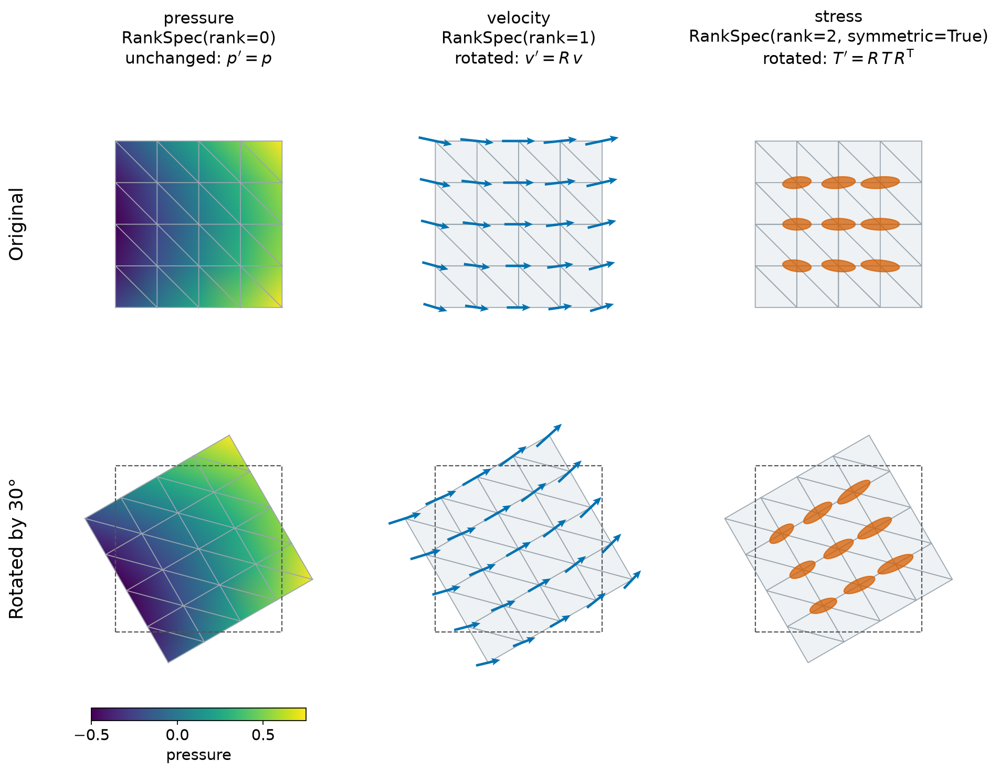

Fields and Schemas
==================

.. currentmodule:: physicsnemo.mesh.fields

A mesh has named fields, such as ``"pressure"``, ``"velocity"``, and
``"stress"``. Each field has a tensor rank: 0 for a scalar, 1 for a vector,
2 for a rank-2 tensor, and so on. The rank sets the transformation
law of the field, which is how its values change when you rotate or reflect
the frame.
A scalar does not change. A vector :math:`v` becomes :math:`R v`, and a
rank-2 tensor :math:`T` becomes :math:`R T R^\top`.

``physicsnemo.mesh.fields`` lets a model declare the rank of each field that
it reads or writes, and check data against that declaration. A plain
concatenation of channels loses this information.

:bdg-secondary:`any rank` :bdg-secondary:`JSON round trip` :bdg-secondary:`rank, symmetry, parity`

         pressure, the same mesh with arrows that point mostly to the right,
         and the same mesh with flat ellipses. Bottom: the mesh rotated by 30
         degrees inside a dashed outline of the original square. The colors
         stay on their vertices, and the arrows and ellipses tilt by 30
         degrees.
   :align: center
   :width: 100%

   Three fields declared with :class:`FieldSchema` on a planar mesh, before
   and after ``mesh.rotate(math.radians(30), transform_point_data=True)``. The
   pressure keeps its values, the velocity turns as :math:`v' = R v`, and the
   symmetric stress turns as :math:`T' = R T R^\top`.

The most-used members are the following:

.. grid:: 1 1 3 3
   :gutter: 2

   .. grid-item-card:: FieldSchema.parse
      :link: physicsnemo.mesh.fields.FieldSchema.parse
      :link-type: any
      :shadow: md
      :class-card: sd-card-hover

      A schema from a mapping, such as one loaded from JSON.

   .. grid-item-card:: FieldSchema.check
      :link: physicsnemo.mesh.fields.FieldSchema.check
      :link-type: any
      :shadow: md
      :class-card: sd-card-hover

      Every missing field and rank mismatch in one error.

   .. grid-item-card:: RankSpec
      :link: physicsnemo.mesh.fields.RankSpec
      :link-type: any
      :shadow: md
      :class-card: sd-card-hover

      The rank, symmetry, and parity of one field.

Example
-------

Declare a schema, attach matching data to a mesh, and check it:

.. code:: python

    import json
    import math

    import torch
    from physicsnemo.mesh import FieldSchema, RankSpec
    from physicsnemo.mesh.primitives.planar import unit_square

    schema = FieldSchema.parse(
        {
            "pressure": {"rank": 0},
            "velocity": RankSpec(rank=1),
            "stress": {"rank": 2, "symmetric": True},
        }
    )
    print(schema.ranks)  # {'pressure': 0, 'velocity': 1, 'stress': 2}
    print(json.dumps(schema))
    # {"pressure": {"rank": 0}, "velocity": {"rank": 1},
    #  "stress": {"rank": 2, "symmetric": true}}

    mesh = unit_square.load(subdivisions=2)  # 25 points in 2D
    n = mesh.n_points
    mesh.point_data["pressure"] = mesh.points[:, 0] + mesh.points[:, 1]
    mesh.point_data["velocity"] = torch.tensor([1.0, 0.0]).expand(n, 2).clone()
    mesh.point_data["stress"] = torch.diag(torch.tensor([2.0, 1.0])).expand(n, 2, 2).clone()

    schema.check(mesh.point_data, label="point data")  # no error

:meth:`FieldSchema.check` reports every missing field and every rank
mismatch in one ``ValueError``. It allows extra fields in the data:

.. code:: python

    outputs = FieldSchema.parse({"pressure": {"rank": 0}, "wall_shear": {"rank": 1}})
    try:
        outputs.check(mesh.point_data, label="point data")
    except ValueError as error:
        print(error)
    # point data does not contain its declared fields:
    #   - missing field 'wall_shear' (declared rank 1)

A rotation with ``transform_point_data=True`` applies the transformation law
of each field. :func:`~physicsnemo.mesh.transformations.geometric.transform` and its
wrappers read the rank from the trailing shape of each tensor:

.. code:: python

    rotated = mesh.rotate(angle=math.pi / 2, transform_point_data=True)
    print(torch.equal(rotated.point_data["pressure"], mesh.point_data["pressure"]))  # True
    print(rotated.point_data["velocity"][0])  # about (0, 1)
    print(rotated.point_data["stress"][0])    # about [[1, 0], [0, 2]]

Declaration Grammar
-------------------

:meth:`FieldSchema.parse` is the entry point for constructor arguments and
configuration files. It accepts these forms:

- A field is a :class:`RankSpec`, or a mapping of its attributes:
  ``{"rank": 2, "symmetric": True}``. The key ``"rank"`` is required. A bare
  integer raises ``TypeError``. Write ``{"rank": 0}``, not ``0``.
- A group is a mapping of fields or of other groups, such as
  ``{"surface": {"shear": {"rank": 1}}}``. ``{}`` is an empty group.
- A dotted name is the same nesting. ``"surface.shear"`` and the nested
  group above give the same field.

The schema stores flat, dotted names. :meth:`FieldSchema.key` converts a
dotted name to a TensorDict key, for example ``"surface.shear"`` to
``("surface", "shear")``. Parsing validates the declaration, so an invalid
schema cannot exist. Both types are read-only ``dict`` subclasses, so a
schema serializes to JSON as it is written, and ``FieldSchema.parse`` reads
the JSON back to an equal schema.

:class:`RankSpec` has three attributes:

- ``rank``: the number of spatial indices. A field with rank :math:`r` in
  :math:`d` spatial dimensions has the trailing shape :math:`(d,)^r`
  (:meth:`RankSpec.shape`).
- ``symmetric``: whether a field of rank 2 or more is unchanged when you
  swap its indices. The default is ``False``.
- ``parity``: ``"even"`` for a true tensor, or ``"odd"`` for a pseudotensor,
  which also changes sign under a reflection. A pseudotensor example is the
  curl of a velocity field in 3D. The default is ``"even"``.

Each channel of a model is a separate named field. A schema has no unnamed
feature axis.

How Models Use Schemas
----------------------

A model takes its schemas as constructor arguments, parses them with
:meth:`FieldSchema.parse`, and checks its inputs with
:meth:`FieldSchema.check` at the start of ``forward``. The JSON form goes
into the checkpoint with the other constructor arguments.
:meth:`FieldSchema.from_tensordict` derives a schema from data, with the
rank read from each leaf's shape. Shapes do not record symmetry or parity, so
these attributes take their defaults.

The GLOBE model (``physicsnemo.experimental.models.globe.GLOBE``) is the
in-tree user. It takes an ``output_schema``, one schema for each
boundary condition type in ``boundary_source_schemas``, and an optional
``global_schema``. In ``forward``, it checks the cell data of each boundary
mesh and the global data against these schemas. GLOBE builds its features
from scalars and true vectors, so it raises ``NotImplementedError`` for a
field of rank 2 or more or with ``parity="odd"``.

Field Associations
------------------

Each field belongs to one of three containers on a
:class:`~physicsnemo.mesh.mesh.Mesh`: ``point_data`` (one value for each
point), ``cell_data`` (one value for each cell), or ``global_data`` (one value
for the mesh). Two names in ``physicsnemo.mesh`` describe these containers.
``physicsnemo.mesh.mesh`` defines them, and ``physicsnemo.mesh`` exports
them:

.. currentmodule:: physicsnemo.mesh.mesh

.. py:data:: MeshFieldAssociation

   The type ``Literal["point_data", "cell_data", "global_data"]``. Each value
   is the name of a ``Mesh`` attribute, so ``getattr(mesh, association)``
   returns the container.

.. py:data:: MESH_FIELD_ASSOCIATIONS

   The tuple ``("point_data", "cell_data", "global_data")``, which holds the
   values of ``MeshFieldAssociation`` for checks at run time.

.. currentmodule:: physicsnemo.mesh.fields

.. code:: python

    from physicsnemo.mesh import MESH_FIELD_ASSOCIATIONS

    for association in MESH_FIELD_ASSOCIATIONS:
        print(association, list(getattr(mesh, association).keys()))
    # point_data ['pressure', 'velocity', 'stress']
    # cell_data []
    # global_data []

Choosing Between Similar Tools
------------------------------

Use the following guidelines to choose between similar tools:

- Use :meth:`FieldSchema.parse` for declarations that a user writes. Use the
  ``FieldSchema`` constructor only for a flat mapping of :class:`RankSpec`
  values.
- Use :meth:`FieldSchema.check` to make sure that data matches a declaration.
  Use :meth:`FieldSchema.from_tensordict` to infer a declaration from data.
- A schema only declares transformation laws. To apply them to data, use
  :func:`~physicsnemo.mesh.transformations.geometric.transform`,
  :func:`~physicsnemo.mesh.transformations.geometric.rotate`, or
  :func:`~physicsnemo.mesh.transformations.geometric.scale` with
  ``transform_point_data``, ``transform_cell_data``, or
  ``transform_global_data``. These functions select fields by shape and do
  not read a schema, so they treat every field as a true tensor.

Summary
-------

.. autosummary::
   :nosignatures:

   RankSpec
   FieldSchema
   RankSpecLike
   FieldSchemaLike

Related Topics
--------------

For more information, refer to the following resources:

- User Guide: `Fields, Ranks, and Schemas
  <https://docs.nvidia.com/physicsnemo/latest/user-guide/mesh/fields.html>`_
- Tutorial: `Meshes in ML Pipelines
  <https://github.com/NVIDIA/physicsnemo/blob/main/examples/minimal/mesh/tutorial_9_ml_integration.ipynb>`_
- :doc:`transformations` for the functions that apply transformation laws.

API Reference
-------------

.. autoclass:: RankSpec
   :members: rank, symmetric, parity, shape, numel, parse

.. autoclass:: FieldSchema
   :members: parse, from_tensordict, ranks, count, key, check

.. autodata:: RankSpecLike

.. autodata:: FieldSchemaLike
