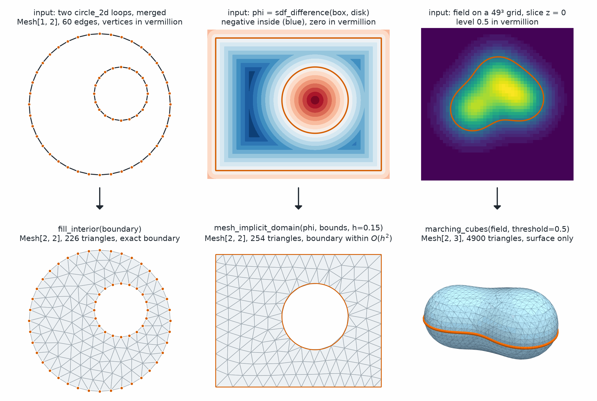

Generate
========

.. currentmodule:: physicsnemo.mesh.generate

``physicsnemo.mesh.generate`` makes meshes from implicit shapes. It meshes the
inside of an implicit function in any dimension, and it extracts isosurfaces
from a 3D grid.

:bdg-success:`CPU and GPU` :bdg-info:`differentiable refit` :bdg-secondary:`any dimension`
:bdg-warning:`marching cubes in 3D only`

         filled with triangles that keep the circle vertices. Middle: a
         filled contour plot of a box minus a circle, then its triangle mesh.
         Right: a slice of a 3D scalar field, then its isosurface.
   :align: center
   :width: 100%

   Three ways to make a mesh from a shape. ``fill_interior`` keeps the given
   boundary, ``mesh_implicit_domain`` meshes an implicit function, and
   ``marching_cubes`` returns only the surface.

The most-used functions are the following:

.. grid:: 1 1 3 3
   :gutter: 2

   .. grid-item-card:: mesh_implicit_domain
      :link: physicsnemo.mesh.generate.mesh_implicit_domain
      :link-type: any
      :shadow: md
      :class-card: sd-card-hover

      A simplex volume mesh of the inside of an implicit function.

   .. grid-item-card:: refit_mesh_to_implicit
      :link: physicsnemo.mesh.generate.refit_mesh_to_implicit
      :link-type: any
      :shadow: md
      :class-card: sd-card-hover

      Gradients from mesh geometry to the shape parameters.

   .. grid-item-card:: Signed Distance Functions
      :link: mesh-generate-sdf
      :link-type: ref
      :shadow: md
      :class-card: sd-card-hover

      Spheres, boxes, polygons, and their unions and differences.

Example
-------

This example meshes a spherical shell and differentiates its volume
with respect to the outer radius:

.. code:: python

    import torch
    from physicsnemo.mesh.generate import (
        mesh_implicit_domain,
        refit_mesh_to_implicit,
        sdf_difference,
        sdf_sphere,
    )

    device = "cuda" if torch.cuda.is_available() else "cpu"

    # A spherical shell meshed with tetrahedra. On a GPU, a finer h such as 0.05 is fast.
    shell = sdf_difference(sdf_sphere([0.0] * 3, 0.8), sdf_sphere([0.0] * 3, 0.35))
    mesh = mesh_implicit_domain(shell, ([-1] * 3, [1] * 3), h=0.1, device=device)

    # Differentiable geometry at fixed topology: the shell volume as a function of
    # the outer radius r. Its derivative is close to the area 4 pi r**2, about 8.
    r = torch.tensor(0.8, requires_grad=True)
    shell_r = sdf_difference(sdf_sphere([0.0] * 3, r), sdf_sphere([0.0] * 3, 0.35))
    refit = refit_mesh_to_implicit(mesh, shell_r)
    refit.cell_areas.sum().backward()
    print(r.grad)  # about 8

The refit does not gate its Newton steps, so that it stays differentiable. It
warns when the projection inverts cells. On this coarse mesh, it warns that
about two percent of the cells inverted, most of them near the outer sphere.

Choosing a Mesher
-----------------

PhysicsNeMo-Mesh has three ways to make a mesh from a shape:

.. grid:: 1 1 3 3
   :gutter: 3

   .. grid-item-card:: fill_interior
      :link: mesh-tessellation-fill
      :link-type: ref
      :shadow: md
      :class-card: sd-card-hover

      - **Input:** a closed boundary ``Mesh``, 2D today.
      - **Output:** a volume ``Mesh`` with exactly that boundary, and a
        minimum angle of up to 33 degrees.
      - **Use when** the boundary discretization is fixed, for example for
        coupling or boundary conditions.

   .. grid-item-card:: mesh_implicit_domain
      :link: mesh-implicit-domain
      :link-type: ref
      :shadow: md
      :class-card: sd-card-hover

      - **Input:** an implicit function :math:`\varphi(x)`, such as a signed
        distance function (SDF), a level set, or a neural field.
      - **Output:** a volume ``Mesh`` in any dimension, with the boundary
        within :math:`O(h^2)` where it is smooth.
      - **Use when** the geometry is implicit, or you need GPU scale or
        gradients with regard to shape.

   .. grid-item-card:: marching_cubes
      :link: mesh-isosurface
      :link-type: ref
      :shadow: md
      :class-card: sd-card-hover

      - **Input:** a 3D scalar field on a grid.
      - **Output:** a surface ``Mesh`` of the isosurface, with no interior.
      - **Use when** the surface itself is the result, for visualization or
        boundary representation (B-rep) export.

.. _mesh-implicit-domain:

Volume Meshing of Implicit Domains
----------------------------------

:func:`mesh_implicit_domain` generates a simplex volume mesh of
``{x : phi(x) < 0}`` for an implicit function ``phi``, such as a signed
distance function or a neural implicit field. It works in any spatial
dimension, entirely in PyTorch on CPU or CUDA. The meshed set is ``{phi < 0}``
intersected with the bounding box, so external-flow "box minus obstacle"
domains work directly.

.. tip::

   Without ``feature_points``, the mesher rounds off sharp convex corners at
   the ``h`` scale. Pass the corners as ``feature_points`` to keep them exactly.

.. dropdown:: Validity and Coverage Guarantees

   Every optimization step is validity-gated, so when the function returns,
   the mesh is positively oriented and has a closed-manifold boundary.
   Difficult inputs lower element quality, which ``full_output=True``
   reports in a diagnostics dictionary, but do not by themselves stop
   generation. The function raises ``ValueError`` when no lattice cell fits
   inside the domain at this ``h``, or when the coverage guard trips. The
   coverage guard raises the error, rather than dropping geometry, when the
   domain has features below the target edge length ``h`` or when coverage
   cannot be certified. The latter can happen, for example, if a neural
   field returns NaN inside the box when queried outside its training range.

:func:`refit_mesh_to_implicit` is the differentiable companion. It
re-projects a mesh's boundary onto ``phi = 0`` with graph-preserving
Newton steps at fixed topology, so gradients flow from mesh coordinates to
shape parameters inside ``phi``. This enables meshing as a
differentiable layer for shape optimization. For a box-minus-obstacle mesh,
pass the same box as ``bounds=``, so that the vertices on the box faces stay
on them.

.. _mesh-generate-sdf:

Signed Distance Functions
-------------------------

The module also provides the following signed-distance building blocks for
convenience:

- :func:`sdf_sphere`
- :func:`sdf_box`
- :func:`sdf_polygon_2d`
- :func:`sdf_union`, a constructive solid geometry (CSG) combinator
- :func:`sdf_intersection`, a CSG combinator
- :func:`sdf_difference`, a CSG combinator
- :func:`project_to_zero_set`, a Newton projection onto ``phi = 0``

Any callable with the signature ``phi(x: (..., d)) -> (...)`` also works,
if it meets the following conditions:

- It is negative inside the domain and positive outside.
- It is differentiable, almost everywhere, under autograd.
- It has a nonzero gradient near ``phi = 0``.
- It does not return NaN inside the bounds.

.. _mesh-isosurface:

Isosurface Extraction
---------------------

:func:`marching_cubes` extracts a triangle isosurface from a 3D scalar
field at the value ``threshold``, which defaults to ``0.0`` for a signed
distance field. It runs on NVIDIA Warp and returns a mesh with ``float32``
points, in physical coordinates when you pass ``coords``. It is not
differentiable.

Summary
-------

.. autosummary::
   :nosignatures:

   mesh_implicit_domain
   refit_mesh_to_implicit
   marching_cubes
   sdf_sphere
   sdf_box
   sdf_polygon_2d
   sdf_union
   sdf_intersection
   sdf_difference
   project_to_zero_set

Related Topics
--------------

For more information, refer to the following resources:

- :doc:`tessellation` for exact-boundary filling of a closed boundary mesh.
- Tutorial: `Primitives and Mesh Generation
  <https://github.com/NVIDIA/physicsnemo/blob/main/examples/minimal/mesh/tutorial_3_primitives_generation.ipynb>`_

API Reference
-------------

.. autofunction:: mesh_implicit_domain

.. autofunction:: refit_mesh_to_implicit

.. autofunction:: marching_cubes

.. autofunction:: sdf_sphere

.. autofunction:: sdf_box

.. autofunction:: sdf_polygon_2d

.. autofunction:: sdf_union

.. autofunction:: sdf_intersection

.. autofunction:: sdf_difference

.. autofunction:: project_to_zero_set
