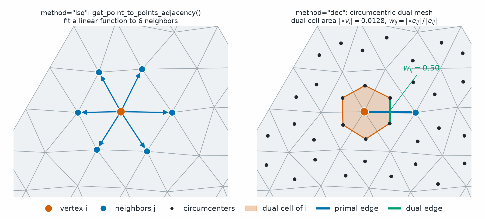

Geometry
========

.. currentmodule:: physicsnemo.mesh.geometry

``physicsnemo.mesh.geometry`` computes the geometric quantities that the
:doc:`calculus` and :doc:`curvature` modules build on. Each function returns a
tensor with one value for each cell, point, or edge.

:bdg-success:`GPU` :bdg-info:`autograd` :bdg-secondary:`any dimension` :bdg-warning:`cell normals need codimension 1`

         method="lsq", a vermillion vertex with blue arrows to its six blue
         neighbors. Right, labeled method="dec", black dots mark the triangle
         circumcenters. A shaded hexagon around the vertex joins the six
         nearest circumcenters. A blue primal edge runs from the vertex to one
         neighbor, and a short green dual edge crosses it, labeled w_ij = 0.50.
   :align: center
   :width: 100%

   The circumcentric dual mesh. The dual cell of a vertex joins the
   circumcenters of its triangles, and its area is the dual volume from
   :func:`compute_dual_volumes_0`. Each primal edge has a dual edge that joins
   the circumcenters of its two triangles, and the cotangent weight from
   :func:`compute_cotan_weights_fem` is the ratio of their lengths. Left, for
   comparison, the neighbors that least squares (LSQ) uses.

.. rubric:: Most Used

.. grid:: 1 1 2 2
   :gutter: 2

   .. grid-item-card:: Cell Areas
      :link: physicsnemo.mesh.geometry.compute_cell_areas
      :link-type: any
      :shadow: md
      :class-card: sd-card-hover

      ``mesh.cell_areas`` caches the length, area, or volume of each cell.

   .. grid-item-card:: Dual Volumes
      :link: physicsnemo.mesh.geometry.compute_dual_volumes_0
      :link-type: any
      :shadow: md
      :class-card: sd-card-hover

      ``compute_dual_volumes_0(mesh)`` gives the Voronoi area or volume of each
      point.

   .. grid-item-card:: Circumcenters
      :link: physicsnemo.mesh.geometry.get_or_compute_circumcenters
      :link-type: any
      :shadow: md
      :class-card: sd-card-hover

      ``get_or_compute_circumcenters(mesh)`` gives the circumcenter of each
      cell and caches it.

   .. grid-item-card:: Cotangent Weights
      :link: physicsnemo.mesh.geometry.compute_cotan_weights_fem
      :link-type: any
      :shadow: md
      :class-card: sd-card-hover

      ``compute_cotan_weights_fem(mesh)`` gives one weight for each edge.

The module computes the following quantities:

.. list-table::
   :header-rows: 1
   :widths: 38 62

   * - Quantity
     - Functions
   * - Cell areas (the n-dimensional volume of each simplex) and cell normals
     - :func:`compute_cell_areas`, :func:`compute_cell_normals`
   * - Interior angles of each cell at each of its vertices
     - :func:`compute_vertex_angles`, :func:`compute_vertex_angle_sums`
   * - Circumcenters, which define the circumcentric dual mesh of discrete
       exterior calculus (DEC)
     - :func:`compute_circumcenters`
   * - Dual volumes of each vertex (its Voronoi region) and of each edge
     - :func:`compute_dual_volumes_0`, :func:`compute_dual_volumes_1`
   * - Cotangent weights, the edge weights of the finite element method (FEM)
       and DEC Laplacian
     - :func:`compute_cotan_weights_fem`

Most of the time, you do not call these functions directly. The ``Mesh``
properties (``mesh.cell_areas``, ``mesh.cell_normals``) and the calculus and
curvature functions call them and cache the results. Use them to write your
own DEC operators or FEM assembly.

.. important::

   ``mesh.cell_normals`` and :func:`compute_cell_normals` need a mesh of
   codimension 1, such as a surface in 3D or a curve in 2D. Other meshes
   have no unique normal direction.

Some functions take a mesh. Others take tensors, so that you can call them
on cell geometry without a ``Mesh``:

- :func:`compute_circumcenters` takes the vertex coordinates of each cell,
  ``mesh.points[mesh.cells]``, with shape
  ``(n_cells, n_manifold_dims + 1, n_spatial_dims)``.
- :func:`compute_cell_areas` and :func:`compute_cell_normals` take the edge
  vectors from the first vertex of each cell, with shape
  ``(n_cells, n_manifold_dims, n_spatial_dims)``.

Example
-------

The following example computes geometric quantities on an icosahedral sphere:

.. code:: python

    import math

    from physicsnemo.mesh.geometry import (
        compute_cell_areas,
        compute_circumcenters,
        compute_cotan_weights_fem,
        compute_dual_volumes_0,
        compute_vertex_angle_sums,
        compute_vertex_angles,
    )
    from physicsnemo.mesh.primitives.surfaces import sphere_icosahedral

    mesh = sphere_icosahedral.load(subdivisions=2)  # 162 points, 320 triangles

    angles = compute_vertex_angles(mesh)  # (n_cells, n_manifold_dims + 1)
    circumcenters = compute_circumcenters(mesh.points[mesh.cells])  # (n_cells, n_spatial_dims)
    dual_areas = compute_dual_volumes_0(mesh)  # (n_points,)
    weights, edges = compute_cotan_weights_fem(mesh)  # (n_edges,) and (n_edges, 2)
    print(angles.shape, circumcenters.shape, dual_areas.shape)
    # torch.Size([320, 3]) torch.Size([320, 3]) torch.Size([162])
    print(weights.shape, edges.shape)  # torch.Size([480]) torch.Size([480, 2])

    # The dual areas tile the surface.
    print(dual_areas.sum().item(), mesh.cell_areas.sum().item())  # equal

    # Gauss-Bonnet: the angle defects sum to 2 pi times the Euler characteristic,
    # which is 4 pi for a sphere.
    print((2 * math.pi - compute_vertex_angle_sums(mesh)).sum().item(), 4 * math.pi)

    # Tensor-level helpers take edge vectors from the first vertex of each cell.
    edge_vectors = mesh.points[mesh.cells[:, 1:]] - mesh.points[mesh.cells[:, :1]]
    areas = compute_cell_areas(edge_vectors)  # equals mesh.cell_areas

Choosing a Function
-------------------

Use the following guidelines to choose a function:

- :func:`get_or_compute_circumcenters` and
  :func:`get_or_compute_dual_volumes_0` read the mesh cache first and
  compute only on a miss. Use them in place of
  :func:`compute_circumcenters` and :func:`compute_dual_volumes_0` when you
  call them more than once on one mesh.
- :func:`compute_vertex_angles` gives one angle for each cell vertex.
  :func:`compute_vertex_angle_sums` adds them up for each point, which gives
  the angle defect for Gaussian curvature.
- :func:`compute_triangle_angles` and :func:`stable_angle_between_vectors`
  take point coordinates or vectors as tensors, not a mesh.

Summary
-------

.. autosummary::
   :nosignatures:

   compute_cell_areas
   compute_cell_normals
   compute_vertex_angles
   compute_vertex_angle_sums
   compute_triangle_angles
   stable_angle_between_vectors
   compute_circumcenters
   get_or_compute_circumcenters
   compute_dual_volumes_0
   get_or_compute_dual_volumes_0
   compute_dual_volumes_1
   compute_cotan_weights_fem

Related Topics
--------------

For more information, refer to the following resources:

- :doc:`calculus` and :doc:`curvature`, which use these quantities.
- Tutorial: `Discrete Calculus and Curvature
  <https://github.com/NVIDIA/physicsnemo/blob/main/examples/minimal/mesh/tutorial_5_calculus.ipynb>`_

API Reference
-------------

.. autofunction:: compute_cell_areas

.. autofunction:: compute_cell_normals

.. autofunction:: compute_vertex_angles

.. autofunction:: compute_vertex_angle_sums

.. autofunction:: compute_triangle_angles

.. autofunction:: stable_angle_between_vectors

.. autofunction:: compute_circumcenters

.. autofunction:: get_or_compute_circumcenters

.. autofunction:: compute_dual_volumes_0

.. autofunction:: get_or_compute_dual_volumes_0

.. autofunction:: compute_dual_volumes_1

.. autofunction:: compute_cotan_weights_fem
