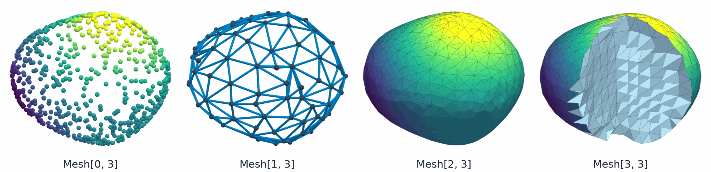

PhysicsNeMo-Mesh
================

.. currentmodule:: physicsnemo.mesh

PhysicsNeMo-Mesh (``physicsnemo.mesh``) is a PyTorch library for simplicial
meshes in any dimension. One :class:`~physicsnemo.mesh.mesh.Mesh` type holds
point clouds, curves, surfaces, and volumes, with tensor fields of any rank on
its points, its cells, and the mesh as a whole.

:bdg-success:`CPU and GPU` :bdg-info:`autograd` :bdg-secondary:`any dimension`
:bdg-secondary:`torch.compile`

         Mesh[0, 3]. An edge graph of blue edges and dark nodes, Mesh[1, 3].
         A triangle surface, Mesh[2, 3]. A tetrahedral volume with a quarter
         cut away to show the cells inside, Mesh[3, 3].
   :align: center
   :width: 100%

   One shape gives four meshes. A point cloud, a graph, a surface, and a
   volume are all the same ``Mesh`` type.

Where to Start
--------------

The library has three sets of documentation:

.. grid:: 1 1 3 3
   :gutter: 2

   .. grid-item-card:: User Guide
      :link: https://docs.nvidia.com/physicsnemo/latest/user-guide/mesh.html
      :shadow: md
      :class-card: sd-card-hover

      The data model, how to choose a method, and meshes in ML pipelines.

   .. grid-item-card:: Tutorials
      :link: https://github.com/NVIDIA/physicsnemo/tree/main/examples/minimal/mesh
      :shadow: md
      :class-card: sd-card-hover

      Nine notebooks, from a first mesh to an ML pipeline.

   .. grid-item-card:: Quick Start
      :link: mesh-quick-start
      :link-type: ref
      :shadow: md
      :class-card: sd-card-hover

      Ten lines, from two triangles to a gradient.

.. _mesh-quick-start:

Quick Start
-----------

This example runs on a CPU. It builds two triangles in the plane, attaches a
scalar field to the points, and computes the gradient of the field:

.. code:: python

    import torch
    from physicsnemo.mesh import Mesh

    points = torch.tensor([[0.0, 0.0], [1.0, 0.0], [1.0, 1.0], [0.0, 1.0]])
    cells = torch.tensor([[0, 1, 2], [0, 2, 3]])
    mesh = Mesh(points=points, cells=cells)

    print(mesh.n_manifold_dims, mesh.n_spatial_dims)  # 2 2
    print(mesh.cell_areas)  # tensor([0.5000, 0.5000])

    # A linear field T = x + 2y has the gradient (1, 2) everywhere.
    mesh.point_data["T"] = mesh.points[:, 0] + 2 * mesh.points[:, 1]
    mesh = mesh.compute_point_derivatives(keys="T", method="lsq")
    print(mesh.point_data["T_gradient"][0])  # tensor([1., 2.])

.. tip::

   To run the same code on a GPU, move the mesh and all of its data with
   ``mesh = mesh.to("cuda")``.

Submodules
----------

This API reference has one page for each submodule, with its purpose, an
example, a summary table, and the full reference. The pages are grouped by
task:

.. rubric:: Core

.. grid:: 1 2 3 3
   :gutter: 3

   .. grid-item-card:: Mesh
      :img-top: ../../img/mesh/thumbnails/core.png
      :img-alt: A small triangle mesh with its points marked and one cell highlighted
      :link: core
      :link-type: doc
      :shadow: md
      :class-card: sd-card-hover

      The ``Mesh`` and ``DomainMesh`` data structures.

   .. grid-item-card:: Fields and Schemas
      :img-top: ../../img/mesh/thumbnails/fields.png
      :img-alt: A rotated square mesh colored by a scalar field, with velocity arrows that turn with it
      :link: fields
      :link-type: doc
      :shadow: md
      :class-card: sd-card-hover

      Named fields and their tensor ranks.

.. rubric:: Building Meshes

.. grid:: 1 2 2 4
   :gutter: 3

   .. grid-item-card:: Primitives
      :img-top: ../../img/mesh/thumbnails/primitives.png
      :img-alt: A shaded Möbius strip mesh
      :link: primitives
      :link-type: doc
      :shadow: md
      :class-card: sd-card-hover

      Ready-made meshes, from one triangle to a tetrahedral ball.

   .. grid-item-card:: I/O
      :img-top: ../../img/mesh/thumbnails/io.png
      :img-alt: A cube of eight voxels drawn as a wire cage, filled with small separated tetrahedra
      :link: io
      :link-type: doc
      :shadow: md
      :class-card: sd-card-hover

      PyVista conversion and native Zarr storage.

   .. grid-item-card:: Tessellation
      :img-top: ../../img/mesh/thumbnails/tessellation.png
      :img-alt: Three outlined polygons, a quad, a hexagon, and an arrow, each split into triangles
      :link: tessellation
      :link-type: doc
      :shadow: md
      :class-card: sd-card-hover

      Polygons to triangles, and quality filling of a closed boundary.

   .. grid-item-card:: Generate
      :img-top: ../../img/mesh/thumbnails/generate.png
      :img-alt: A rectangle with a round hole filled with even triangles, its boundary outlined in orange
      :link: generate
      :link-type: doc
      :shadow: md
      :class-card: sd-card-hover

      Volume meshes of implicit domains, and marching cubes.

.. rubric:: Geometry and Calculus

.. grid:: 1 2 3 3
   :gutter: 3

   .. grid-item-card:: Geometry
      :img-top: ../../img/mesh/thumbnails/geometry.png
      :img-alt: A gray triangle mesh overlaid with a blue network of dual cells, one cell filled around an orange vertex
      :link: geometry
      :link-type: doc
      :shadow: md
      :class-card: sd-card-hover

      Angles, circumcenters, dual volumes, and cotangent weights.

   .. grid-item-card:: Curvature
      :img-top: ../../img/mesh/thumbnails/curvature.png
      :img-alt: A torus colored red on its outer rim and blue on its inner rim by Gaussian curvature
      :link: curvature
      :link-type: doc
      :shadow: md
      :class-card: sd-card-hover

      Gaussian and mean curvature.

   .. grid-item-card:: Discrete Calculus
      :img-top: ../../img/mesh/thumbnails/calculus.png
      :img-alt: A sphere shaded by a scalar field, covered with small orange arrows tangent to the surface
      :link: calculus
      :link-type: doc
      :shadow: md
      :class-card: sd-card-hover

      Gradient, divergence, curl, Laplacian, and integrals, by discrete
      exterior calculus (DEC) or least squares (LSQ).

.. rubric:: Topology and Queries

.. grid:: 1 2 2 4
   :gutter: 3

   .. grid-item-card:: Boundaries and Topology
      :img-top: ../../img/mesh/thumbnails/boundaries.png
      :img-alt: A pale triangulated ring with its inner and outer boundaries drawn in thick orange
      :link: boundaries
      :link-type: doc
      :shadow: md
      :class-card: sd-card-hover

      Boundary detection, facets, and watertight checks.

   .. grid-item-card:: Neighbors and Adjacency
      :img-top: ../../img/mesh/thumbnails/neighbors.png
      :img-alt: A triangle mesh with one orange point, blue lines to its neighbor points, and its surrounding cells shaded blue
      :link: neighbors
      :link-type: doc
      :shadow: md
      :class-card: sd-card-hover

      Point and cell adjacency, and graphs.

   .. grid-item-card:: Spatial Queries
      :img-top: ../../img/mesh/thumbnails/spatial.png
      :img-alt: A red-and-blue distance map with an orange closed curve where the distance is zero
      :link: spatial
      :link-type: doc
      :shadow: md
      :class-card: sd-card-hover

      Bounding volume hierarchies and signed distance.

   .. grid-item-card:: Sampling and Interpolation
      :img-top: ../../img/mesh/thumbnails/sampling.png
      :img-alt: A gray torus sprinkled with small dots colored from purple to yellow
      :link: sampling
      :link-type: doc
      :shadow: md
      :class-card: sd-card-hover

      Random points on cells, and interpolation at query points.

.. rubric:: Editing

.. grid:: 1 2 3 3
   :gutter: 3

   .. grid-item-card:: Transformations and Projections
      :img-top: ../../img/mesh/thumbnails/transformations.png
      :img-alt: A flat triangle sheet pulled up into a smooth bump by one orange control handle
      :link: transformations
      :link-type: doc
      :shadow: md
      :class-card: sd-card-hover

      Rigid and linear transforms, deformations, and projections.

   .. grid-item-card:: Differentiable Deformation Energies
      :img-top: ../../img/mesh/thumbnails/deformation.png
      :img-alt: A sphere stretched upward into an egg shape by an orange handle, with green fixed anchors
      :link: deformation
      :link-type: doc
      :shadow: md
      :class-card: sd-card-hover

      Differentiable penalties that keep a deformation well shaped.

   .. grid-item-card:: Subdivision
      :img-top: ../../img/mesh/thumbnails/subdivision.png
      :img-alt: An orange wireframe cube around the smooth sphere-like surface that Loop subdivision makes from it
      :link: subdivision
      :link-type: doc
      :shadow: md
      :class-card: sd-card-hover

      Linear, Loop, and Butterfly refinement.

   .. grid-item-card:: Smoothing
      :img-top: ../../img/mesh/thumbnails/smoothing.png
      :img-alt: A sphere whose left side is rough and faceted and whose right side is smooth
      :link: smoothing
      :link-type: doc
      :shadow: md
      :class-card: sd-card-hover

      Laplacian smoothing of point positions.

   .. grid-item-card:: Remeshing
      :img-top: ../../img/mesh/thumbnails/remeshing.png
      :img-alt: An orange lumpy sphere made of even, evenly sized triangles
      :link: remeshing
      :link-type: doc
      :shadow: md
      :class-card: sd-card-hover

      A new surface mesh with a target number of vertices.

   .. grid-item-card:: Repair
      :img-top: ../../img/mesh/thumbnails/repair.png
      :img-alt: A triangulated sphere with one patch of new orange triangles that fills a hole
      :link: repair
      :link-type: doc
      :shadow: md
      :class-card: sd-card-hover

      Duplicates, degenerate cells, orientation, and holes.

.. rubric:: Checking and Viewing

.. grid:: 1 2 3 3
   :gutter: 3

   .. grid-item-card:: Validation and Quality
      :img-top: ../../img/mesh/thumbnails/validation.png
      :img-alt: A jittered triangle grid with each triangle shaded by its quality score, dark blue to yellow
      :link: validation
      :link-type: doc
      :shadow: md
      :class-card: sd-card-hover

      Structural checks, cell quality, and statistics.

   .. grid-item-card:: Visualization
      :img-top: ../../img/mesh/thumbnails/visualization.png
      :img-alt: A lumpy sphere with black triangle edges, colored by height from green to yellow
      :link: visualization
      :link-type: doc
      :shadow: md
      :class-card: sd-card-hover

      Plots of meshes and their data.

Learning Path
-------------

The tutorial notebooks are in
`examples/minimal/mesh/ <https://github.com/NVIDIA/physicsnemo/tree/main/examples/minimal/mesh>`_.
Each one runs on a CPU and uses a GPU when one is present. Work through them
in order:

.. grid:: 1 2 3 3
   :gutter: 2

   .. grid-item-card:: 1. Getting Started
      :link: https://github.com/NVIDIA/physicsnemo/blob/main/examples/minimal/mesh/tutorial_1_getting_started.ipynb
      :shadow: md
      :class-card: sd-card-hover

      Build a mesh, attach fields, and compute a gradient.

   .. grid-item-card:: 2. Loading, Converting, and Saving Meshes
      :link: https://github.com/NVIDIA/physicsnemo/blob/main/examples/minimal/mesh/tutorial_2_io_interop.ipynb
      :shadow: md
      :class-card: sd-card-hover

      Read files through PyVista and save to Zarr.

   .. grid-item-card:: 3. Primitives and Mesh Generation
      :link: https://github.com/NVIDIA/physicsnemo/blob/main/examples/minimal/mesh/tutorial_3_primitives_generation.ipynb
      :shadow: md
      :class-card: sd-card-hover

      Make meshes from the catalog and from implicit shapes.

   .. grid-item-card:: 4. Mesh Operations
      :link: https://github.com/NVIDIA/physicsnemo/blob/main/examples/minimal/mesh/tutorial_4_operations.ipynb
      :shadow: md
      :class-card: sd-card-hover

      Transform, subdivide, slice, and merge meshes.

   .. grid-item-card:: 5. Discrete Calculus and Curvature
      :link: https://github.com/NVIDIA/physicsnemo/blob/main/examples/minimal/mesh/tutorial_5_calculus.ipynb
      :shadow: md
      :class-card: sd-card-hover

      Derivatives, integrals, and curvature on surfaces.

   .. grid-item-card:: 6. Neighbors and Spatial Queries
      :link: https://github.com/NVIDIA/physicsnemo/blob/main/examples/minimal/mesh/tutorial_6_neighbors_spatial.ipynb
      :shadow: md
      :class-card: sd-card-hover

      Adjacency, graphs, and nearest-point search.

   .. grid-item-card:: 7. Quality, Validation, and Repair
      :link: https://github.com/NVIDIA/physicsnemo/blob/main/examples/minimal/mesh/tutorial_7_quality_repair.ipynb
      :shadow: md
      :class-card: sd-card-hover

      Find and fix bad cells.

   .. grid-item-card:: 8. Simulation Domains
      :link: https://github.com/NVIDIA/physicsnemo/blob/main/examples/minimal/mesh/tutorial_8_domain_mesh.ipynb
      :shadow: md
      :class-card: sd-card-hover

      An interior with named boundaries in one object.

   .. grid-item-card:: 9. Meshes in ML Pipelines
      :link: https://github.com/NVIDIA/physicsnemo/blob/main/examples/minimal/mesh/tutorial_9_ml_integration.ipynb
      :shadow: md
      :class-card: sd-card-hover

      Batching, augmentation, and features for a model.

.. toctree::
   :maxdepth: 1
   :caption: Core

   core
   fields

.. toctree::
   :maxdepth: 1
   :caption: Building Meshes

   primitives
   io
   tessellation
   generate

.. toctree::
   :maxdepth: 1
   :caption: Geometry and Calculus

   geometry
   curvature
   calculus

.. toctree::
   :maxdepth: 1
   :caption: Topology and Queries

   boundaries
   neighbors
   spatial
   sampling

.. toctree::
   :maxdepth: 1
   :caption: Editing

   transformations
   deformation
   subdivision
   smoothing
   remeshing
   repair

.. toctree::
   :maxdepth: 1
   :caption: Checking and Viewing

   validation
   visualization
