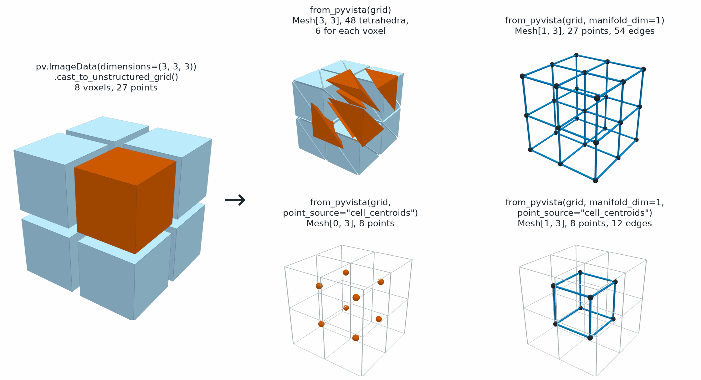

I/O
===

.. currentmodule:: physicsnemo.mesh.io

``physicsnemo.mesh.io`` converts between :class:`~physicsnemo.mesh.mesh.Mesh`
and `PyVista <https://pyvista.org/>`_ meshes, and saves meshes in the native
Zarr format. PyVista reads and writes many file formats, such as VTK, STL,
PLY, and OBJ, so it is the main way to load and save files.

:bdg-secondary:`VTK, STL, PLY, OBJ, and more` :bdg-secondary:`Zarr`
:bdg-info:`point and cell data`

         four results of from_pyvista. The cubes split into 48 tetrahedra,
         with the six tetrahedra of the orange cube pulled apart. The edge
         graph of the grid in blue, with 27 nodes and 54 edges. Eight orange
         points at the cube centers. The dual graph, a small blue cube of 8
         nodes and 12 edges joining neighboring cube centers.
   :align: center
   :width: 100%

   One voxel grid gives four meshes. ``from_pyvista`` splits each voxel into
   six tetrahedra by default. With ``manifold_dim=1`` it returns the edge
   graph of the cells. With ``point_source="cell_centroids"`` it returns one
   point for each cell, and with ``manifold_dim=1`` as well it returns the
   dual graph, which links cells that share a face.

The module has the following functions:

.. grid:: 1 1 3 3
   :gutter: 2

   .. grid-item-card:: from_pyvista
      :link: physicsnemo.mesh.io.from_pyvista
      :link-type: any
      :shadow: md
      :class-card: sd-card-hover

      A ``Mesh`` from a ``PolyData``, ``UnstructuredGrid``, or ``PointSet``.

   .. grid-item-card:: to_pyvista
      :link: physicsnemo.mesh.io.to_pyvista
      :link-type: any
      :shadow: md
      :class-card: sd-card-hover

      A PyVista mesh, to save in any format that PyVista writes.

   .. grid-item-card:: to_zarr and from_zarr
      :link: physicsnemo.mesh.io.to_zarr
      :link-type: any
      :shadow: md
      :class-card: sd-card-hover

      A ``Mesh`` or ``DomainMesh`` with all of its data, in a Zarr store.

:func:`from_pyvista` keeps the point data and cell data, and it detects the
manifold dimension, or you set it with ``manifold_dim``. Polygons and
polyhedra become triangles and tetrahedra. With
``point_source="cell_centroids"``, the cell centroids become a point cloud or
a dual graph, which avoids tetrahedralization of a large polyhedral mesh.
:func:`to_pyvista` returns a ``pyvista.PolyData`` for curves and surfaces, a
``pyvista.UnstructuredGrid`` for volumes, and a ``pyvista.PointSet`` for a
point cloud without cells.

Example
-------

This example makes a PyVista sphere. To load a file, use
``pv.read("geometry.stl")`` in its place.

.. code:: python

    import pyvista as pv
    from physicsnemo.mesh.io import from_pyvista, from_zarr, to_pyvista, to_zarr

    pv_mesh = pv.Sphere(theta_resolution=16, phi_resolution=16)
    mesh = from_pyvista(pv_mesh)
    print(mesh.n_manifold_dims, mesh.n_spatial_dims)  # 2 3

    mesh = mesh.subdivide(levels=1, filter="loop")

    # Back to PyVista, to save in any format it supports.
    pv_out = to_pyvista(mesh)
    pv_out.save("refined.vtk")

    # Native storage keeps every field and nested key.
    to_zarr(mesh, "refined.zarr")
    restored = from_zarr("refined.zarr")
    print(restored.n_cells == mesh.n_cells)  # True

.. tip::

   PyVista conversions preserve ``float32`` and ``float64`` point coordinates.
   They convert integer, complex, and reduced-precision coordinates to
   ``float32`` as part of PhysicsNeMo's PyVista compatibility policy. To
   normalize imported geometry and its floating data explicitly, use
   ``mesh = from_pyvista(pv_mesh).to(torch.float32)``. Likewise, use
   ``to_pyvista(mesh.to(torch.float32))`` before export. Retaining ``float64``
   coordinates doubles their storage relative to ``float32`` and can keep
   downstream PyVista computations in double precision.

Summary
-------

.. autosummary::
   :nosignatures:

   from_pyvista
   to_pyvista
   from_zarr
   to_zarr

Related Topics
--------------

For more information, refer to the following resources:

- :doc:`tessellation` for polygon meshes.
- Tutorial: `Loading, Converting, and Saving Meshes
  <https://github.com/NVIDIA/physicsnemo/blob/main/examples/minimal/mesh/tutorial_2_io_interop.ipynb>`_

API Reference
-------------

.. autofunction:: from_pyvista

.. autofunction:: to_pyvista

.. autofunction:: from_zarr

.. autofunction:: to_zarr
