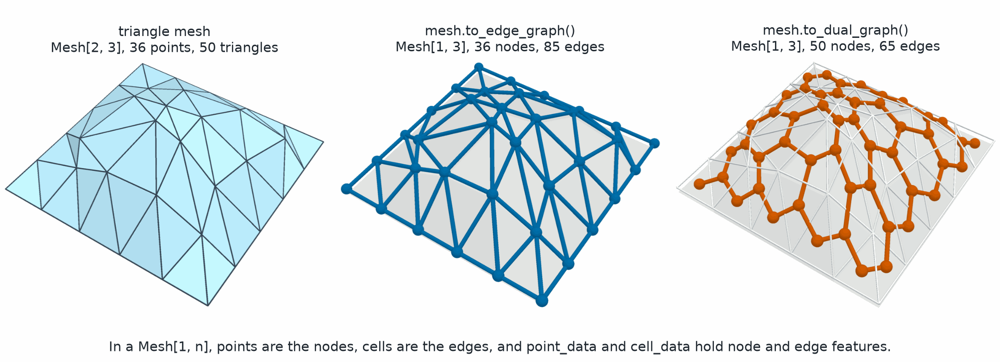
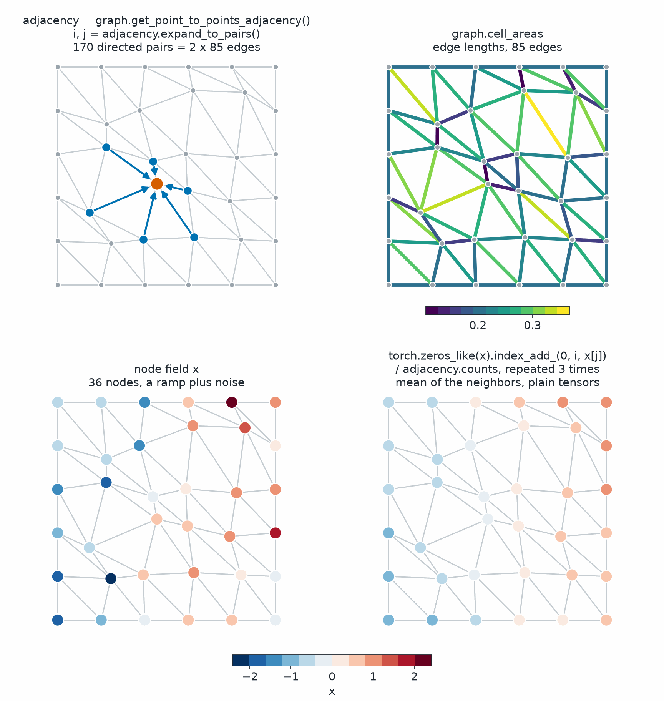

Neighbors and Adjacency
=======================

.. currentmodule:: physicsnemo.mesh.neighbors

``physicsnemo.mesh.neighbors`` computes which points and cells of a mesh are
connected to which others. Each query uses the connectivity in ``mesh.cells``,
not distances, and returns an :class:`Adjacency`, a ragged array of neighbor
indices.

:bdg-success:`GPU` :bdg-secondary:`any dimension` :bdg-secondary:`cached on the mesh`

.. figure:: ../../img/mesh/neighbors_adjacency.png
   :alt: Four copies of a gray triangle mesh. Top left: a point joined to its
         six neighbor points. Top right: the same point with its six
         surrounding cells filled. Bottom left: a triangle and the three
         triangles that share an edge with it. Bottom right: the same triangle
         with its three vertices marked.
   :align: center
   :width: 70%

   The four adjacency queries on one jittered triangle mesh. Each panel
   highlights a query point or cell in orange and the neighbors returned for
   it in blue.

.. rubric:: Most Used

.. grid:: 1 2 2 2
   :gutter: 2

   .. grid-item-card:: Point Neighbors
      :link: physicsnemo.mesh.neighbors.get_point_to_points_adjacency
      :link-type: any
      :shadow: md
      :class-card: sd-card-hover

      ``mesh.get_point_to_points_adjacency()`` gives the points that share an
      edge with each point.

   .. grid-item-card:: Cell Neighbors
      :link: physicsnemo.mesh.neighbors.get_cell_to_cells_adjacency
      :link-type: any
      :shadow: md
      :class-card: sd-card-hover

      ``mesh.get_cell_to_cells_adjacency()`` gives the cells that share a facet
      with each cell.

   .. grid-item-card:: Source and Target Pairs
      :link: physicsnemo.mesh.neighbors.Adjacency.expand_to_pairs
      :link-type: any
      :shadow: md
      :class-card: sd-card-hover

      ``adjacency.expand_to_pairs()`` turns the ragged array into the
      ``(source, target)`` index pairs of message passing.

   .. grid-item-card:: Meshes as Graphs
      :link: mesh-neighbors-graphs
      :link-type: ref
      :shadow: md
      :class-card: sd-card-hover

      ``mesh.to_edge_graph()`` and ``mesh.to_dual_graph()`` return graphs that
      are ``Mesh`` objects themselves.

Example
-------

The following example runs the four queries on a small square mesh:

.. code:: python

    from physicsnemo.mesh.primitives.planar import unit_square

    mesh = unit_square.load(subdivisions=1)  # 9 points, 8 triangles
    print(mesh.cells[0].tolist())  # [0, 1, 3]

    p2p = mesh.get_point_to_points_adjacency()
    print(p2p.offsets.tolist())  # [0, 2, 6, 9, 13, 19, 23, 26, 30, 32]
    print(p2p.to_list()[4])  # [1, 2, 3, 5, 6, 7]: the center point

    print(mesh.get_point_to_cells_adjacency().to_list()[4])  # [1, 2, 3, 4, 5, 6]
    print(mesh.get_cell_to_cells_adjacency().to_list()[0])  # [1]
    print(mesh.get_cell_to_points_adjacency().to_list()[0])  # [0, 1, 3]

    # Ragged arrays as (source, target) pairs, for example to build a graph.
    sources, targets = p2p.expand_to_pairs()
    print(sources.shape, p2p.n_total_neighbors)  # torch.Size([32]) 32

.. dropdown:: Storage and Dtypes

   An :class:`Adjacency` stores the neighbors in compressed sparse row (CSR)
   form. The neighbors of source ``i`` are
   ``indices[offsets[i]:offsets[i + 1]]``, and ``offsets`` has
   ``n_sources + 1`` entries. ``offsets`` are always ``int64``. ``indices`` of
   the point-to-points and cell-to-points queries have the dtype of
   ``mesh.cells``, so an ``int32`` mesh gives ``int32`` indices. The other two
   queries give ``int64`` indices.

Each query is a ``Mesh`` method and a function in this module. The ``Mesh``
method caches its result, and the cache stays valid through geometric
transformations:

.. tab-set::

   .. tab-item:: Mesh Method

      .. code:: python

          adjacency = mesh.get_point_to_points_adjacency()

   .. tab-item:: Function

      .. code:: python

          from physicsnemo.mesh.neighbors import get_point_to_points_adjacency

          adjacency = get_point_to_points_adjacency(mesh)

Choosing a Function
-------------------

The following table lists the four queries:

.. list-table::
   :header-rows: 1
   :widths: 22 48 30

   * - Query
     - Returns for Each Source
     - Typical Use
   * - Point to points
     - The points that share an edge with the point (the mesh graph)
     - Graphs on points, smoothing stencils
   * - Point to cells
     - The cells that contain the point (the star of the point)
     - Gathering cell values at a point
   * - Cell to cells
     - The cells that share a facet with the cell
     - Graphs on cells, region growing
   * - Cell to points
     - The points of the cell
     - Gathering point values at a cell

Set ``adjacency_codimension=2`` on the cell-to-cells query to also count cells
that share only an edge of a tetrahedral mesh, or only a vertex of a triangle
mesh. Use :func:`build_adjacency_from_pairs` to build an :class:`Adjacency`
from your own ``(source, target)`` pairs.

.. _mesh-neighbors-graphs:

Graphs
------

A ``Mesh[1, n]`` is an undirected graph with node positions. Its ``points``
are the nodes, and its ``cells``, of shape ``(n_edges, 2)``, are the edges.
The connectivity of any mesh is one call away as such a graph.

         shaded triangle mesh. Center, its edge graph drawn as blue nodes and
         edges on the vertices and edges of the sheet, labeled Mesh[1, 3] with
         36 nodes and 85 edges. Right, its dual graph drawn as orange nodes at
         the triangle centers, joined across shared edges, labeled Mesh[1, 3]
         with 50 nodes and 65 edges.
   :align: center
   :width: 100%

   The edge graph and the dual graph of a triangle mesh. The edge graph,
   ``mesh.to_edge_graph()``, keeps the mesh vertices as nodes and the mesh
   edges as edges. The dual graph, ``mesh.to_dual_graph()``, puts a node at
   each cell centroid and links two cells that share a facet. Both are
   ``Mesh[1, 3]``, so every ``Mesh`` method works on them.

For mesh-based graph work, a ``Mesh[1, n]`` holds what a deep learning graph
library usually provides:

.. list-table::
   :header-rows: 1
   :widths: 40 60

   * - Graph Concept
     - PhysicsNeMo-Mesh
   * - Graph object
     - ``Mesh[1, n]``, for example ``isinstance(graph, Mesh[1, 3])``
   * - Node positions and node features
     - ``graph.points`` and ``graph.point_data``
   * - Edge list, each undirected edge once
     - ``graph.cells``, of shape ``(n_edges, 2)``
   * - Directed pairs for message passing
     - ``graph.get_point_to_points_adjacency().expand_to_pairs()``
   * - Edge features
     - ``graph.cell_data``, with ``graph.cell_areas`` as edge lengths and
       ``graph.cell_centroids`` as midpoints
   * - Graph-level attributes
     - ``graph.global_data``
   * - Edge graph and dual graph of a mesh
     - ``mesh.to_edge_graph()`` and ``mesh.to_dual_graph()``
   * - Batching
     - ``Mesh.merge(graphs)``, which offsets the edge indices
   * - Augmentation
     - ``rotate`` and ``scale``, with ``transform_point_data`` and
       ``transform_cell_data``, and ``translate``
   * - Subgraph and edge dropout
     - ``slice_points`` and ``slice_cells``

The following example builds the edge graph of a sphere, stores edge features
from its geometry, and runs one step of mean aggregation on plain tensors:

.. code:: python

    import torch
    from physicsnemo.mesh import Mesh
    from physicsnemo.mesh.primitives.surfaces import sphere_icosahedral

    surface = sphere_icosahedral.load(subdivisions=2)
    graph = surface.to_edge_graph()  # points are nodes, cells are edges
    print(isinstance(graph, Mesh[1, 3]), graph.n_points, graph.n_cells)  # True 162 480

    # Edge features from geometry, stored on the edges.
    first, second = graph.cells.unbind(-1)
    graph.cell_data["dx"] = graph.points[second] - graph.points[first]
    graph.cell_data["length"] = graph.cell_areas  # the measure of an edge is its length

    # Each undirected edge in both directions: 960 directed pairs.
    adjacency = graph.get_point_to_points_adjacency()
    source, target = adjacency.expand_to_pairs()

    # One message-passing step: the mean of a node field over the neighbors.
    x = graph.points[:, 2]
    x_mean = torch.zeros_like(x).index_add_(0, source, x[target]) / adjacency.counts

    # Batching: two graphs become one disconnected graph.
    batch = Mesh.merge([graph, graph.translate(torch.tensor([3.0, 0.0, 0.0]))])
    print(batch.n_points, batch.n_cells)  # 324 960

         left, arrows from six neighboring nodes point into one orange node,
         labeled 170 directed pairs from expand_to_pairs. Top right, the edges
         colored by length from dark purple to yellow. Bottom left, nodes
         colored by a noisy field that runs from blue on the left to red on the
         right. Bottom right, the same nodes after three steps of averaging
         over neighbors with index_add_, where most of the noise is gone and
         a smooth blue to red ramp remains.
   :align: center
   :width: 100%

   Message passing on a mesh graph needs only tensors. ``expand_to_pairs()``
   gives two index pairs for each edge. ``cell_areas`` of a ``Mesh[1, n]``
   gives the edge lengths. Three steps of mean aggregation with ``index_add_``
   remove most of the noise from a node field and keep the ramp.

.. tip::

   The aggregation step uses only tensor indexing, so ``torch.compile``
   applies to it. Build the adjacency outside the compiled function and pass
   ``source`` and ``target`` in as tensors.

The library does not provide aggregation layers, heterogeneous graphs,
neighbor-sampling data loaders, or a batch vector. ``Mesh.merge`` returns no
batch vector, so build one with ``torch.repeat_interleave`` from the sizes of
the graphs.

Summary
-------

.. autosummary::
   :nosignatures:

   Adjacency
   get_point_to_points_adjacency
   get_point_to_cells_adjacency
   get_cell_to_cells_adjacency
   get_cell_to_points_adjacency
   build_adjacency_from_pairs

Related Topics
--------------

For more information, refer to the following resources:

- :doc:`spatial` for queries by distance.
- :doc:`boundaries` for facets and boundaries.
- Tutorial: `Neighbors, Adjacency, and Spatial Queries
  <https://github.com/NVIDIA/physicsnemo/blob/main/examples/minimal/mesh/tutorial_6_neighbors_spatial.ipynb>`_

API Reference
-------------

.. autoclass:: Adjacency
   :members:
   :show-inheritance:

.. autofunction:: get_point_to_points_adjacency

.. autofunction:: get_point_to_cells_adjacency

.. autofunction:: get_cell_to_cells_adjacency

.. autofunction:: get_cell_to_points_adjacency

.. autofunction:: build_adjacency_from_pairs
