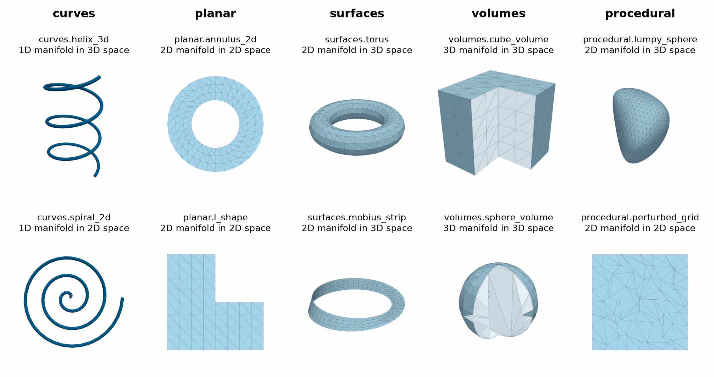

Primitives
==========

.. currentmodule:: physicsnemo.mesh.primitives

``physicsnemo.mesh.primitives`` is a catalog of ready-made meshes for
tutorials, tests, and experiments. The library builds each mesh when you ask
for it, except the PyVista datasets, which it downloads. Each primitive is a
module with one ``load`` function. Its keyword arguments set the size and the
resolution, and ``device`` sets where the tensors go. The ``text`` module is
the exception, with one function for each kind of text mesh.

:bdg-success:`CPU and GPU` :bdg-secondary:`points to volumes` :bdg-info:`deterministic`

         Curves: a helix and a spiral. Planar: an annulus and an L-shape.
         Surfaces: a torus and a Möbius strip. Volumes: a cube and a ball,
         each cut open to show its tetrahedra. Procedural: a lumpy sphere and
         a jittered planar grid.
   :align: center
   :width: 100%

   Two primitives from each family, labeled with the module path and with the
   manifold and spatial dimensions. The volume meshes are cut open, and the
   faces of the tetrahedra on each cut are drawn in a lighter tint.

The most-used primitives are the following:

.. grid:: 1 1 3 3
   :gutter: 2

   .. grid-item-card:: sphere_icosahedral
      :link: physicsnemo.mesh.primitives.surfaces.sphere_icosahedral.load
      :link-type: any
      :shadow: md
      :class-card: sd-card-hover

      A closed surface with near-equilateral triangles.

   .. grid-item-card:: unit_square
      :link: physicsnemo.mesh.primitives.planar.unit_square.load
      :link-type: any
      :shadow: md
      :class-card: sd-card-hover

      A 2D domain for quick tests of fields and calculus.

   .. grid-item-card:: sphere_volume
      :link: physicsnemo.mesh.primitives.volumes.sphere_volume.load
      :link-type: any
      :shadow: md
      :class-card: sd-card-hover

      A tetrahedral ball.

Example
-------

.. code:: python

    from physicsnemo.mesh.primitives import curves, planar, procedural, surfaces, volumes

    sphere = surfaces.sphere_icosahedral.load(radius=1.0, subdivisions=2)
    print(sphere)
    # Mesh[n_manifold_dims=2, n_spatial_dims=3](n_points=162, n_cells=320)

    helix = curves.helix_3d.load(n_turns=2.0)          # edges in 3D
    ball = volumes.sphere_volume.load(resolution=10)   # tetrahedra in 3D

    # Procedural meshes perturb a mesh with a fixed seed.
    square = planar.unit_square.load(subdivisions=3)
    noisy = procedural.noisy_mesh.load(square, noise_scale=0.01, seed=0)

To make a mesh on a GPU, pass ``device="cuda"`` to ``load``.

Catalog
-------

The tables give each primitive's type as
``Mesh[n_manifold_dims, n_spatial_dims]``. For example, ``Mesh[2, 3]`` is a
triangle mesh in 3D space. Each name links to the reference of its ``load``
function, which lists the arguments and defaults.

.. tab-set::

   .. tab-item:: Curves

      ``physicsnemo.mesh.primitives.curves``: One-dimensional meshes (edges) in 1D, 2D, or 3D space, including lines, arcs, closed curves, a helix, and a knot. The following table lists its primitives:

      .. list-table::
         :header-rows: 1
         :widths: 30 15 55

         * - Module
           - Type
           - Description
         * - :func:`circle_2d <physicsnemo.mesh.primitives.curves.circle_2d.load>`
           - ``Mesh[1, 2]``
           - A closed circle curve in 2D space
         * - :func:`circle_3d <physicsnemo.mesh.primitives.curves.circle_3d.load>`
           - ``Mesh[1, 3]``
           - A closed circle curve in 3D space
         * - :func:`circular_arc_2d <physicsnemo.mesh.primitives.curves.circular_arc_2d.load>`
           - ``Mesh[1, 2]``
           - A circular arc in 2D space
         * - :func:`ellipse_2d <physicsnemo.mesh.primitives.curves.ellipse_2d.load>`
           - ``Mesh[1, 2]``
           - A closed ellipse curve in 2D space
         * - :func:`helix_3d <physicsnemo.mesh.primitives.curves.helix_3d.load>`
           - ``Mesh[1, 3]``
           - A helical curve in 3D space
         * - :func:`line_segment_1d <physicsnemo.mesh.primitives.curves.line_segment_1d.load>`
           - ``Mesh[1, 1]``
           - A line segment in 1D space
         * - :func:`line_segments_1d <physicsnemo.mesh.primitives.curves.line_segments_1d.load>`
           - ``Mesh[1, 1]``
           - Multiple disconnected line segments in 1D space
         * - :func:`polyline_2d <physicsnemo.mesh.primitives.curves.polyline_2d.load>`
           - ``Mesh[1, 2]``
           - A zigzag polyline in 2D space
         * - :func:`spiral_2d <physicsnemo.mesh.primitives.curves.spiral_2d.load>`
           - ``Mesh[1, 2]``
           - An Archimedean spiral in 2D space
         * - :func:`spline_3d <physicsnemo.mesh.primitives.curves.spline_3d.load>`
           - ``Mesh[1, 3]``
           - A 3D spiral curve
         * - :func:`straight_line_2d <physicsnemo.mesh.primitives.curves.straight_line_2d.load>`
           - ``Mesh[1, 2]``
           - A straight line segment in 2D space
         * - :func:`straight_line_3d <physicsnemo.mesh.primitives.curves.straight_line_3d.load>`
           - ``Mesh[1, 3]``
           - A straight line segment in 3D space
         * - :func:`trefoil_knot_3d <physicsnemo.mesh.primitives.curves.trefoil_knot_3d.load>`
           - ``Mesh[1, 3]``
           - A trefoil knot curve in 3D space

   .. tab-item:: Planar

      ``physicsnemo.mesh.primitives.planar``: Triangle meshes that fill a region of the plane, including squares, rectangles, disks, an annulus, polygons, and a non-convex L shape. The following table lists its primitives:

      .. list-table::
         :header-rows: 1
         :widths: 30 15 55

         * - Module
           - Type
           - Description
         * - :func:`annulus_2d <physicsnemo.mesh.primitives.planar.annulus_2d.load>`
           - ``Mesh[2, 2]``
           - An annulus (ring) triangulated in 2D space
         * - :func:`circle_2d <physicsnemo.mesh.primitives.planar.circle_2d.load>`
           - ``Mesh[2, 2]``
           - A filled disk (circle) triangulated in 2D space
         * - :func:`equilateral_triangle <physicsnemo.mesh.primitives.planar.equilateral_triangle.load>`
           - ``Mesh[2, 2]``
           - An equilateral triangle in 2D space
         * - :func:`l_shape <physicsnemo.mesh.primitives.planar.l_shape.load>`
           - ``Mesh[2, 2]``
           - An L-shaped non-convex domain in 2D space
         * - :func:`rectangle <physicsnemo.mesh.primitives.planar.rectangle.load>`
           - ``Mesh[2, 2]``
           - A triangulated rectangle in 2D space
         * - :func:`regular_polygon <physicsnemo.mesh.primitives.planar.regular_polygon.load>`
           - ``Mesh[2, 2]``
           - A regular polygon triangulated in 2D space
         * - :func:`structured_grid <physicsnemo.mesh.primitives.planar.structured_grid.load>`
           - ``Mesh[2, 2]``
           - A structured triangular grid in 2D space
         * - :func:`unit_square <physicsnemo.mesh.primitives.planar.unit_square.load>`
           - ``Mesh[2, 2]``
           - A triangulated unit square in 2D space

   .. tab-item:: Surfaces

      ``physicsnemo.mesh.primitives.surfaces``: Triangle meshes in 3D space. The closed surfaces are spheres, a torus, Platonic solids, a cylinder with caps, and a cone. The open ones are a plane, a disk, a hemisphere, an open cylinder, and a Möbius strip. The following table lists its primitives:

      .. list-table::
         :header-rows: 1
         :widths: 30 15 55

         * - Module
           - Type
           - Description
         * - :func:`cone <physicsnemo.mesh.primitives.surfaces.cone.load>`
           - ``Mesh[2, 3]``
           - A cone surface in 3D space
         * - :func:`cube_surface <physicsnemo.mesh.primitives.surfaces.cube_surface.load>`
           - ``Mesh[2, 3]``
           - A cube surface triangulated in 3D space
         * - :func:`cylinder <physicsnemo.mesh.primitives.surfaces.cylinder.load>`
           - ``Mesh[2, 3]``
           - A cylinder surface (with caps) in 3D space
         * - :func:`cylinder_open <physicsnemo.mesh.primitives.surfaces.cylinder_open.load>`
           - ``Mesh[2, 3]``
           - An open cylinder surface (without caps) in 3D space
         * - :func:`disk <physicsnemo.mesh.primitives.surfaces.disk.load>`
           - ``Mesh[2, 3]``
           - A flat disk in 3D space (in the xy-plane)
         * - :func:`hemisphere <physicsnemo.mesh.primitives.surfaces.hemisphere.load>`
           - ``Mesh[2, 3]``
           - A hemisphere surface in 3D space
         * - :func:`icosahedron_surface <physicsnemo.mesh.primitives.surfaces.icosahedron_surface.load>`
           - ``Mesh[2, 3]``
           - A regular icosahedron surface in 3D space
         * - :func:`mobius_strip <physicsnemo.mesh.primitives.surfaces.mobius_strip.load>`
           - ``Mesh[2, 3]``
           - A Möbius strip surface in 3D space
         * - :func:`octahedron_surface <physicsnemo.mesh.primitives.surfaces.octahedron_surface.load>`
           - ``Mesh[2, 3]``
           - A regular octahedron surface in 3D space
         * - :func:`plane <physicsnemo.mesh.primitives.surfaces.plane.load>`
           - ``Mesh[2, 3]``
           - A flat triangulated plane in 3D space
         * - :func:`sphere_icosahedral <physicsnemo.mesh.primitives.surfaces.sphere_icosahedral.load>`
           - ``Mesh[2, 3]``
           - A subdivided icosahedron projected onto a sphere
         * - :func:`sphere_uv <physicsnemo.mesh.primitives.surfaces.sphere_uv.load>`
           - ``Mesh[2, 3]``
           - A UV sphere using latitude and longitude parameterization
         * - :func:`tetrahedron_surface <physicsnemo.mesh.primitives.surfaces.tetrahedron_surface.load>`
           - ``Mesh[2, 3]``
           - A regular tetrahedron surface in 3D space
         * - :func:`torus <physicsnemo.mesh.primitives.surfaces.torus.load>`
           - ``Mesh[2, 3]``
           - A torus surface in 3D space

   .. tab-item:: Volumes

      ``physicsnemo.mesh.primitives.volumes``: Tetrahedral meshes that fill a solid in 3D space. The following table lists its primitives:

      .. list-table::
         :header-rows: 1
         :widths: 30 15 55

         * - Module
           - Type
           - Description
         * - :func:`cube_volume <physicsnemo.mesh.primitives.volumes.cube_volume.load>`
           - ``Mesh[3, 3]``
           - A tetrahedral volume mesh of a cube
         * - :func:`cylinder_volume <physicsnemo.mesh.primitives.volumes.cylinder_volume.load>`
           - ``Mesh[3, 3]``
           - A tetrahedral volume mesh of a cylinder
         * - :func:`sphere_volume <physicsnemo.mesh.primitives.volumes.sphere_volume.load>`
           - ``Mesh[3, 3]``
           - A tetrahedral volume mesh of a sphere
         * - :func:`tetrahedron_volume <physicsnemo.mesh.primitives.volumes.tetrahedron_volume.load>`
           - ``Mesh[3, 3]``
           - A single regular tetrahedron volume

   .. tab-item:: Procedural

      ``physicsnemo.mesh.primitives.procedural``: Meshes with seeded random perturbations, for tests that need irregular geometry. Each ``load`` function takes a ``seed`` argument. The helper module ``procedural.noise`` provides the Perlin noise functions that they use: ``perlin_noise_1d``, ``perlin_noise_2d``, ``perlin_noise_3d``, and ``perlin_noise_nd``. The following table lists its primitives:

      .. list-table::
         :header-rows: 1
         :widths: 30 15 55

         * - Module
           - Type
           - Description
         * - :func:`lumpy_ball <physicsnemo.mesh.primitives.procedural.lumpy_ball.load>`
           - ``Mesh[3, 3]``
           - A lumpy ball volume mesh
         * - :func:`lumpy_sphere <physicsnemo.mesh.primitives.procedural.lumpy_sphere.load>`
           - ``Mesh[2, 3]``
           - A sphere with radial noise
         * - :func:`noisy_mesh <physicsnemo.mesh.primitives.procedural.noisy_mesh.load>`
           - same as input
           - A copy of ``base_mesh`` with Gaussian noise added to its points
         * - :func:`perturbed_grid <physicsnemo.mesh.primitives.procedural.perturbed_grid.load>`
           - ``Mesh[2, 2]``
           - A perturbed structured grid in 2D space

   .. tab-item:: Basic

      ``physicsnemo.mesh.primitives.basic``: Meshes with one to three cells, for unit tests and small examples. The following table lists its primitives:

      .. list-table::
         :header-rows: 1
         :widths: 30 15 55

         * - Module
           - Type
           - Description
         * - :func:`single_edge_2d <physicsnemo.mesh.primitives.basic.single_edge_2d.load>`
           - ``Mesh[1, 2]``
           - A mesh with a single edge in 2D space
         * - :func:`single_edge_3d <physicsnemo.mesh.primitives.basic.single_edge_3d.load>`
           - ``Mesh[1, 3]``
           - A mesh with a single edge in 3D space
         * - :func:`single_point_2d <physicsnemo.mesh.primitives.basic.single_point_2d.load>`
           - ``Mesh[0, 2]``
           - A mesh with a single point in 2D space
         * - :func:`single_point_3d <physicsnemo.mesh.primitives.basic.single_point_3d.load>`
           - ``Mesh[0, 3]``
           - A mesh with a single point in 3D space
         * - :func:`single_tetrahedron <physicsnemo.mesh.primitives.basic.single_tetrahedron.load>`
           - ``Mesh[3, 3]``
           - A mesh with a single tetrahedron in 3D space
         * - :func:`single_triangle_2d <physicsnemo.mesh.primitives.basic.single_triangle_2d.load>`
           - ``Mesh[2, 2]``
           - A mesh with a single triangle in 2D space
         * - :func:`single_triangle_3d <physicsnemo.mesh.primitives.basic.single_triangle_3d.load>`
           - ``Mesh[2, 3]``
           - A mesh with a single triangle in 3D space
         * - :func:`three_edges_2d <physicsnemo.mesh.primitives.basic.three_edges_2d.load>`
           - ``Mesh[1, 2]``
           - A polyline with three edges in 2D space
         * - :func:`three_edges_3d <physicsnemo.mesh.primitives.basic.three_edges_3d.load>`
           - ``Mesh[1, 3]``
           - A polyline with three edges in 3D space
         * - :func:`three_points_2d <physicsnemo.mesh.primitives.basic.three_points_2d.load>`
           - ``Mesh[0, 2]``
           - A mesh with three points in 2D space
         * - :func:`three_points_3d <physicsnemo.mesh.primitives.basic.three_points_3d.load>`
           - ``Mesh[0, 3]``
           - A mesh with three points in 3D space
         * - :func:`two_tetrahedra <physicsnemo.mesh.primitives.basic.two_tetrahedra.load>`
           - ``Mesh[3, 3]``
           - A mesh with two tetrahedra in 3D space
         * - :func:`two_triangles_2d <physicsnemo.mesh.primitives.basic.two_triangles_2d.load>`
           - ``Mesh[2, 2]``
           - A mesh with two triangles in 2D space
         * - :func:`two_triangles_3d <physicsnemo.mesh.primitives.basic.two_triangles_3d.load>`
           - ``Mesh[2, 3]``
           - A mesh with two triangles in 3D space

   .. tab-item:: PyVista Datasets

      ``physicsnemo.mesh.primitives.pyvista_datasets``: Example datasets from PyVista, converted to a ``Mesh``. These need ``pyvista``, and the first call downloads the file. Conversion splits cells other than simplices into simplices. The following table lists its primitives:

      .. list-table::
         :header-rows: 1
         :widths: 30 15 55

         * - Module
           - Type
           - Description
         * - :func:`airplane <physicsnemo.mesh.primitives.pyvista_datasets.airplane.load>`
           - ``Mesh[2, 3]``
           - Airplane surface mesh from PyVista examples
         * - :func:`ant <physicsnemo.mesh.primitives.pyvista_datasets.ant.load>`
           - ``Mesh[2, 3]``
           - Ant surface mesh from PyVista examples
         * - :func:`bunny <physicsnemo.mesh.primitives.pyvista_datasets.bunny.load>`
           - ``Mesh[2, 3]``
           - Stanford bunny surface mesh from PyVista examples
         * - :func:`cow <physicsnemo.mesh.primitives.pyvista_datasets.cow.load>`
           - ``Mesh[2, 3]``
           - Cow surface mesh from PyVista examples
         * - :func:`globe <physicsnemo.mesh.primitives.pyvista_datasets.globe.load>`
           - ``Mesh[2, 3]``
           - Globe surface mesh from PyVista examples
         * - :func:`hexbeam <physicsnemo.mesh.primitives.pyvista_datasets.hexbeam.load>`
           - ``Mesh[3, 3]``
           - Hexahedral beam from PyVista examples, split into tetrahedra
         * - :func:`tetbeam <physicsnemo.mesh.primitives.pyvista_datasets.tetbeam.load>`
           - ``Mesh[3, 3]``
           - Tetrahedral beam volume mesh from PyVista examples

   .. tab-item:: Text

      ``physicsnemo.mesh.primitives.text``: Meshes of a text string, built from the
      outlines of a bold sans-serif font through matplotlib. These need
      ``matplotlib``. Each function
      takes the string, a font size, and the sampling resolution of the outlines. The
      following table lists its functions:

      .. list-table::
         :header-rows: 1
         :widths: 30 15 55

         * - Function
           - Type
           - Description
         * - :func:`~physicsnemo.mesh.primitives.text.text_1d_2d`
           - ``Mesh[1, 2]``
           - Letter outlines as closed curves in the plane
         * - :func:`~physicsnemo.mesh.primitives.text.text_2d_2d`
           - ``Mesh[2, 2]``
           - Filled, triangulated letters in the plane
         * - :func:`~physicsnemo.mesh.primitives.text.text_2d_3d`
           - ``Mesh[2, 3]``
           - Surface of the extruded letters in 3D
         * - :func:`~physicsnemo.mesh.primitives.text.text_3d_3d`
           - ``Mesh[3, 3]``
           - Solid extruded letters, as tetrahedra

Choosing a Primitive
--------------------

Use the following guidelines to choose a primitive:

- For a quick closed surface, use ``surfaces.sphere_icosahedral``. Its
  triangles are close to equilateral, so it suits calculus and curvature
  checks. ``surfaces.sphere_uv`` has small, thin triangles near its poles.
- For a surface with a boundary, use ``surfaces.plane``, ``surfaces.disk``,
  ``surfaces.hemisphere``, or ``surfaces.cylinder_open``.
- For a 2D simulation domain, use ``planar.unit_square``,
  ``planar.rectangle``, or ``planar.structured_grid``. ``planar.l_shape``
  has a re-entrant corner, and ``planar.annulus_2d`` has a hole.
- For a unit test that needs exact values, use a mesh from ``basic``.
- For a mesh of your own geometry, refer to :doc:`generate`,
  :doc:`tessellation`, and :doc:`io`.

Related Topics
--------------

For more information, refer to the following resources:

- User Guide: `Using Mesh
  <https://docs.nvidia.com/physicsnemo/latest/user-guide/mesh/using_mesh.html>`_
- Tutorial: `Primitives and Mesh Generation
  <https://github.com/NVIDIA/physicsnemo/blob/main/examples/minimal/mesh/tutorial_3_primitives_generation.ipynb>`_

API Reference
-------------

Curves
^^^^^^

.. autofunction:: physicsnemo.mesh.primitives.curves.circle_2d.load

.. autofunction:: physicsnemo.mesh.primitives.curves.circle_3d.load

.. autofunction:: physicsnemo.mesh.primitives.curves.circular_arc_2d.load

.. autofunction:: physicsnemo.mesh.primitives.curves.ellipse_2d.load

.. autofunction:: physicsnemo.mesh.primitives.curves.helix_3d.load

.. autofunction:: physicsnemo.mesh.primitives.curves.line_segment_1d.load

.. autofunction:: physicsnemo.mesh.primitives.curves.line_segments_1d.load

.. autofunction:: physicsnemo.mesh.primitives.curves.polyline_2d.load

.. autofunction:: physicsnemo.mesh.primitives.curves.spiral_2d.load

.. autofunction:: physicsnemo.mesh.primitives.curves.spline_3d.load

.. autofunction:: physicsnemo.mesh.primitives.curves.straight_line_2d.load

.. autofunction:: physicsnemo.mesh.primitives.curves.straight_line_3d.load

.. autofunction:: physicsnemo.mesh.primitives.curves.trefoil_knot_3d.load

Planar Meshes
^^^^^^^^^^^^^

.. autofunction:: physicsnemo.mesh.primitives.planar.annulus_2d.load

.. autofunction:: physicsnemo.mesh.primitives.planar.circle_2d.load

.. autofunction:: physicsnemo.mesh.primitives.planar.equilateral_triangle.load

.. autofunction:: physicsnemo.mesh.primitives.planar.l_shape.load

.. autofunction:: physicsnemo.mesh.primitives.planar.rectangle.load

.. autofunction:: physicsnemo.mesh.primitives.planar.regular_polygon.load

.. autofunction:: physicsnemo.mesh.primitives.planar.structured_grid.load

.. autofunction:: physicsnemo.mesh.primitives.planar.unit_square.load

Surfaces
^^^^^^^^

.. autofunction:: physicsnemo.mesh.primitives.surfaces.cone.load

.. autofunction:: physicsnemo.mesh.primitives.surfaces.cube_surface.load

.. autofunction:: physicsnemo.mesh.primitives.surfaces.cylinder.load

.. autofunction:: physicsnemo.mesh.primitives.surfaces.cylinder_open.load

.. autofunction:: physicsnemo.mesh.primitives.surfaces.disk.load

.. autofunction:: physicsnemo.mesh.primitives.surfaces.hemisphere.load

.. autofunction:: physicsnemo.mesh.primitives.surfaces.icosahedron_surface.load

.. autofunction:: physicsnemo.mesh.primitives.surfaces.mobius_strip.load

.. autofunction:: physicsnemo.mesh.primitives.surfaces.octahedron_surface.load

.. autofunction:: physicsnemo.mesh.primitives.surfaces.plane.load

.. autofunction:: physicsnemo.mesh.primitives.surfaces.sphere_icosahedral.load

.. autofunction:: physicsnemo.mesh.primitives.surfaces.sphere_uv.load

.. autofunction:: physicsnemo.mesh.primitives.surfaces.tetrahedron_surface.load

.. autofunction:: physicsnemo.mesh.primitives.surfaces.torus.load

Volumes
^^^^^^^

.. autofunction:: physicsnemo.mesh.primitives.volumes.cube_volume.load

.. autofunction:: physicsnemo.mesh.primitives.volumes.cylinder_volume.load

.. autofunction:: physicsnemo.mesh.primitives.volumes.sphere_volume.load

.. autofunction:: physicsnemo.mesh.primitives.volumes.tetrahedron_volume.load

Procedural Meshes
^^^^^^^^^^^^^^^^^

.. autofunction:: physicsnemo.mesh.primitives.procedural.lumpy_ball.load

.. autofunction:: physicsnemo.mesh.primitives.procedural.lumpy_sphere.load

.. autofunction:: physicsnemo.mesh.primitives.procedural.noisy_mesh.load

.. autofunction:: physicsnemo.mesh.primitives.procedural.perturbed_grid.load

Basic Meshes
^^^^^^^^^^^^

.. autofunction:: physicsnemo.mesh.primitives.basic.single_edge_2d.load

.. autofunction:: physicsnemo.mesh.primitives.basic.single_edge_3d.load

.. autofunction:: physicsnemo.mesh.primitives.basic.single_point_2d.load

.. autofunction:: physicsnemo.mesh.primitives.basic.single_point_3d.load

.. autofunction:: physicsnemo.mesh.primitives.basic.single_tetrahedron.load

.. autofunction:: physicsnemo.mesh.primitives.basic.single_triangle_2d.load

.. autofunction:: physicsnemo.mesh.primitives.basic.single_triangle_3d.load

.. autofunction:: physicsnemo.mesh.primitives.basic.three_edges_2d.load

.. autofunction:: physicsnemo.mesh.primitives.basic.three_edges_3d.load

.. autofunction:: physicsnemo.mesh.primitives.basic.three_points_2d.load

.. autofunction:: physicsnemo.mesh.primitives.basic.three_points_3d.load

.. autofunction:: physicsnemo.mesh.primitives.basic.two_tetrahedra.load

.. autofunction:: physicsnemo.mesh.primitives.basic.two_triangles_2d.load

.. autofunction:: physicsnemo.mesh.primitives.basic.two_triangles_3d.load

PyVista Datasets
^^^^^^^^^^^^^^^^

.. autofunction:: physicsnemo.mesh.primitives.pyvista_datasets.airplane.load

.. autofunction:: physicsnemo.mesh.primitives.pyvista_datasets.ant.load

.. autofunction:: physicsnemo.mesh.primitives.pyvista_datasets.bunny.load

.. autofunction:: physicsnemo.mesh.primitives.pyvista_datasets.cow.load

.. autofunction:: physicsnemo.mesh.primitives.pyvista_datasets.globe.load

.. autofunction:: physicsnemo.mesh.primitives.pyvista_datasets.hexbeam.load

.. autofunction:: physicsnemo.mesh.primitives.pyvista_datasets.tetbeam.load

Text
^^^^

.. autofunction:: physicsnemo.mesh.primitives.text.text_1d_2d

.. autofunction:: physicsnemo.mesh.primitives.text.text_2d_2d

.. autofunction:: physicsnemo.mesh.primitives.text.text_2d_3d

.. autofunction:: physicsnemo.mesh.primitives.text.text_3d_3d
