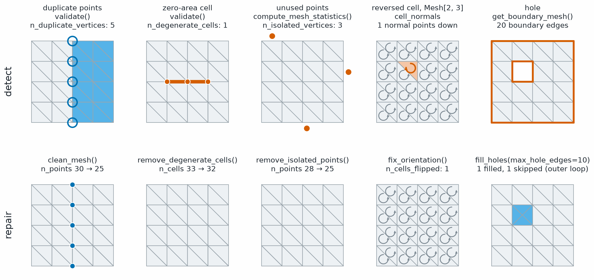

Repair
======

.. currentmodule:: physicsnemo.mesh.repair

``physicsnemo.mesh.repair`` fixes common mesh problems, such as duplicate
points, degenerate cells, inconsistent winding, and holes. Each repair
function returns the repaired mesh and a ``dict`` of statistics.

:bdg-success:`GPU` :bdg-warning:`hole filling for triangle meshes only`

         Top row, from left: blue rings on five points where the right half of
         the mesh has its own copies, labeled n_duplicate_vertices: 5. A
         vermillion line through three collinear points, labeled
         n_degenerate_cells: 1. Three vermillion dots outside the mesh, labeled
         n_isolated_vertices: 3. Circular arrows in every cell, one of them
         vermillion and reversed, labeled 1 normal points down. Vermillion
         outlines on the outer edge and on a square hole, labeled 20 boundary
         edges. The bottom row shows the repaired meshes. clean_mesh, n_points
         30 to 25. remove_degenerate_cells, n_cells 33 to 32.
         remove_isolated_points, n_points 28 to 25. fix_orientation,
         n_cells_flipped: 1. fill_holes, one hole filled in light blue and the
         outer loop skipped.
   :align: center
   :width: 100%

   Five defects, each with the call that finds it (top) and the call that
   repairs it (bottom). :func:`~physicsnemo.mesh.validation.validate` finds
   duplicate points and zero-area cells.
   :func:`~physicsnemo.mesh.validation.compute_mesh_statistics` counts unused
   points. The normals in ``cell_normals`` show a reversed cell, and
   ``get_boundary_mesh`` shows the loops around holes. :func:`fill_holes` fills
   the hole and skips the outer loop, which has more edges than
   ``max_hole_edges``.

.. rubric:: Most Used

.. grid:: 1 2 2 2
   :gutter: 2

   .. grid-item-card:: Clean
      :link: physicsnemo.mesh.repair.clean_mesh
      :link-type: any
      :shadow: md
      :class-card: sd-card-hover

      ``mesh.clean()`` merges duplicate points, removes duplicate cells, and
      removes unused points.

   .. grid-item-card:: Repair Pipeline
      :link: physicsnemo.mesh.repair.repair_mesh
      :link-type: any
      :shadow: md
      :class-card: sd-card-hover

      ``repair_mesh(mesh)`` runs a configurable sequence of repairs.

   .. grid-item-card:: Fix Orientation
      :link: physicsnemo.mesh.repair.fix_orientation
      :link-type: any
      :shadow: md
      :class-card: sd-card-hover

      ``fix_orientation(mesh)`` gives all cells a consistent winding.

   .. grid-item-card:: Fill Holes
      :link: physicsnemo.mesh.repair.fill_holes
      :link-type: any
      :shadow: md
      :class-card: sd-card-hover

      ``fill_holes(mesh)`` closes small boundary loops of a triangle mesh.

The single repairs are the following functions:

.. list-table::
   :header-rows: 1
   :widths: 40 60

   * - Function
     - Fixes
   * - :func:`remove_degenerate_cells`
     - Cells with zero area or volume, or with a repeated point
   * - :func:`remove_isolated_points`
     - Points that no cell uses
   * - :func:`fix_orientation`
     - Cells whose winding disagrees with their neighbors
   * - :func:`fill_holes`
     - Boundary loops of a triangle mesh
   * - :func:`merge_duplicate_points`, :func:`remove_duplicate_cells`,
       :func:`remove_unused_points`
     - Duplicates and unused points, as tensor-level steps that take
       ``points``, ``cells``, and data, not a ``Mesh``

By default, :func:`repair_mesh` removes degenerate cells, merges duplicate
points, and removes isolated points. Pass ``fix_orientation=True`` or
``fill_holes=True`` to add the other two.

Example
-------

The following example cleans and repairs a mesh made of two copies of one
sphere, then fills a hole in it:

.. code:: python

    import torch
    from physicsnemo.mesh import Mesh
    from physicsnemo.mesh.primitives.surfaces import sphere_icosahedral
    from physicsnemo.mesh.repair import clean_mesh, fill_holes, repair_mesh

    # Two copies of one sphere: every point and every cell appears twice.
    sphere = sphere_icosahedral.load(subdivisions=1)  # 42 points, 80 triangles
    mesh = Mesh(
        points=torch.cat([sphere.points, sphere.points]),
        cells=torch.cat([sphere.cells, sphere.cells + sphere.n_points]),
    )

    # The Mesh method returns only the mesh.
    cleaned = mesh.clean()
    print(cleaned.n_points, cleaned.n_cells)  # 42 80

    # The functions also return statistics.
    cleaned, stats = clean_mesh(mesh)
    print(stats["n_cells_before_dedup"], stats["n_cells_after_dedup"])  # 160 80

    repaired, repair_stats = repair_mesh(cleaned, fix_orientation=True)
    print(list(repair_stats))  # ['degenerates', 'merge_points', 'clean', 'isolated', 'orientation']

    # Cut one triangle out, then fill the hole.
    holed = cleaned.slice_cells(torch.arange(1, cleaned.n_cells))
    filled, hole_stats = fill_holes(holed)
    print(holed.is_watertight(), filled.is_watertight())  # False True
    print(hole_stats)

.. code-block:: text
   :caption: Output

   {'n_holes_detected': 1, 'n_holes_filled': 1, 'n_holes_skipped': 0, 'n_faces_added': 3, 'n_points_added': 1}

Choosing a Function
-------------------

Use the following guidelines to choose a function:

- To remove duplicates after a merge or a file import, use ``mesh.clean()``.
  It merges points closer than ``tolerance`` (default ``1e-12``).
- To repair a mesh from an outside source, use :func:`repair_mesh`. Its
  ``tolerance`` default is ``1e-6``.
- :func:`fill_holes` works only on meshes with a manifold dimension of 2,
  and only closes loops of at most ``max_hole_edges`` edges (default 10).

.. note::

   :func:`repair_mesh` does not remove duplicate cells. Run
   :func:`clean_mesh` first if the mesh can have them.

Summary
-------

.. autosummary::
   :nosignatures:

   clean_mesh
   repair_mesh
   remove_degenerate_cells
   remove_isolated_points
   fix_orientation
   fill_holes
   merge_duplicate_points
   remove_duplicate_cells
   remove_unused_points

Related Topics
--------------

For more information, refer to the following resources:

- :doc:`validation` to find problems before you repair them.
- Tutorial: `Quality, Validation, and Repair
  <https://github.com/NVIDIA/physicsnemo/blob/main/examples/minimal/mesh/tutorial_7_quality_repair.ipynb>`_

API Reference
-------------

.. autofunction:: clean_mesh

.. autofunction:: repair_mesh

.. autofunction:: remove_degenerate_cells

.. autofunction:: remove_isolated_points

.. autofunction:: fix_orientation

.. autofunction:: fill_holes

.. autofunction:: merge_duplicate_points

.. autofunction:: remove_duplicate_cells

.. autofunction:: remove_unused_points
