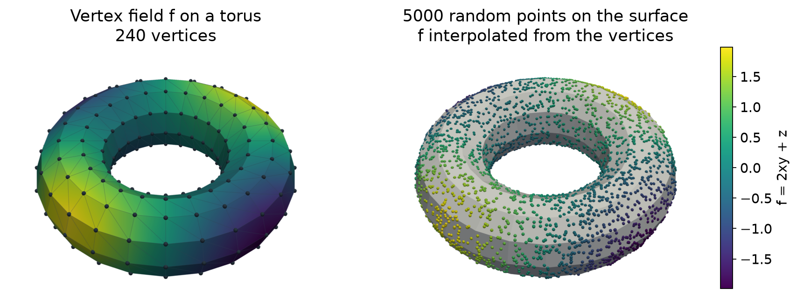

Sampling and Interpolation
==========================

.. currentmodule:: physicsnemo.mesh.sampling

``physicsnemo.mesh.sampling`` draws random points on the cells of a mesh and
interpolates mesh data at query points. Both jobs are also ``Mesh`` methods,
:meth:`~physicsnemo.mesh.mesh.Mesh.sample_random_points_on_cells` and
:meth:`~physicsnemo.mesh.mesh.Mesh.sample_data_at_points`.

:bdg-success:`GPU` :bdg-info:`autograd` :bdg-secondary:`any dimension`

         by a field, with dark dots at the vertices. Right: a gray torus
         covered with colored dots whose colors match the left view.
   :align: center
   :width: 100%

   Left: a field :math:`f = 2xy + z` stored at the vertices of a coarse torus.
   Right: 5,000 points sampled uniformly by area with
   :func:`sample_random_points_on_cells`, colored by the values that
   :func:`sample_data_at_points` interpolates from the vertices.

.. rubric:: Most Used

.. grid:: 1 1 2 2
   :gutter: 2

   .. grid-item-card:: Random Points
      :link: physicsnemo.mesh.sampling.sample_random_points_on_cells
      :link-type: any
      :shadow: md
      :class-card: sd-card-hover

      ``sample_random_points_on_cells(mesh, idx)`` returns one point in each
      listed cell.

   .. grid-item-card:: Data at Points
      :link: physicsnemo.mesh.sampling.sample_data_at_points
      :link-type: any
      :shadow: md
      :class-card: sd-card-hover

      ``mesh.sample_data_at_points(queries)`` interpolates point or cell data.

   .. grid-item-card:: Containing Cells
      :link: physicsnemo.mesh.sampling.find_containing_cells
      :link-type: any
      :shadow: md
      :class-card: sd-card-hover

      ``find_containing_cells(mesh, queries)`` gives each point's cell and its
      barycentric coordinates.

   .. grid-item-card:: Nearest Cells
      :link: physicsnemo.mesh.sampling.find_nearest_cells
      :link-type: any
      :shadow: md
      :class-card: sd-card-hover

      ``find_nearest_cells(mesh, queries)`` gives the cell with the nearest
      centroid.

Example
-------

The following example samples points on a sphere and interpolates a field on
a square:

.. code:: python

    import torch
    from physicsnemo.mesh.primitives.planar import unit_square
    from physicsnemo.mesh.primitives.surfaces import sphere_icosahedral

    sphere = sphere_icosahedral.load(subdivisions=3)

    # 10,000 points, uniform over the surface area. The result is a tensor.
    torch.manual_seed(0)
    cell_indices = torch.multinomial(sphere.cell_areas, num_samples=10_000, replacement=True)
    points = sphere.sample_random_points_on_cells(cell_indices)
    print(points.shape)  # torch.Size([10000, 3])

    # Interpolate a point field at query points. The result is a TensorDict.
    square = unit_square.load(subdivisions=3)
    square.point_data["u"] = square.points[:, 0]
    queries = torch.tensor([[0.25, 0.25], [0.5, 0.75], [2.0, 2.0]])
    values = square.sample_data_at_points(queries, data_source="points")
    print(values["u"])  # tensor([0.2500, 0.5000,    nan]): the last point is outside

:func:`sample_random_points_on_cells` draws the barycentric coordinates from a
`Dirichlet distribution <https://en.wikipedia.org/wiki/Dirichlet_distribution>`_,
which is uniform in the cell for the default ``alpha=1.0``. Repeat a cell
index to draw several points from that cell. To sample uniformly over the
whole mesh, draw the cell indices in proportion to the cell areas, as the
example does.

:func:`sample_data_at_points` finds the cell that contains each query point,
computes its
`barycentric coordinates <https://en.wikipedia.org/wiki/Barycentric_coordinate_system>`_,
and interpolates point data (``data_source="points"``) or takes the cell data
(``data_source="cells"``) there. The search uses a
:class:`~physicsnemo.mesh.spatial.BVH`. To reuse one over several calls, build
it once and pass it as ``bvh``.

.. tip::

   A query point outside the mesh gets ``NaN``. Set
   ``project_onto_nearest_cell=True`` to first move each query point to the
   centroid of its nearest cell. This helps on surfaces, where query points
   seldom lie exactly on a cell.

Choosing a Function
-------------------

Use the following guidelines to choose a function:

- :func:`find_containing_cells` returns the first cell that contains each
  query point (``-1`` if none) and its barycentric coordinates.
  :func:`find_all_containing_cells` returns every containing cell as an
  :class:`~physicsnemo.mesh.neighbors.Adjacency`, for points on shared
  facets.
- :func:`find_nearest_cells` returns the cell with the nearest centroid, for
  query points that can be outside the mesh.
- :func:`compute_barycentric_coordinates` works on tensors of query points
  and cell vertices, without a mesh.
- :func:`match_points` pairs points of two point sets that coincide within a
  tolerance.

Summary
-------

.. autosummary::
   :nosignatures:

   sample_random_points_on_cells
   sample_data_at_points
   find_containing_cells
   find_all_containing_cells
   find_nearest_cells
   compute_barycentric_coordinates
   match_points

Related Topics
--------------

For more information, refer to the following resources:

- :doc:`spatial` for the bounding volume hierarchy (BVH) that accelerates the
  search.
- Tutorial: `Neighbors, Adjacency, and Spatial Queries
  <https://github.com/NVIDIA/physicsnemo/blob/main/examples/minimal/mesh/tutorial_6_neighbors_spatial.ipynb>`_

API Reference
-------------

.. autofunction:: sample_random_points_on_cells

.. autofunction:: sample_data_at_points

.. autofunction:: find_containing_cells

.. autofunction:: find_all_containing_cells

.. autofunction:: find_nearest_cells

.. autofunction:: compute_barycentric_coordinates

.. autofunction:: match_points
