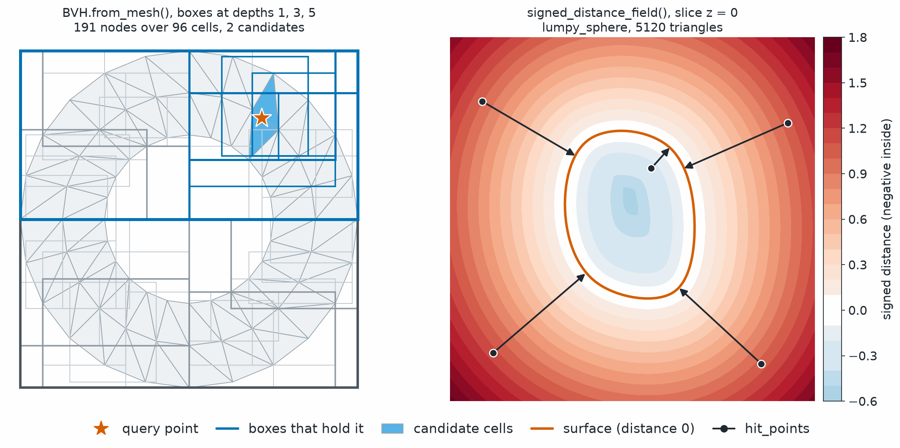

Spatial Queries
===============

.. currentmodule:: physicsnemo.mesh.spatial

``physicsnemo.mesh.spatial`` answers geometric queries on large meshes with a
bounding volume hierarchy (BVH), a cluster tree, and a signed distance field. Unlike
:doc:`neighbors`, these queries use distances, not connectivity.

:bdg-success:`GPU` :bdg-secondary:`any dimension` :bdg-secondary:`Warp signed distance` :bdg-warning:`signed distance needs triangles in 3D`

         gray rectangles. The rectangles that contain an orange star are blue,
         and the two triangles under the star are light blue. Its title reads
         191 nodes over 96 cells, 2 candidates. Right, a blue-to-red filled
         contour plot of signed distance around a lumpy closed curve drawn in
         vermillion, with black arrows from five query points to the curve.
   :align: center
   :width: 100%

   Left, a BVH over an annulus, with its boxes at depths one, three, and five.
   A point query descends only into the boxes that hold the point (blue) and
   returns the cells of the leaves it reaches as candidates. Right, the signed
   distance to a closed surface on the plane z = 0. It is negative inside and
   positive outside, and the arrows run from query points to the closest points
   on the surface that :func:`signed_distance_field` returns.

.. rubric:: Most Used

.. grid:: 1 1 2 2
   :gutter: 2

   .. grid-item-card:: Bounding Volume Hierarchy
      :link: physicsnemo.mesh.spatial.BVH.from_mesh
      :link-type: any
      :shadow: md
      :class-card: sd-card-hover

      ``BVH.from_mesh(mesh)`` builds a tree of boxes over the cells.

   .. grid-item-card:: Candidate Cells
      :link: physicsnemo.mesh.spatial.BVH.find_candidate_cells
      :link-type: any
      :shadow: md
      :class-card: sd-card-hover

      ``bvh.find_candidate_cells(points)`` gives the cells whose boxes hold
      each point.

   .. grid-item-card:: Signed Distance
      :link: physicsnemo.mesh.spatial.signed_distance_field
      :link-type: any
      :shadow: md
      :class-card: sd-card-hover

      ``signed_distance_field(mesh, queries)`` gives the distance, the closest
      point, and the nearest face.

   .. grid-item-card:: Cluster Tree
      :link: physicsnemo.mesh.spatial.ClusterTree
      :link-type: any
      :shadow: md
      :class-card: sd-card-hover

      ``ClusterTree.from_points(points)`` groups points for Barnes-Hut
      kernels.

Example
-------

The following example builds a BVH over a sphere and finds the candidate
cells of random query points:

.. code:: python

    import torch
    from physicsnemo.mesh.spatial import BVH
    from physicsnemo.mesh.primitives.surfaces import sphere_icosahedral

    mesh = sphere_icosahedral.load(subdivisions=3)
    bvh = BVH.from_mesh(mesh)

    query_points = torch.randn(1000, 3)
    candidate_cells = bvh.find_candidate_cells(query_points)  # an Adjacency

The following example computes the signed distance from two points to a unit
sphere:

.. code:: python

    import torch
    from physicsnemo.mesh.primitives.surfaces import sphere_icosahedral
    from physicsnemo.mesh.spatial import signed_distance_field

    sphere = sphere_icosahedral.load(subdivisions=3)  # unit sphere, 1280 triangles
    query = torch.tensor([[0.0, 0.0, 0.0], [2.0, 0.0, 0.0]])
    sdf, hit_points, hit_faces = signed_distance_field(sphere, query)
    print(sdf)  # about (-1, 1): negative inside, positive outside
    # hit_points: (2, 3) closest surface points
    # hit_faces:  (2,)   index of the nearest face in sphere.cells

Choosing a Structure
--------------------

Use the following guidelines to choose a structure:

- The :class:`BVH` is a tree of axis-aligned
  bounding boxes over the cells of a mesh. It speeds up point containment,
  which finds the cell, if any, that contains each query point.
  The sampling module uses it in
  :func:`~physicsnemo.mesh.sampling.sample_data_at_points` and
  :func:`~physicsnemo.mesh.sampling.find_containing_cells`, to avoid a
  brute-force search over all cells.
- :class:`ClusterTree` is a hierarchy of point clusters for Barnes-Hut
  acceleration of kernel and attention operators. Far-apart clusters interact
  through aggregates instead of point by point. :class:`DualInteractionPlan`
  and :class:`SourceAggregates` hold the plan and the cluster aggregates of
  that computation.
- :func:`signed_distance_field` computes the signed distance from query
  points to a triangle surface mesh, and the closest point on the surface. It
  is a :class:`~physicsnemo.mesh.Mesh`-typed wrapper around the Warp-backed
  :func:`physicsnemo.nn.functional.signed_distance_field` function, which runs
  NVIDIA Warp mesh queries on CPU and CUDA.

``use_sign_winding_number`` selects one of two methods for the sign of the
distance:

.. list-table::
   :header-rows: 1
   :widths: 22 48 30

   * - Value
     - Sign from
     - Suits
   * - ``False`` (default)
     - The angle-weighted pseudo-normal of the closest mesh feature
       (``wp.mesh_query_point_sign_normal``). This method is fast.
     - Watertight meshes
   * - ``True``
     - The generalized winding number
       (``wp.mesh_query_point_sign_winding_number``)
     - Open or self-intersecting geometry, such as a triangle soup

Summary
-------

.. autosummary::
   :nosignatures:

   BVH
   ClusterTree
   DualInteractionPlan
   SourceAggregates
   signed_distance_field

Related Topics
--------------

For more information, refer to the following resources:

- :doc:`sampling`, which uses the BVH to interpolate data at query points.
- Tutorial: `Neighbors, Adjacency, and Spatial Queries
  <https://github.com/NVIDIA/physicsnemo/blob/main/examples/minimal/mesh/tutorial_6_neighbors_spatial.ipynb>`_

API Reference
-------------

.. automodule:: physicsnemo.mesh.spatial
   :members:
   :show-inheritance:
