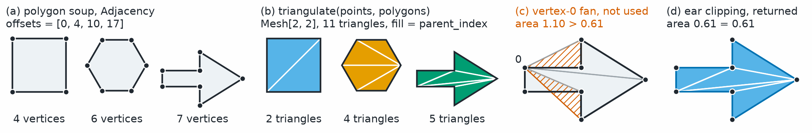

Tessellation
============

.. currentmodule:: physicsnemo.mesh.tessellation

``physicsnemo.mesh.tessellation`` turns polygons into the simplices that a
:class:`~physicsnemo.mesh.mesh.Mesh` stores, and fills a closed boundary with
quality triangles. :func:`triangulate` splits each ``k``-gon of a polygon soup
into ``k - 2`` triangles, and :func:`fill_interior` meshes the inside of a
closed boundary without moving it.

:bdg-secondary:`any polygon` :bdg-warning:`fill_interior in 2D only`

         and an arrow) with four, six, and seven vertices, under the title
         "polygon soup, Adjacency offsets = [0, 4, 10, 17]". Second, the same
         polygons split into two, four, and five triangles, each polygon in its
         own color.
         Third, the arrow alone with a fan of triangles from one shaft vertex.
         Two of them lie outside the arrow and are hatched in orange, under
         the title "area 1.10 > 0.61". Fourth, the arrow split into triangles
         that all stay inside it, titled "area 0.61 = 0.61".
   :align: center
   :width: 100%

   :func:`triangulate` gives each ``k``-gon ``k - 2`` triangles. A non-convex
   polygon needs ear clipping, because the triangles of a vertex-0 fan leave
   the polygon and their unsigned areas add up to more than its area.

The most-used functions are the following:

.. grid:: 1 1 3 3
   :gutter: 2

   .. grid-item-card:: Mesh.from_polygons
      :link: physicsnemo.mesh.mesh.Mesh.from_polygons
      :link-type: any
      :shadow: md
      :class-card: sd-card-hover

      A triangle ``Mesh`` from a polygon soup, with its cell data.

   .. grid-item-card:: triangulate
      :link: physicsnemo.mesh.tessellation.triangulate
      :link-type: any
      :shadow: md
      :class-card: sd-card-hover

      Triangles and the index of each one's parent polygon.

   .. grid-item-card:: fill_interior
      :link: mesh-tessellation-fill
      :link-type: ref
      :shadow: md
      :class-card: sd-card-hover

      Quality triangles inside a closed boundary that stays exact.

Example
-------

A *polygon soup* is a flat list of polygonal cells, each given only by its
vertex ring, with no shared-edge connectivity between cells. A surface mesh
read from a polygonal face list, such as a VTP or STL file, takes this form.
Every ``k``-gon yields exactly ``k - 2`` triangles, so indexing with the
returned ``parent_index`` broadcasts the data of each polygon to its
triangles. The following example triangulates one quad:

.. code:: python

    import torch
    from physicsnemo.mesh import Mesh
    from physicsnemo.mesh.neighbors import Adjacency
    from physicsnemo.mesh.tessellation import triangulate

    # A polygon soup as a cell-to-vertex Adjacency (CSR): one quad (vertices 0-3).
    points = torch.tensor([[0.0, 0.0, 0.0], [1.0, 0.0, 0.0],
                           [1.0, 1.0, 0.0], [0.0, 1.0, 0.0]])
    polygons = Adjacency(offsets=torch.tensor([0, 4]),
                         indices=torch.tensor([0, 1, 2, 3]))

    # Low-level: triangle connectivity plus the parent-polygon index.
    cells, parent_index = triangulate(points, polygons)
    cells          # tensor([[0, 1, 2], [0, 2, 3]])
    parent_index   # tensor([0, 0]), so cell_data[parent_index] broadcasts

    # High-level: build a Mesh directly, broadcasting per-polygon cell data.
    mesh = Mesh.from_polygons(
        points, polygons, cell_data={"pressure": torch.tensor([2.5])}
    )

:func:`triangulate` uses a vectorized vertex-0 fan for convex polygons and
`ear clipping <https://en.wikipedia.org/wiki/Polygon_triangulation>`_ for the
rare non-convex ones. Getting non-convex polygons right matters for any
unsigned-area-weighted quantity, such as wall-shear or viscous force
integration, or total wetted area.

.. warning::

   Each polygon must be simple (no self-intersections), with no repeated
   consecutive vertices or zero-length edges. :func:`triangulate` does not detect
   these cases, and the result is undefined. Ear clipping also assumes that a
   non-convex polygon is approximately planar.

.. note::

   This module is unrelated to the deprecated ``Tessellation`` *geometry*
   class in PhysicsNeMo-Sym (``physicsnemo.sym.geometry.tessellation``). That
   class represents a tessellated STL surface as a solid for sampling surface
   and interior points and signed-distance values. The utilities here split
   the polygonal cells of an existing mesh into simplices.

.. _mesh-tessellation-fill:

Exact-Boundary Interior Filling
-------------------------------

Beyond decomposing existing cells, the package also *generates* quality
meshes. :func:`fill_interior` takes a closed codimension-one boundary
``Mesh`` and fills the enclosed interior with quality simplices. In 2D, the
boundary is an edge mesh forming one or more loops, in any order and
orientation. The algorithm resolves holes, multiple components, and
islands-inside-holes automatically through containment.

The algorithm uses constrained Delaunay triangulation followed by Ruppert's
Delaunay refinement, so that every 2D output triangle satisfies the
requested minimum angle and, optionally, a maximum cell size. The
triangulation uses Bowyer--Watson insertion with constrained-edge recovery,
and an even-odd parity flood fill removes holes topologically.

The minimum-angle guarantee has these conditions:

- Adjacent input segments must meet at 60 degrees or more. A sharper input
  corner raises ``ValueError``. To fill such a boundary, pass
  ``min_angle_degrees=0.0`` for an unrefined constrained triangulation, or
  blunt the corner.
- ``min_angle_degrees`` must be in :math:`[0, 33]`. The default is 30.
- Ruppert's proof of termination covers bounds up to about 20.7 degrees.
  Larger bounds, such as the default, terminate in practice. If refinement
  exceeds its budget of inserted vertices, it raises ``RuntimeError``.

Optional optimal-Delaunay-triangulation (ODT) smoothing, controlled by
``smooth_iterations``, moves each interior vertex to the area-weighted
average of its incident triangles' circumcenters (Chen and Xu 2004). This
improves the *typical* angle while preserving both bounds. The
exact-boundary contract provides three guarantees:

- Every input vertex that an edge references appears bit-identically in
  the output, in the leading rows and in input order. The output drops
  vertices that no edge references.
- The pipeline only ever *subdivides* boundary facets and never moves
  them.
- The entire process is deterministic.

Interior filling is not differentiable. The output carries no autograd
history.

You can attach provenance fields (``"boundary_marker"`` and
``"source_point"``) to the output's ``point_data`` by setting
``provenance=True``. By default, the pipeline claims no keys in the
user-owned namespace.

The contract is dimension-generic by design. The ``n = 3`` case (a
watertight surface ``Mesh[2, 3]`` producing tetrahedra) currently raises
:class:`NotImplementedError`. Exact 3D boundary recovery is a
substantially harder problem that requires its own implementation effort.
For implicit domains, or approximate volume meshing of a surface through
its signed distance function (SDF), refer to
:func:`physicsnemo.mesh.generate.mesh_implicit_domain`.

The following example fills a unit square with triangles:

.. code:: python

    import math
    import torch
    from physicsnemo.mesh import Mesh
    from physicsnemo.mesh.tessellation import fill_interior

    square = torch.tensor([[0.0, 0.0], [1.0, 0.0], [1.0, 1.0], [0.0, 1.0]])
    edges = torch.tensor([[0, 1], [1, 2], [2, 3], [3, 0]])
    h = 0.1  # target interior edge length
    filled = fill_interior(
        Mesh(points=square, cells=edges),
        max_cell_size=math.sqrt(3.0) / 4.0 * h * h,
        min_angle_degrees=30.0,
        smooth_iterations=3,  # optional ODT smoothing
    )

:func:`polygon_interior_point` is a companion utility returning a point
strictly inside a simple polygon.

Summary
-------

.. autosummary::
   :nosignatures:

   triangulate
   fill_interior
   polygon_interior_point

Related Topics
--------------

For more information, refer to the following resources:

- :doc:`generate` for meshes of implicit domains, in any dimension.
- :doc:`io` to load polygon meshes from files.
- Tutorials: `Loading, Converting, and Saving Meshes
  <https://github.com/NVIDIA/physicsnemo/blob/main/examples/minimal/mesh/tutorial_2_io_interop.ipynb>`_
  and `Primitives and Mesh Generation
  <https://github.com/NVIDIA/physicsnemo/blob/main/examples/minimal/mesh/tutorial_3_primitives_generation.ipynb>`_

API Reference
-------------

.. autofunction:: triangulate

.. autofunction:: fill_interior

.. autofunction:: polygon_interior_point
