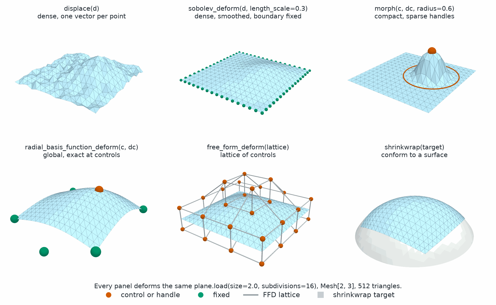
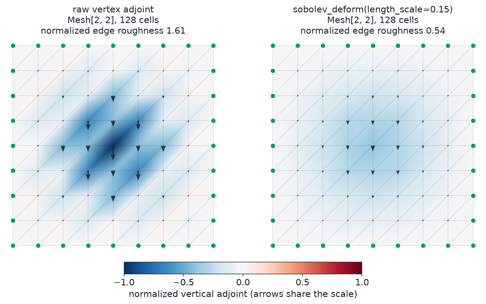
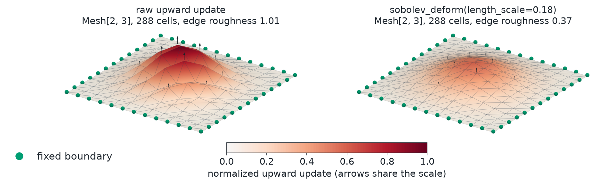
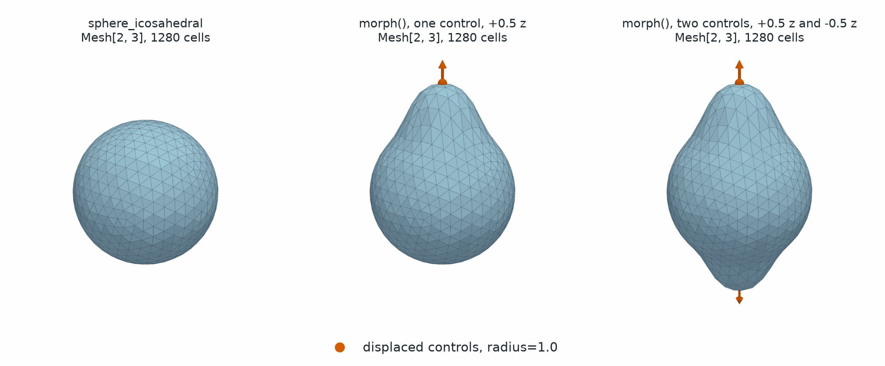
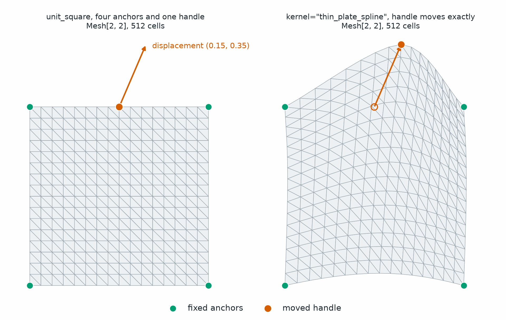
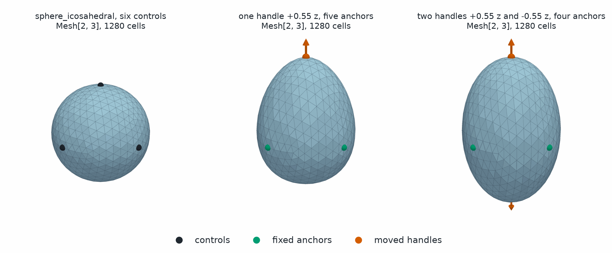
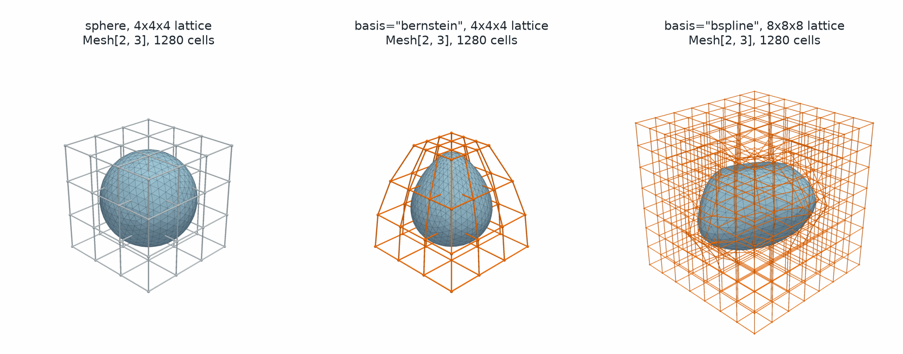
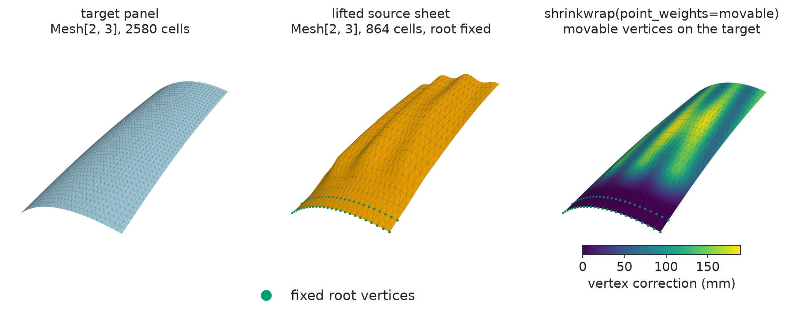
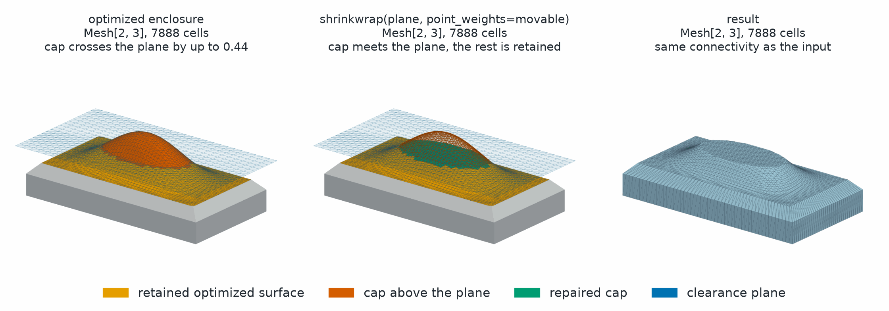
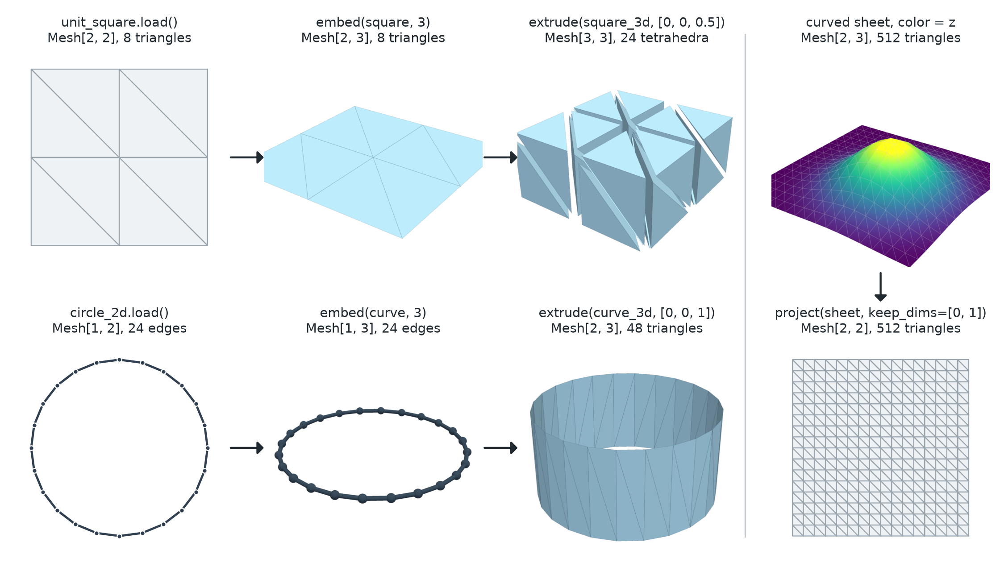

Transformations and Projections
===============================

These functions move the points of a mesh and keep its connectivity. They
cover rigid and linear transforms, six families of deformation, and
projections between spatial dimensions, and each returns a new
:class:`~physicsnemo.mesh.mesh.Mesh`.

:bdg-success:`CPU and GPU` :bdg-info:`autograd` :bdg-secondary:`any dimension`
:bdg-warning:`rotate in 2D and 3D` :bdg-warning:`shrinkwrap in 3D only`

         show a noisy dense displacement, the same displacement smoothed with
         a fixed boundary, and one orange handle that lifts a round patch.
         Then a sheet with one lifted handle and five green anchors, four at
         the corners and one below the front edge. Last, a sheet bent by a
         gray control lattice, and a sheet wrapped onto a curved surface.
   :align: center
   :width: 100%

   Six ways to deform one sheet. Each keeps the connectivity and moves only
   the points.

The most-used functions are the following:

.. grid:: 1 2 4 4
   :gutter: 2

   .. grid-item-card:: rotate
      :link: physicsnemo.mesh.transformations.geometric.rotate
      :link-type: any
      :shadow: md
      :class-card: sd-card-hover

      Rotate the points, and optionally the vector and tensor fields.

   .. grid-item-card:: morph
      :link: mesh-transform-morph
      :link-type: ref
      :shadow: md
      :class-card: sd-card-hover

      Move a few handles, and the rest of the mesh follows.

   .. grid-item-card:: sobolev_deform
      :link: mesh-transform-sobolev
      :link-type: ref
      :shadow: md
      :class-card: sd-card-hover

      Smooth a raw displacement before it moves the mesh.

   .. grid-item-card:: extrude
      :link: physicsnemo.mesh.projections.extrude
      :link-type: any
      :shadow: md
      :class-card: sd-card-hover

      Sweep a mesh into one more manifold dimension.

Example
-------

Each transformation is both a ``Mesh`` method and a function. The two forms
give the same result:

.. tab-set::

   .. tab-item:: Mesh Method

      .. code:: python

          import numpy as np
          import torch
          from physicsnemo.mesh.primitives.surfaces import sphere_icosahedral

          mesh = sphere_icosahedral.load(subdivisions=3)

          translated = mesh.translate([1.0, 0.0, 0.0])
          rotated = mesh.rotate(axis=[0, 0, 1], angle=np.pi / 4)
          scaled = mesh.scale(2.0)
          scaled_aniso = mesh.scale([2.0, 1.0, 0.5])
          transformed = mesh.transform(torch.eye(3) * 2)  # any linear map

   .. tab-item:: Function

      .. code:: python

          import numpy as np
          import torch
          from physicsnemo.mesh.primitives.surfaces import sphere_icosahedral
          from physicsnemo.mesh.transformations import rotate, scale, transform, translate

          mesh = sphere_icosahedral.load(subdivisions=3)

          translated = translate(mesh, [1.0, 0.0, 0.0])
          rotated = rotate(mesh, axis=[0, 0, 1], angle=np.pi / 4)
          scaled = scale(mesh, 2.0)
          scaled_aniso = scale(mesh, [2.0, 1.0, 0.5])
          transformed = transform(mesh, torch.eye(3) * 2)  # any linear map

The projections and the two matrix builders are functions only. Refer to
:doc:`deformation` for penalty energies that keep a deformation well shaped.

Geometric Transformations
-------------------------

.. currentmodule:: physicsnemo.mesh.transformations.geometric

These functions apply linear and affine transformations to mesh geometry.
Each function returns a new :class:`~physicsnemo.mesh.mesh.Mesh` with
transformed point coordinates and the same connectivity.

By default, :func:`rotate`, :func:`scale`, and :func:`transform` leave
``point_data``, ``cell_data``, and ``global_data`` unchanged. To transform
vector and tensor fields with the mesh, pass ``transform_point_data``,
``transform_cell_data``, or ``transform_global_data``. ``True`` transforms
every field. Scalar fields stay unchanged, and a field whose trailing sizes do
not all equal the spatial dimension raises ``ValueError``. When the data also
holds other channels, such as a ``(n_points, 5)`` feature array on a 3D mesh,
pass a ``dict`` of booleans that selects fields by name. For more information,
refer to :doc:`fields`. :func:`translate` does not change data.

Topology caches carry over to the new mesh. Cached cell areas, normals, and
centroids are updated from the matrix where possible. Other cached geometry,
such as curvature, is recomputed on next access.

Deformations
------------

.. currentmodule:: physicsnemo.mesh.transformations.deform

The ``deform`` namespace provides six deformation families. Each one is also
a :class:`~physicsnemo.mesh.mesh.Mesh` method, and each wraps a tensor
functional in ``physicsnemo.nn.functional``, such as
:func:`~physicsnemo.nn.functional.morph_points` for :func:`morph`.

Pick a family by what you control:

.. grid:: 1 2 3 3
   :gutter: 2

   .. grid-item-card:: Dense Displacement
      :link: mesh-transform-displace
      :link-type: ref
      :shadow: md
      :class-card: sd-card-hover

      One vector for each point, applied as given, with :func:`displace`.

   .. grid-item-card:: Sobolev-Filtered
      :link: mesh-transform-sobolev
      :link-type: ref
      :shadow: md
      :class-card: sd-card-hover

      One vector for each point, smoothed first, with :func:`sobolev_deform`.

   .. grid-item-card:: Morph
      :link: mesh-transform-morph
      :link-type: ref
      :shadow: md
      :class-card: sd-card-hover

      A few handles with compact support, with :func:`morph`.

   .. grid-item-card:: Radial Basis Function
      :link: mesh-transform-rbf
      :link-type: ref
      :shadow: md
      :class-card: sd-card-hover

      A few handles, one global field that is exact at each handle, with
      :func:`radial_basis_function_deform`.

   .. grid-item-card:: Free-Form Lattice
      :link: mesh-transform-ffd
      :link-type: ref
      :shadow: md
      :class-card: sd-card-hover

      A regular grid of control displacements, with :func:`free_form_deform`.

   .. grid-item-card:: Shrinkwrap
      :link: mesh-transform-shrinkwrap
      :link-type: ref
      :shadow: md
      :class-card: sd-card-hover

      Points moved onto a target surface, with :func:`shrinkwrap`.

Every deformation preserves connectivity and attached point, cell, global, and
domain data. These operations treat attached vector and tensor fields as
Lagrangian data and do not push them forward. They discard geometry-dependent
caches and recompute them lazily. They retain topology caches.

.. warning::

   Deformations do not detect or repair inverted, degenerate, or
   self-intersecting output cells. Call
   :meth:`~physicsnemo.mesh.mesh.Mesh.validate` or
   :meth:`~physicsnemo.mesh.domain_mesh.DomainMesh.validate` explicitly when a
   deformation could compromise validity.

.. _mesh-transform-displace:

Dense Displacement
^^^^^^^^^^^^^^^^^^

Dense displacement accepts a tensor or a point-data key, including a nested
tuple key. The operation returns a new mesh without changing ``mesh.points``.
Assigning a point-data key, as in the second example below, is a separate,
explicit mutation of the source mesh's attached data. The following example
shows both forms:

.. code:: python

    displacement = torch.zeros_like(mesh.points)
    displacement[:, 2] = 0.05
    displaced = mesh.displace(0.5 * displacement)

    # Point-data fields can drive the same operation.
    mesh.point_data["design_displacement"] = displacement
    displaced_from_data = mesh.displace("design_displacement")

.. _mesh-transform-sobolev:

Sobolev-Filtered Deformation
^^^^^^^^^^^^^^^^^^^^^^^^^^^^

:meth:`~physicsnemo.mesh.mesh.Mesh.sobolev_deform` turns a raw displacement
:math:`d` into a spatially smooth displacement :math:`u` with a discrete
Helmholtz filter. ``length_scale`` sets how far the smoothing reaches, in the
same units as ``mesh.points``. A zero length scale applies the raw displacement
exactly at unfixed vertices.

.. dropdown:: The Filter Equation

   The filter solves

   .. math::

      (M + \ell^2 K)u = M d.

   Here :math:`M=\bar m I` is a uniform vertex mass matrix scaled by the mean
   positive lumped P1 mass, and :math:`K` is the P1 stiffness matrix. The
   uniform mass makes the filter self-adjoint in standard Euclidean vertex
   coordinates, so the same operator smooths the displacement and its adjoint.
   ``length_scale`` is :math:`\ell`. Larger values suppress variation over
   longer distances. This discrete Helmholtz filter is motivated by the
   implicit formulation for node-based shape optimization studied by
   `Najian Asl and Bletzinger <https://doi.org/10.1007/s00158-023-03548-2>`_.

.. code:: python

    reference_points = mesh.points.detach()
    candidate_vertices = reference_points.clone().requires_grad_()
    raw_displacement = candidate_vertices - reference_points
    smooth = mesh.sobolev_deform(
        raw_displacement,
        length_scale=0.2,
    )

    objective = smooth.points.square().mean()
    objective.backward()
    smooth_vertex_adjoint = candidate_vertices.grad

The forward deformation is the uniform-mass discrete Helmholtz solve itself. Its
first-order implicit backward solves the matching adjoint system. Optimize
candidate vertex coordinates by subtracting fixed reference points and passing
that offset as ``raw_displacement``. The adjoint with respect to those
candidate vertices receives the same Sobolev filter. Gradients with respect to
the reference coordinates also include the geometric dependence of the
P1 stiffness and mass scale. Higher-order derivatives are not supported for a
positive length scale. Each ambient displacement component is filtered
independently.

``fixed_points`` accepts a boolean point mask or a point-data key. True entries
receive zero displacement, which imposes a homogeneous Dirichlet condition.
Other mesh boundaries use the natural homogeneous Neumann condition. With no
fixed points, constant displacements pass through to solver precision.

The Torch and Warp implementations use matrix-free preconditioned conjugate
gradients. The Warp implementation runs on CUDA and supplies an explicit
implicit-adjoint backward with an analytic geometry vector-Jacobian product.
By default, CUDA segments, triangles, and tetrahedra select Warp when it is
available. CPU meshes and higher-dimensional simplices select Torch.
``max_iterations`` and ``tolerance`` control the iterative solve. Keep the
following behavior in mind:

- The operation raises an error if either the forward or adjoint solve does
  not reach the requested tolerance.
- At positive length scales, cells must be finite, nondegenerate simplices.
- Isolated points receive their raw displacement.
- CUDA Graph capture is not supported because P1 operator assembly and solver
  diagnostics are not capture-safe.
- Both backends support ``torch.compile``.
- Warp CUDA results and point gradients can vary at roundoff between runs.

.. rubric:: Before and After

The panels show the initial objective adjoint with respect to candidate vertex
coordinates. The raw field contains checkerboard-scale oscillation. Applying
the Sobolev deformation filters that adjoint over the mesh while retaining the
fixed boundary. Both panels use the same color and arrow scale.

.. rubric:: Three-Dimensional Surface Example

The 3D figure applies the same workflow to a triangulated sheet with points
shaped ``(N, 3)``. Its objective pulls the center upward while the boundary
remains fixed. The reproducible figure source is
``docs/img/mesh/sobolev_adjoint_field_3d.py``.

The arrows show the normalized negative adjoint, which is the gradient-descent
update direction. Each panel applies that field to the sheet geometry for
visibility. The raw panel is corrugated by vertex-scale oscillations. The
Sobolev panel gives the same broad upward pull with a smooth surface. Green
points mark the fixed boundary, and both panels use one shared scale.

Sparse controls are useful when only a small set of design handles is known. A
control point is a location in world coordinates, and its control displacement
is a vector rather than a destination coordinate. Control points do not need to
be mesh vertices, although selecting vertices makes their prescribed movement
directly visible in the result.

.. _mesh-transform-morph:

Single-Control Morphing
^^^^^^^^^^^^^^^^^^^^^^^

Indexing one vertex produces a coordinate vector with shape ``(3,)``. The
``morph`` API instead expects ``(n_controls, n_spatial_dims)``, so
``unsqueeze(0)`` adds the control dimension and gives shape ``(1, 3)``. It is
not a batch dimension.

.. code:: python

    top_index = mesh.points[:, 2].argmax()
    control_points = mesh.points[top_index].unsqueeze(0)  # (1, 3)
    control_displacements = mesh.points.new_tensor(
        [[0.0, 0.0, 0.5]], requires_grad=True
    )
    single_morph = mesh.morph(
        control_points,
        control_displacements,
        radius=1.0,
    )

    # Autograd continues through the returned point coordinates.
    objective = single_morph.points.square().mean()
    objective.backward()

``control_displacements`` is differentiable. An optimizer can learn it from any
differentiable loss computed from ``single_morph.points``. A model can also
predict the displacements.

Without point weights, a mesh vertex exactly at a unique control moves by its
prescribed displacement. ``point_weights`` can scale or mask the final movement.
Duplicate controls at the same coordinate contribute their mean displacement.

Multiple-Control Morphing
^^^^^^^^^^^^^^^^^^^^^^^^^

Advanced indexing retains the control dimension when several vertices are
selected. Each row of ``control_points`` pairs with the same row of
``control_displacements`` and, when supplied, one entry of ``radius``.

.. code:: python

    bottom_index = mesh.points[:, 2].argmin()
    control_indices = torch.stack((top_index, bottom_index))
    control_points = mesh.points[control_indices]  # (2, 3)
    control_displacements = mesh.points.new_tensor(
        [[0.0, 0.0, 0.5], [0.0, 0.0, -0.5]]
    )
    radii = mesh.points.new_tensor([1.0, 1.0])

    multiple_morph = mesh.morph(
        control_points,
        control_displacements,
        radius=radii,
    )

The radius is a Euclidean support distance in the same coordinate units as the
mesh. A control's influence vanishes smoothly at its support boundary. Where
supports overlap, all active controls are evaluated together using a stationary
zero-displacement background. The result is not a simple sum or average. Points
outside every support remain unchanged. Put simultaneous controls in one call,
because applying several morphs sequentially evaluates later fields on already
modified coordinates and is therefore order-dependent.

The ``kernel`` keyword names the compact radial kernel used by the field.
``"wendland_c2"`` is currently the supported value and the default.

Every tensor-valued radius must remain finite and strictly positive. Its values
are not validated at runtime. When a model learns the radius, use a positive
parameterization such as
``torch.nn.functional.softplus(raw_radius) + radius_epsilon`` rather than
optimizing an unconstrained radius directly. Floating ``point_weights`` are
used as supplied and can be signed or greater than one.

.. rubric:: Visualization

The panels compare the original sphere with the single-control and
multiple-control examples above. Orange markers identify the displaced handle
locations. Arrows show the prescribed displacement directions, and the panel
titles give their magnitudes.

.. _mesh-transform-rbf:

Global Radial-Basis Deformation
^^^^^^^^^^^^^^^^^^^^^^^^^^^^^^^

Radial basis function (RBF) deformation fits one global displacement field
through sparse handles. With zero smoothing and a nonsingular control layout,
the fitted field interpolates each prescribed control displacement up to
solver precision.
Optional point weights are applied after interpolation. Unlike compact Shepard
morphing, every control generally influences every point. Fixed controls are
therefore useful as anchors.

The standard affine polynomial tail reproduces affine displacement fields. The
controls must affinely span the coordinate space. In 3D, for example, they must
not all lie in one plane. The augmented system must also be nonsingular. This formulation follows the thin-plate-spline interpolant
described by Bookstein [1].

[1] F. L. Bookstein, `"Principal warps: thin-plate splines and the decomposition
of deformations" <https://doi.org/10.1109/34.24792>`_, IEEE Transactions on
Pattern Analysis and Machine Intelligence, vol. 11, no. 6, pp. 567–585, 1989.

.. rubric:: Two-Dimensional Example

A mesh with ``n_spatial_dims=2`` requires at least three non-collinear controls
when the affine tail is enabled. The following example fixes the four corners
of a triangulated square and moves a fifth handle at the midpoint of its upper
edge:

.. code:: python

    import torch
    from physicsnemo.mesh.primitives.planar import unit_square

    mesh_2d = unit_square.load(subdivisions=4)
    controls_2d = mesh_2d.points.new_tensor(
        [[0.0, 0.0], [1.0, 0.0], [1.0, 1.0], [0.0, 1.0], [0.5, 1.0]]
    )
    displacements_2d = torch.zeros_like(controls_2d)
    displacements_2d[-1] = controls_2d.new_tensor([0.15, 0.35])

    deformed_2d = mesh_2d.radial_basis_function_deform(
        controls_2d,
        displacements_2d,
        kernel="thin_plate_spline",
        polynomial=True,
        smoothing=0.0,
    )

    handle_index = torch.linalg.vector_norm(
        mesh_2d.points - controls_2d[-1], dim=1
    ).argmin()
    torch.testing.assert_close(
        deformed_2d.points[handle_index],
        controls_2d[-1] + displacements_2d[-1],
        atol=2.0e-5,
        rtol=2.0e-5,
    )

The corner controls remain fixed while the upper edge and interior deform
smoothly. The hollow orange marker in the output panel shows the handle's source
position.

.. rubric:: Three-Dimensional Example

In three dimensions, the affine tail requires at least four controls spanning
the coordinate space. Practical layouts usually use more. The following
sphere example uses its six axis-extreme vertices as controls:

.. code:: python

    control_indices = torch.stack(
        (
            mesh.points[:, 2].argmax(),
            mesh.points[:, 2].argmin(),
            mesh.points[:, 0].argmax(),
            mesh.points[:, 0].argmin(),
            mesh.points[:, 1].argmax(),
            mesh.points[:, 1].argmin(),
        )
    )
    rbf_controls = mesh.points[control_indices]
    rbf_displacements = torch.zeros_like(rbf_controls)
    rbf_displacements[0, 2] = 0.55

    exact_rbf = mesh.radial_basis_function_deform(
        rbf_controls,
        rbf_displacements,
        kernel="thin_plate_spline",
        polynomial=True,
        smoothing=0.0,
    )

    torch.testing.assert_close(
        exact_rbf.points[control_indices],
        rbf_controls + rbf_displacements,
        atol=2.0e-5,
        rtol=2.0e-5,
    )

``smoothing=0.0`` interpolates the controls up to solver precision. A positive
smoothing value adds diagonal regularization. This relaxes
interpolation accuracy.

Both evaluation backends use PyTorch for the dense coefficient solve. The Warp
backend fuses evaluation over the mesh points without materializing its full
kernel matrix between points and controls.

Green controls are fixed anchors. Orange controls mark moved handles, and the
arrows show their displacement directions. The panel titles give the prescribed
magnitudes. With zero smoothing, the deformed surfaces interpolate all six
control displacements up to solver precision.

.. _mesh-transform-ffd:

Lattice Free-Form Deformation
^^^^^^^^^^^^^^^^^^^^^^^^^^^^^

:meth:`~physicsnemo.mesh.mesh.Mesh.free_form_deform` defines a regular array of
control displacements over an axis-aligned evaluation box and deforms every
point inside the box by tensor-product basis interpolation.
Compared with sparse morphing, the design parameters form a structured grid of
fixed size, which suits parametric shape optimization. A lattice of zeros is
exactly the identity, and the same lattice deforms any geometry embedded in
the box.

When ``origin`` and ``extent`` are omitted, the box spans the mesh bounds. Each
coordinate axis must have positive range. Planar or linear geometry embedded
in a higher-dimensional space therefore needs an explicit positive extent.
Validating an automatically derived extent synchronizes with the device and is
not CUDA Graph capture-safe. For capture, pass both ``origin`` and ``extent``
as device tensors.

The ``basis`` argument accepts the following options:

- ``basis="bernstein"`` provides classic global-support free-form deformation
  for coarse lattices.
- ``basis="bspline"`` provides local support of four nodes along each axis and
  scales to fine lattices for local sculpting. Its first and last coefficient planes lie
  one knot spacing outside the evaluation box.
- ``basis="linear"``, ``"cubic_hermite"``, and ``"quintic_hermite"`` instead
  use the two neighboring nodes for each axis and reproduce every control
  displacement at its lattice node.

For a local cell coordinate :math:`t`, the upper-node weights of these three
node-interpolating bases are
:math:`t`, :math:`3t^2-2t^3` (cubic Hermite), and
:math:`6t^5-15t^4+10t^3` (quintic Hermite), respectively. The lower-node
weight is one minus the upper-node weight. The resulting fields are C0, C1,
and C2 across cell boundaries, respectively. Perlin introduced the quintic
blend in `Improving Noise <https://doi.org/10.1145/566654.566636>`_ to
eliminate the cubic blend's second-derivative discontinuities.

.. code:: python

    # A 4x4x4 Bernstein lattice spans the mesh bounds.
    # Zero displacements start at the identity.
    control_displacements = torch.zeros(4, 4, 4, 3, requires_grad=True)
    deformed = mesh.free_form_deform(control_displacements)

    # Autograd continues through the returned point coordinates.
    objective = deformed.points.square().mean()
    objective.backward()

Points outside the lattice box are unchanged. The deformation is generally not
continuous across the box boundary. A sufficient condition for a fixed
exterior is to zero the outermost coefficient plane on every Bernstein or
node-interpolating face. For cubic B-splines, zero the first and last three
coefficient planes on every axis. ``origin`` and ``extent`` are
non-differentiable lattice parameters. Optimize ``control_displacements``
instead.

.. rubric:: Visualization

The panels compare the original sphere with two lattice deformations. A coarse
Bernstein lattice tapers the whole sphere because every node acts globally.
In a finer cubic B-spline lattice, three independently displaced regions
produce two local bulges and a local indentation.

.. _mesh-transform-shrinkwrap:

Nearest-Surface Shrinkwrap
^^^^^^^^^^^^^^^^^^^^^^^^^^

:meth:`~physicsnemo.mesh.mesh.Mesh.shrinkwrap` projects source vertices to
their closest points on a triangle target. An optional signed ``offset`` keeps
the result a specified distance from the target along its oriented face
normals. ``point_weights`` can fix selected vertices or apply a partial
projection. ``max_distance`` leaves vertices unchanged when no target surface
is close enough.

The following example projects a lifted sheet onto a flat target and keeps
one edge of the sheet fixed:

.. code:: python

    from physicsnemo.mesh.primitives.surfaces import plane

    panel_target = plane.load(size=2.0, subdivisions=10)  # the z = 0 plane
    source = plane.load(size=2.0, subdivisions=8)
    lift = 0.2 * (1.0 - source.points[:, 0].square())
    source = source.with_points(source.points + lift[:, None] * source.points.new_tensor([0.0, 0.0, 1.0]))

    movable = source.points[:, 0] > -0.9  # the edge at x = -1 stays fixed
    conformed = source.shrinkwrap(
        panel_target,
        point_weights=movable,
        max_distance=0.34,
    )
    print(conformed.points[movable, 2].abs().max())  # tensor(0.): on the target

The figure shows the same call on a curved panel.
The figure's example constructs a swept triangle panel and adds a smooth
springback error to form the source sheet. The boolean ``movable`` mask keeps its green
root attachment strip fixed. The movable vertices lie on the target surface.
Color shows how far each source vertex moved.

Nearest-face selection and closest-feature changes are discrete. With those
choices fixed, gradients propagate through the following inputs:

- Source points
- Selected target vertices
- Floating-point weights
- A tensor-valued ``offset``

At a shared edge or vertex, adjacent faces can provide different normals. Use
consistently oriented target faces and avoid placing offset-sensitive samples
exactly on shared features.

The source points and the target must be in 3D. Torch provides the reference
search. By default (``implementation=None``), shrinkwrap searches with Torch
on CPU and with Warp on CUDA when Warp is available.
``implementation="warp"`` also runs on CPU. Both backends replay the selected
point-to-triangle projection with PyTorch in the input dtype.
Shrinkwrap is available on :class:`~physicsnemo.mesh.mesh.Mesh`, not
:class:`~physicsnemo.mesh.domain_mesh.DomainMesh`, because one source mesh is
projected onto one target surface.

``float64`` targets use the Torch search because Warp searches in
``float32``. Safe ``float32`` coordinates are searched unchanged. Warp falls
back to Torch for unsafe coordinate magnitudes or face geometry.

Shrinkwrap performs data-dependent validation and nearest-face search setup.
CUDA executions with either backend are not supported inside CUDA Graph
capture.

.. rubric:: Shape-Optimization Constraint Example

In shape optimization, an otherwise acceptable design iterate can locally
cross an admissible clearance surface. This example constructs a closed
triangulated low-profile enclosure with an inset lid and chamfered walls. A
boolean mask selects only the vertices above a horizontal clearance plane.
The central call has this form, here with the sheet and plane from the
previous example:

.. code:: python

    candidate, admissible_envelope = source, panel_target
    design_region = candidate.points[:, 2] > 0.0  # vertices above the z = 0 limit
    feasible = candidate.shrinkwrap(
        admissible_envelope,
        point_weights=design_region,
    )

Before repair, a smooth orange dome protrudes through the blue clearance plane
while the broad gold lid deformation remains admissible. Shrinkwrap projects
only the violating vertices back to the limit. After repair, the cap is green,
the gold optimized surface is retained, and an orange wire outline marks the
former excess.

All connectivity is triangular. The example checks the following properties:

- The repaired-cap residual
- Exact preservation of admissible vertices
- Closed two-manifold source and result connectivity
- Consistent winding
- Positive enclosed volume
- Adjoints
- Agreement between Torch and Warp

Shrinkwrap restores this geometric constraint. It does not run the optimizer
or guarantee valid cells for arbitrary inputs.

.. _mesh-transform-domain:

Domain Meshes
^^^^^^^^^^^^^

:meth:`~physicsnemo.mesh.domain_mesh.DomainMesh.morph` evaluates one
world-coordinate control field on the interior and every named boundary. With
``point_weights=None``, coincident component points receive identical motion.
Domain point weights must instead be a point-data key, or a nested tuple key,
present in every component. The method rejects raw weight tensors because
component point counts can differ. Every resolved field must use one common dtype across
the domain: ``bool`` for a hard mask, or the same floating dtype as the mesh
points. Coincident points remain coincident under a point-weight key only when
their resolved values also match.

:meth:`~physicsnemo.mesh.domain_mesh.DomainMesh.radial_basis_function_deform`
follows the same component and point-weight rules while fitting one global RBF
field. It solves the coefficient system once and evaluates the combined
interior and boundary points together before it rebuilds the component meshes.
The following example morphs a domain with a point-weight key:

.. code:: python

    import torch
    from physicsnemo.mesh import DomainMesh, Mesh

    interior = Mesh(
        points=torch.tensor([[0.0, 0.0], [1.0, 0.0], [0.0, 1.0]]),
        cells=torch.tensor([[0, 1, 2]]),
        point_data={"design_weight": torch.tensor([1.0, 0.8, 0.5])},
    )
    wall = Mesh(
        points=interior.points[:2],
        cells=torch.tensor([[0, 1]]),
        point_data={"design_weight": torch.tensor([1.0, 0.8])},
    )
    domain = DomainMesh(interior=interior, boundaries={"wall": wall})

    domain_controls = interior.points[[0]]  # (1, 2)
    domain_displacements = interior.points.new_tensor([[0.0, 0.25]])
    morphed_domain = domain.morph(
        domain_controls,
        domain_displacements,
        radius=1.25,
        point_weights="design_weight",
        implementation="torch",
    )

    # Equal point weights keep the shared wall vertices coincident.
    assert torch.allclose(
        morphed_domain.interior.points[:2],
        morphed_domain.boundaries["wall"].points,
    )

:meth:`~physicsnemo.mesh.domain_mesh.DomainMesh.free_form_deform` follows the
same pattern for lattice free-form deformation:

- The operation evaluates one lattice field over the combined interior and
  boundary points.
- The default box spans the combined component bounds.

The combined bounds must have positive range on every coordinate axis unless
you supply an explicit extent.

For optimization-time geometric penalties on a fixed topology, refer to
:doc:`deformation`.

Projections
-----------

These functions change the spatial dimension of a mesh, or extrude it into a
mesh one manifold dimension higher:

- :func:`~physicsnemo.mesh.projections.embed`: add spatial dimensions without loss, for example from 2D to
  3D by appending zero coordinates.
- :func:`~physicsnemo.mesh.projections.extrude`: sweep each cell along a vector into a prism, and split the
  prism into simplices. A triangle mesh becomes a tetrahedral mesh.
- :func:`~physicsnemo.mesh.projections.project`: remove spatial dimensions by dropping coordinate axes.
  This loses information.

The following example embeds a square in 3D, extrudes it into tetrahedra,
and projects it back to 2D:

.. code:: python

    from physicsnemo.mesh.primitives.planar import unit_square
    from physicsnemo.mesh.projections import embed, extrude, project

    square = unit_square.load(subdivisions=2)  # triangles in 2D
    in_3d = embed(square, target_n_spatial_dims=3)  # z = 0
    prism = extrude(in_3d, vector=[0.0, 0.0, 1.0])  # tetrahedra in 3D
    flat = project(in_3d, target_n_spatial_dims=2)  # drops z
    print(in_3d.n_spatial_dims, prism.n_manifold_dims, flat.n_spatial_dims)  # 3 3 2

         flat square of eight triangles, Mesh[2, 2], then the same square
         tilted in 3D, Mesh[2, 3], then a slab of 24 separated tetrahedra,
         Mesh[3, 3]. The bottom row shows a circle of 24 edges, Mesh[1, 2],
         and the same circle tilted in 3D, Mesh[1, 3]. Last comes an open
         cylinder of 48 triangles, Mesh[2, 3]. The right column sits behind a
         thin divider. In it, a bumpy sheet colored by height, Mesh[2, 3],
         points down to a flat uncolored grid of the same 512 triangles,
         Mesh[2, 2].
   :align: center
   :width: 100%

   ``embed``, ``extrude``, and ``project`` change the two numbers of
   ``Mesh[m, s]``. ``embed`` raises ``s``, ``extrude`` raises ``m`` by one,
   and ``project`` lowers ``s``. Only ``project`` loses information.

Summary
-------

.. currentmodule:: None

.. rubric:: Geometric Transformations

.. autosummary::
   :nosignatures:

   ~physicsnemo.mesh.transformations.geometric.translate
   ~physicsnemo.mesh.transformations.geometric.rotate
   ~physicsnemo.mesh.transformations.geometric.scale
   ~physicsnemo.mesh.transformations.geometric.transform
   ~physicsnemo.mesh.transformations.geometric.rotation_matrix
   ~physicsnemo.mesh.transformations.geometric.scale_matrix

.. rubric:: Deformations

.. autosummary::
   :nosignatures:

   ~physicsnemo.mesh.transformations.deform.displace
   ~physicsnemo.mesh.transformations.deform.sobolev_deform
   ~physicsnemo.mesh.transformations.deform.morph
   ~physicsnemo.mesh.transformations.deform.radial_basis_function_deform
   ~physicsnemo.mesh.transformations.deform.free_form_deform
   ~physicsnemo.mesh.transformations.deform.shrinkwrap

.. rubric:: Projections

.. autosummary::
   :nosignatures:

   ~physicsnemo.mesh.projections.embed
   ~physicsnemo.mesh.projections.extrude
   ~physicsnemo.mesh.projections.project

Related Topics
--------------

For more information, refer to the following resources:

- :doc:`deformation` for penalty energies that keep a deformation well shaped.
- :doc:`fields` for the transformation laws of vector and tensor fields.
- Tutorial: `Mesh Operations
  <https://github.com/NVIDIA/physicsnemo/blob/main/examples/minimal/mesh/tutorial_4_operations.ipynb>`_

API Reference
-------------

Geometric Transformations
^^^^^^^^^^^^^^^^^^^^^^^^^

.. currentmodule:: physicsnemo.mesh.transformations.geometric

.. autofunction:: translate

.. autofunction:: rotate

.. autofunction:: scale

.. autofunction:: transform

.. autofunction:: rotation_matrix

.. autofunction:: scale_matrix

Deformations
^^^^^^^^^^^^

.. currentmodule:: physicsnemo.mesh.transformations.deform

.. autofunction:: displace

.. autofunction:: sobolev_deform

.. autofunction:: morph

.. autofunction:: radial_basis_function_deform

.. autofunction:: free_form_deform

.. autofunction:: shrinkwrap

Projections
^^^^^^^^^^^

.. currentmodule:: physicsnemo.mesh.projections

.. autofunction:: embed

.. autofunction:: extrude

.. autofunction:: project
