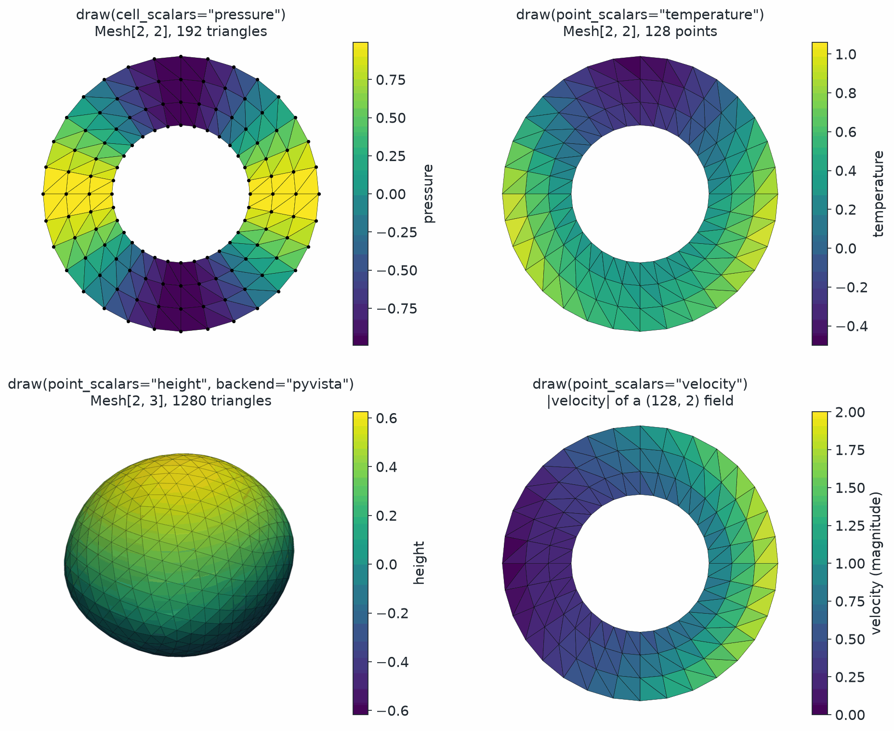

Visualization
=============

.. currentmodule:: physicsnemo.mesh.visualization

``physicsnemo.mesh.visualization`` draws a mesh and its scalar data with one
call, :func:`draw`, which is also the ``mesh.draw()`` method. It returns a
Matplotlib ``Axes`` or a PyVista ``Plotter`` that you can keep drawing on.

:bdg-secondary:`Matplotlib` :bdg-secondary:`PyVista` :bdg-warning:`at most three spatial dimensions`

         by a cell field named pressure. Top right, the same ring colored by a
         point field named temperature. Bottom left, a shaded lumpy sphere
         drawn by PyVista and colored by height. Bottom right, the ring colored
         by the magnitude of a two-component velocity field. Each panel has a
         viridis colorbar and a title with the draw call.
   :align: center
   :width: 65%

   ``mesh.draw()`` picks Matplotlib for meshes in 2D space and PyVista in 3D
   space. It colors cells or points by a stored field, and it colors a vector
   field by its norm.

.. rubric:: Most Used

.. grid:: 1 1 2 2
   :gutter: 2

   .. grid-item-card:: Draw a Mesh
      :link: physicsnemo.mesh.visualization.draw
      :link-type: any
      :shadow: md
      :class-card: sd-card-hover

      ``mesh.draw(point_scalars="T")`` colors the mesh by a field and shows
      it.

   .. grid-item-card:: Custom Rendering
      :link: physicsnemo.mesh.io.to_pyvista
      :link-type: any
      :shadow: md
      :class-card: sd-card-hover

      ``to_pyvista(mesh)`` exports the mesh for full control of a PyVista
      scene.

Example
-------

The following example draws a planar mesh and a surface:

.. code:: python

    from physicsnemo.mesh.primitives.planar import unit_square
    from physicsnemo.mesh.primitives.surfaces import sphere_icosahedral

    # A planar mesh selects Matplotlib. The call returns its Axes.
    square = unit_square.load(subdivisions=3)
    square.point_data["x"] = square.points[:, 0]
    ax = square.draw(point_scalars="x", show=False)

    # A surface in 3D selects PyVista. The call returns its Plotter.
    sphere = sphere_icosahedral.load(subdivisions=2)
    sphere.point_data["height"] = sphere.points[:, 2]
    plotter = sphere.draw(point_scalars="height", show_edges=True, show=False)

    # The standalone function is the same operation.
    from physicsnemo.mesh.visualization import draw

    ax = draw(sphere, backend="matplotlib", point_scalars="height", show=False)

With ``show=False``, :func:`draw` returns the Matplotlib ``Axes`` or the
PyVista ``Plotter`` without showing it. Pass it back as ``ax`` to draw
several meshes in one scene. ``backend_options`` passes keyword arguments to
PyVista's ``Plotter.add_mesh``. Matplotlib ignores them with a warning.

Pass ``point_scalars`` or ``cell_scalars``, but not both, to color the mesh by
a field. Each one accepts a tensor or a key of ``point_data`` or
``cell_data``. For a vector or tensor field, :func:`draw` colors by the L2
norm of the trailing dimensions.

Choosing a Backend
------------------

:func:`draw` has two backends:

.. list-table::
   :header-rows: 1
   :widths: 20 45 35

   * - Backend
     - Draws
     - Selected by ``backend="auto"`` for
   * - Matplotlib
     - Static 2D plots, and 3D plots through ``mplot3d``. It draws a volume
       mesh as its boundary surface.
     - Meshes with two or fewer spatial dimensions
   * - PyVista
     - Interactive 3D scenes with the Visualization Toolkit (VTK)
     - Meshes in 3D

``backend="auto"``, the default, selects the backend from the spatial
dimension of the mesh only. If the preferred backend is not installed, it uses
the other one. To choose a backend, pass ``backend="matplotlib"`` or
``backend="pyvista"``.

.. note::

   ``draw_mesh`` is a compatibility name for :func:`draw`. It is pending
   deprecation.

Summary
-------

.. autosummary::
   :nosignatures:

   draw
   draw_mesh

Related Topics
--------------

For more information, refer to the following resources:

- Tutorial: `Getting Started
  <https://github.com/NVIDIA/physicsnemo/blob/main/examples/minimal/mesh/tutorial_1_getting_started.ipynb>`_
- :doc:`io` to export a mesh to PyVista for custom rendering.

API Reference
-------------

.. autofunction:: draw

.. autofunction:: draw_mesh
