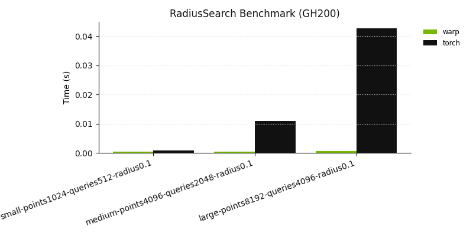

Neighbor Functionals
====================

KNN
---

.. autofunction:: physicsnemo.nn.functional.knn

Radius Search
-------------

.. autofunction:: physicsnemo.nn.functional.radius_search

.. rubric:: Benchmarks (ASV)

Static Neighborhoods
--------------------

Reference neighborhoods computed once per mesh (geodesic or Euclidean k nearest
neighbours on the undeformed geometry) for neighborhood attention and local
message passing.

.. autoclass:: physicsnemo.nn.functional.neighbors.static_knn.StaticNeighborhood

.. autofunction:: physicsnemo.nn.functional.neighbors.static_knn.static_knn

.. autofunction:: physicsnemo.nn.functional.neighbors.static_knn.geodesic_knn

.. autofunction:: physicsnemo.nn.functional.neighbors.static_knn.euclidean_knn
