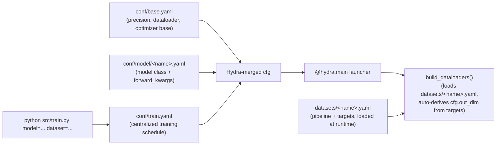

<!-- markdownlint-disable -->
# Unified External Aerodynamics Recipe

## Introduction

External aerodynamics recipes in PhysicsNeMo have proliferated: we have
a number of recipes, across a range of models, all working on different models
with unique data handling, pipelines, model architectures, metrics, training
paradigms, etc.  While there is nothing wrong with that, it does make comparison
challenging and development of new models somewhat challenging.  In this folder,
we have unified the external aerodynamic recipes for our best models, including
GLOBE (our newest model, designed for large 3D use cases).

Here, you're able to train (and run inference with) the following models:
- [DoMINO](https://arxiv.org/abs/2501.13350) coming soon
- [Transolver](https://arxiv.org/abs/2402.02366)
- [GeoTransolver](https://arxiv.org/abs/2512.20399), optionally using the [FLARE](https://arxiv.org/abs/2508.12594) attention mechanism backend
- [SMART](https://arxiv.org/abs/2601.18707) (experimental, separate surface/volume models)
- [GLOBE](https://arxiv.org/abs/2511.15856)
- [AB-UPT](https://arxiv.org/abs/2502.09692v4) (experimental; surface, volume, or joint)

We currently support the following datasets:
- DrivaerML

Support for these datasets is coming imminently, with pre-processing support from
PhysicsNeMo-Curator:
- ShiftSUV Estate
- ShiftSUV Fastback
- ShiftWING
- HiftliftAeroML

## Dataset Handling

The pipeline non-dimensionalizes raw fields to unitless model inputs
(see the YAML configs in `datasets/`). Per-sample reference freestream
conditions (`U_inf`, `rho_inf`, `p_inf`, ...) live in each file's
`global_data` and are read by `MeshReaderWithGlobalData`. Because the
datasets are non-dimensionalized and loaded through the PhysicsNeMo
datapipes' `MultiDataset` abstraction, you can merge directory- and
manifest-split datasets on the fly for multi-dataset training. Manifest
indices are resolved within each dataset and shifted into the combined
index space before sampling. Non-dimensionalization itself is the
`NonDimensionalizeByMetadata` transform in `src/nondim.py`.

## Quick start

```bash
cd examples/cfd/external_aerodynamics/unified_external_aero_recipe

# 1. Train (single GPU, default model + dataset = GeoTransolver / DrivAerML volume)
python src/train.py

# 1b. Pick a different model and/or dataset on the CLI
python src/train.py model=transolver_surface dataset=drivaer_ml_surface

# 1c. Train (multi-GPU)
torchrun --nproc_per_node=N src/train.py

# 2. Override any config value
python src/train.py precision=bfloat16 training.num_epochs=100

# 3. Run inference on a trained checkpoint
#    (writes physical-unit .pdmsh predictions + CD/CL/CM for surface cases)
python src/infer.py model=geotransolver_surface dataset=highlift_surface \
    run_id=<the trained run_id> infer_split=test
```

For the canonical CLI invocations of every named recipe (FA variants,
SMART, AB-UPT, GLOBE, multi-dataset Transolver, HiLift, DoMINO), see the
[Recipe Gallery](#recipe-gallery) section below.

## Pipeline architecture

Each dataset gets its own `MeshDataset` / `DomainMeshDataset` with an
ordered chain of `MeshTransform` steps defined in YAML; multiple
datasets are merged via `MultiDataset`. The pipeline is
**DomainMesh-native end-to-end**: every dataset YAML produces a
`DomainMesh` (see the
[DomainMesh contract](#domainmesh-contract-and-the-data-to-model-mapping)),
and each model YAML's `forward_kwargs:` block declaratively maps
DomainMesh paths into the model's `forward()` kwargs. The recipe collate
either passes those values through (mesh-native models like GLOBE) or
batch-wraps them into `(B, N, C)` tensors (transformer-style models).
Section 5 of the [PhysicsNeMo-Mesh paper](https://arxiv.org/abs/2610.39072)
describes this design, with one stored DrivAerML dataset feeding Transolver,
GeoTransolver, and GLOBE.

```mermaid
flowchart LR
    pdmsh[".pdmsh on disk"] --> Reader["MeshReader / DomainMeshReader"]
    Reader --> Pipeline["mesh transforms (DropMeshFields, CenterMesh, NonDim, Rename, Normalize, ComputeSurfaceNormals, SubsampleMesh, ...)"]
    Pipeline --> Term["MeshToDomainMesh (surface only; volume already produces DomainMesh natively)"]
    Term --> Multi["MultiDataset (optional; concatenates samples across datasets)"]
    Multi --> Collate["build_collate_fn(input_type, forward_kwargs_spec, target_config)"]
    Collate --> Branch{"input_type?"}
    Branch -- mesh --> mk["forward_kwargs as Mesh / dict / scalar tensors (no batch dim)"]
    Branch -- tensors --> tk["forward_kwargs as batched tensors (1, N, C)"]
    mk --> Model["model.forward(**kwargs)"]
    tk --> Model
    Model --> Out{"output_type?"}
    Out -- mesh --> mout["Mesh.point_data"]
    Out -- tensors --> tout["(1, N, C) tensor"]
    mout --> Norm["normalize to TensorDict[name -> Tensor]"]
    tout --> Norm
    Norm --> Loss["LossCalculator + MetricCalculator (TensorDict interface; optional field_weights)"]
```



### Why each step exists

- **Freestream conditions on `global_data`** — Each sample's freestream
  conditions (`U_inf`, `rho_inf`, `p_inf`, `nu`, `L_ref`, and `T_inf`
  for compressible datasets) are embedded at the **domain level** of each
  `.pdmsh` / `.pmsh` at conversion time, so transforms like
  `NonDimensionalizeByMetadata` read them straight off the loaded sample.
  Surface configs read a boundary `Mesh` whose own `global_data` is
  typically empty, so they use the recipe-local
  `MeshReaderWithGlobalData` to merge the domain-level `global_data` onto
  each boundary at load time. See [Design decisions](#design-decisions)
  for the rationale.

- **DropMeshFields** — Removes fields that are not needed for training
  (e.g. `TimeValue` in DrivaerML) to reduce memory and avoid schema
  mismatches when merging datasets.

- **CenterMesh** — Centers each geometry at the origin so that
  rotations happen around a sensible point.  DrivaerML uses point-mean
  centering (`use_area_weighting: false`); SHIFT SUV uses area-weighted
  cell centroid centering (`use_area_weighting: true`).

- **RandomRotateMesh / RandomTranslateMesh** — Data augmentation,
  defined in the `augmentations:` block of each dataset config and
  activated at runtime by setting `augment: true` (default `false`).
  Augmentations are inserted after `CenterMesh` by the dataset builder.
  Rotation is restricted to the vertical axis.  Translation is restricted
  to horizontal axes by setting the vertical component of the offset
  distribution to zero (`low == high`), which needs
  `validate_args: false` on the `Uniform`.

- **NonDimensionalizeByMetadata** — Converts raw physical fields into
  non-dimensional coefficients using the per-sample freestream
  conditions stored on `metadata`:
    - Pressure → Cp: `(p - p_inf) / q_inf` where `q_inf = 0.5 * rho_inf * |U_inf|²`
    - Wall shear stress → Cf: `tau / q_inf`
    - Velocity → `U / |U_inf|`

  Also supports temperature, density, and identity (pass-through) field
  types, and provides an `inverse()` for re-dimensionalizing predictions.
  When `L_ref` is in `global_data` the mesh coordinates are divided by it
  as well, once per instance: a chain that needs a second instance (say
  interior `point_data` fields first, boundary `cell_data` fields second)
  sets `scale_geometry: false` on the second one.
  Input points are non-dimensionalized by a single reference scalar
  `L_ref` (rather than scaling x/y/z independently) so geometry aspect
  ratios are preserved.

- **ComputeSDFFromBoundary** — Volume pipelines only.  Computes a
  signed distance field (and surface normals) from an auxiliary STL
  boundary mesh loaded via the reader's `extra_boundaries` option.
  The SDF and normals are stored into `point_data` and used as
  geometry-aware input features for the model.

- **DropBoundary** — Removes the auxiliary STL boundary mesh after
  `ComputeSDFFromBoundary` has consumed it, keeping only the interior
  volume and the original surface boundary.

- **RenameMeshFields** — Maps dataset-specific field names to canonical
  names (`pressure`, `wss`, `velocity`, etc.) so all downstream code
  uses a single naming convention.

- **NormalizeMeshFields** — Applies z-score normalization using
  inline statistics declared in the YAML config or loaded from a `.pt`
  file.  Handles scalar and vector fields differently.  The normalization
  stats are saved alongside model checkpoints for use at inference time.

  Note that not all fields are normalized, in fact most are not.  Only fields
  that are particularly far from unit mean or standard deviation are normalized.

- **ComputeSurfaceNormals** — Computes per-cell (or per-point) surface
  normals from the mesh connectivity.  Used in surface pipelines to
  provide normal vectors as part of the model's local embedding.

- **SubsampleMesh** — Randomly downsamples each mesh to a fixed size
  (controlled by `sampling_resolution` in the training config) so that
  samples can be batched.  Different samples in the same dataset get
  different random subsets each epoch.

- **MeshToDomainMesh** — Terminal transform for surface dataset YAMLs
  (volume YAMLs already produce a `DomainMesh` natively via
  `DomainMeshReader`). Converts the surface `Mesh` into a
  `DomainMesh(interior, boundaries={"vehicle": ...}, global_data)` per
  the prediction-vs-input contract described under
  [DomainMesh contract](#domainmesh-contract-and-the-data-to-model-mapping).
  The dataset builder auto-injects `cell_data_targets` from the YAML's
  `targets:` block, so users don't list field names twice.

## Model and training

The default model is **GeoTransolver**, a transformer-based architecture
for point-cloud regression that uses multi-scale local attention with
geometric embeddings.

### Default settings (GeoTransolver automotive surface)

| Setting | Default |
|---|---|
| Model | `GeoTransolver` (12 layers, 256 hidden, 8 heads) |
| Attention type | `GALE` (also supports `GALE_FA` for FLARE-based self-attention) |
| State mixing | `weighted` (learnable sigmoid gate; also supports `concat_project`) |
| Input | Cell centroids (N×3) + surface normals (N×3) + freestream velocity (1×3) |
| Output | Pressure (1) + wall shear stress (3) = 4 channels |
| Loss | Huber (smooth L1), normalized by total channels |
| Optimizer | Muon (2D params) + AdamW (other params) |
| Scheduler | StepLR (step=100, gamma=0.1) |
| Precision | bfloat16 (float16/float32 also supported) |
| Batch size | 1 |

### DomainMesh contract and the data-to-model mapping

Each dataset YAML's pipeline produces a [`DomainMesh`](../../../../physicsnemo/mesh/domain_mesh.py)
that follows a simple semantic contract:

- **`interior`** — answers "where should the output be?". For surface
  configs this is a `Mesh[0, 3]` point cloud at the cell centroids of
  the (subsampled) car body surface; for volume configs it's the volume
  mesh's interior points. Prediction targets live in
  `interior.point_data` and are extracted by the loss / metric
  calculators by name.
- **`boundaries`** — answers "what are the inputs?". A `dict[str, Mesh]`
  keyed by boundary name. The car / aircraft body is keyed `"vehicle"`
  in both surface and volume configs (the curated DrivAerML and
  HighLiftAeroML `.pdmsh` files standardize on `vehicle` as the
  canonical body-boundary key, so `boundaries.vehicle` resolves
  uniformly across domains). Surface configs additionally carry
  precomputed cell normals on `boundaries.vehicle.cell_data` (from
  `ComputeSurfaceNormals` in the surface dataset pipelines).
- **`global_data`** — per-sample freestream conditions (`U_inf`,
  `L_ref`, etc.) embedded directly in the data files.

**Each model YAML declares its data contract** with three top-level fields:

- `input_type: mesh | tensors`. Controls whether the collate passes
  forward kwargs through as Mesh / DomainMesh / dict objects (for
  mesh-native models like GLOBE) or extracts and batch-stacks tensors
  (for transformer models like GeoTransolver).
- `output_type: mesh | tensors`. Controls how the model output is
  unpacked for the loss: `Mesh.point_data` lookup vs. tensor channel
  splitting by `target_config` order.
- `forward_kwargs:`. A declarative spec mapping `model.forward()` kwarg
  names to paths into the DomainMesh.

The `forward_kwargs:` spec syntax is intentionally minimal:

| Spec value | Resolves to |
|---|---|
| `"interior.points"` | The tensor at that dotted path on the DomainMesh (walked via getattr-then-getitem). Empty string `""` resolves to the source itself. |
| `1.0` (number) | A 0-d float32 tensor literal. |
| `[a, b, c]` | Each element resolved, then `torch.cat` along the last dim. Used for tensor-input models that want concatenated feature vectors (e.g. `[interior.points, boundaries.vehicle.cell_data.normals]`). |
| `{a: ..., b: ...}` | Each value resolved, returned as a dict. Used for dict-valued kwargs (e.g. GLOBE's `boundary_meshes: {vehicle: boundaries.vehicle}` and `reference_lengths: {L_ref: 1.0, delta_turb: 0.015}`). |
| `{source: <path>, expand_like: <other_kwarg>}` | Resolve `source` then expand its axis -2 to match `<other_kwarg>`'s axis -2. Used by Transolver / FLARE-style models that need a per-sample feature (e.g. freestream velocity) broadcast across the per-element axis of another kwarg. |
| `{concat_point_sets: [<mesh path>, ...]}` | One point-cloud `Mesh` of the listed point sets, merged in order: their points, and the `point_data` fields every set holds. Used by single-decoder models that predict several sets at once (see [Training on several prediction sets](#training-on-several-prediction-sets)). |

For tensor-input models, scalars and 1-D vectors in `forward_kwargs`
are padded up to ndim>=2 before the batch dim is added (so `U_inf`
shape `(3,)` becomes `(1, 1, 3)` and lines up with per-element features
shaped `(1, N, C)`). For mesh-input models, no batch dim is added at
all.

**Targets live at `interior.point_data.<name>` by default.**
The dataset YAML's `targets:` block declares the names + types; the
recipe's dataset builder also auto-injects those names into the
`MeshToDomainMesh` transform so you don't have to list them twice.
Targets on other point sets are declared with `target_sources` (see
[Training on several prediction sets](#training-on-several-prediction-sets)).

Example (GeoTransolver surface):

```yaml
input_type: tensors
output_type: tensors
forward_kwargs:
  geometry: interior.points
  local_embedding:
    - interior.points
    - boundaries.vehicle.cell_data.normals
  local_positions: interior.points
  global_embedding: global_data.U_inf
```

Example (GLOBE surface):

```yaml
input_type: mesh
output_type: mesh
forward_kwargs:
  prediction_points: interior.points
  boundary_meshes:
    vehicle: boundaries.vehicle
  reference_lengths:
    L_ref: 1.0
    delta_turb: 0.015
```

Available models and datasets:

| Group | Files |
|---|---|
| `model/` (`conf/model/*.yaml`) | `geotransolver_{surface,volume,volume_highlift}`, `transolver_{surface,volume}`, `flare_{surface,volume}`, `smart_{surface,volume}`, `globe_{surface,volume}`, `domino_{surface,volume}`, `ab_upt_{surface,volume,joint}` |
| `dataset/` (`datasets/*.yaml`) | `drivaer_ml_{surface,volume}`, `highlift_{surface,volume}`, `shift_suv_{estate,fastback}_surface`, `drivaer_ml_{surface,volume,joint}_point_sets` |

Pick one of each on the CLI:

```bash
python src/train.py model=<one of above> dataset=<one of above>
```

To add a new model, drop a new template under `conf/model/` declaring
`input_type`, `output_type`, `forward_kwargs`, and the `model:` block.
No registry edits needed.

The **loss calculator** (`src/loss.py`) and **metric calculator**
(`src/metrics.py`) operate on `TensorDict` predictions and targets,
keyed by the field names declared in the dataset YAML's `targets:` block.
The collate produces the targets `TensorDict` (`batch_size=[N]` in
mesh-input mode, `[1, N]` in tensor-input mode); the predictions
`TensorDict` is built from the model output with matching `batch_size`.
For each field, the loss type is applied per the field's type (`scalar`
or `vector`); per-field losses are then weighted by the optional
`training.field_weights` block in the model YAML and summed.

Supported loss types (`training.loss_type`): `huber` (default), `mse`, and
`relative_mse` (`sum((pred - target)^2) / sum(target^2)`, per field; per
component and summed for vector fields). `rmse` is a deprecated alias for
`relative_mse` and warns.
Supported metrics: relative L1, relative L2, MAE.

**`training.field_weights`** is a model-side dict that multiplies each
per-field loss before summation (note: the logged `loss/<field>` values
include the weight). Leave it unset by default: the surface dataset YAMLs
already bring every target to unit scale via `NormalizeMeshFields`, so
per-field losses are directly comparable without weighting.

**`measure_weighted`** sets how much each target point counts. When a
dataset puts its targets at cell centroids
(`MeshToDomainMesh(interior_points=cell_centroids)`, as the surface
dataset YAMLs do), each target point stands for one cell, and the
transform stores that cell's measure (its area on a surface, its volume in
a volume) beside the targets. By default (`measure_weighted: true` in
`conf/base.yaml`) the loss and the metrics weight each point by this
measure, so they approximate integrals over the domain and do not depend
on how finely the mesh resolves each region. Datasets whose targets are
points without cells carry no measure, and their points always count
alike. To count every target point alike on every dataset, as earlier
versions of the recipe did, pass `measure_weighted=false` on the command
line (to `train.py` and `infer.py` alike).

### Training on several prediction sets

One sample may carry several prediction point sets, each with its own
targets, such as the volume interior and a surface point set. The keys:

- `target_sources: {<target>: <mesh path>.point_data.<field>}` (dataset YAML)
  says where each target lives. Once any target has a source, the others
  default to `interior.point_data.<name>`. Without it nothing changes. A path
  of another form (such as a `cell_data` one) is an error at startup.
- `dataset_append_transforms: [...]` (model YAML) appends transforms to every
  chosen dataset's `pipeline.transforms`, for training and validation.
- `extra_task: {transforms, targets, target_sources, field_weights}` (model
  YAML) adds a prediction set to every chosen dataset: its transforms run
  last, and its targets, sources and loss weights join the dataset's. In its
  transforms, a `NormalizeMeshFields` field may name the dataset normalizer
  field whose constants it reuses (`fields: {surface_p: pressure}`); give the
  new field its own name, since `NormalizeMeshFields` applies to every mesh.
- `output_groups` or `output_sets` (model YAML, not both) map the model
  output onto the sets; see the examples below.
- `training.mask_nonfinite_targets: true` leaves non-finite target elements
  (NaN where a point lacks a field) out of the loss and metrics. A field with
  no finite target in a sample adds 0 to the loss and gets NaN metrics, which
  the epoch and inference means skip.

Each target is scored on its own set's points, weighted by that set's measure
when it stores one (see `measure_weighted` above). Inference applies the same
model-config hooks, inverts every `NormalizeMeshFields` of the pipeline,
integrates forces on the set holding a pressure and a shear target together
when it sits at the `boundaries.vehicle` cell centroids, and writes `pred_*` /
`true_*` onto each target's source mesh.

A branch model returns one `(B, N_i, C_i)` tensor per group of targets:

```yaml
output_type: tensors
forward_kwargs:
  surface_points: boundaries.surface_queries.points
  volume_points: interior.points
output_groups:
  - [surface.pressure, surface.wss]
  - [volume.pressure, volume.velocity]
```

A single-decoder model predicts on one point-cloud `Mesh` of the sets' merged
points and returns a `Mesh` (`output_type: mesh`). `output_sets` splits its
`point_data` back: its keys are the sets, in merge order, each the source mesh
of its targets, and its values map each target to the output field it reads.
A `concat_point_sets` list of exactly the `output_sets` keys must list them in
the same order, or training stops at startup.

```yaml
output_type: mesh
forward_kwargs:
  prediction_points:
    concat_point_sets: [interior, boundaries.surface_queries]
output_sets:
  interior: {volume.pressure: pressure, volume.velocity: velocity}
  boundaries.surface_queries: {surface.pressure: pressure, surface.wss: wss}
```

**`batch_size > 1`** is not supported by any model in the recipe today;
the YAML field is reserved for future use, and the recipe raises
`NotImplementedError` (in `build_dataloaders` and the collate) if you try
to set it above 1.

## Scripts

All scripts are run from the recipe root directory:

```bash
cd examples/cfd/external_aerodynamics/unified_external_aero_recipe
```

### Train

See [Quick start](#quick-start) for the common invocations and the
[Recipe Gallery](#recipe-gallery) for every named recipe. Training
supports checkpointing (auto-resume), TensorBoard + JSONL logging,
mixed precision (float16/bfloat16), `torch.compile`, and NVIDIA
profiling.

### Infer

```bash
# Run a trained checkpoint over a split, writing physical-unit predictions
python src/infer.py model=geotransolver_surface dataset=highlift_surface \
    run_id=<the trained run_id> infer_split=test

# Point at an explicit checkpoints directory instead of deriving from run_id
python src/infer.py model=geotransolver_surface dataset=highlift_surface \
    run_id=eval checkpoint_path=/path/to/run/checkpoints
```

`infer.py` is the inference companion to `train.py`: it shares
`conf/base.yaml` (so precision / dataloader knobs match) and reuses the
same dataloader, output-normalization, and metric machinery. It loads
the checkpoint named by `run_id` (under `checkpoint_dir`, default
`runs/`), runs the model over `infer_split` (a manifest split; default
`test`), and writes one prediction per sample:

```text
${output_dir}/${run_id}/
  predictions/<sample_id>.pdmsh   # DomainMesh: interior carries
                                  # pred_<field> and true_<field>
  metrics.jsonl                   # infer_step + infer_summary records
```

- **Metrics** are reported in training space (non-dim / normalized), so
  they line up with the validation numbers logged during training. The
  JSONL carries one `infer_step` row per sample plus an `infer_summary`
  aggregate (and `infer_forces_summary` for surface cases).
- **Physical units**: written fields are re-dimensionalized
  (`redimensionalize=true`, default) by inverting normalization then
  non-dimensionalization; `rescale_geometry=true` additionally restores
  physical-scale coordinates (the lost `CenterMesh` offset leaves them
  centered at the origin).
- **Force / moment coefficients** (surface cases): integrates the
  predicted and reference surface traction over
  the `vehicle` boundary into `CD`/`CL`/`CS` (drag/lift/side) and
  `CMR`/`CMP`/`CMY` (roll/pitch/yaw), logged as a per-coefficient
  pred / true / MAE table. The traction is `-Cp*n + Cf` for outward
  normals and a wall shear stress on the body. The dataset YAML's
  `surface_normals_point` and `wall_shear_acts_on` declare other
  conventions. Set `force_coefficients.reference_area` (and
  optionally `reference_length` / `moment_center`) for physically
  meaningful magnitudes; the predicted-vs-reference comparison is
  independent of the reference area. Volume runs (no Cp/Cf) auto-skip.
  See `src/forces.py` for the integration and sign conventions.
- Inference runs at full mesh resolution by default (a large
  `sampling_resolution` makes the reader's subsample a no-op).

### Benchmark datapipe throughput

```bash
python src/train.py benchmark_io=true
python src/train.py benchmark_io=true +training.benchmark_max_steps=20
```

> NOTE: If you want to profile, we recommend you set the number of epochs to 2.

Measures per-sample load time and throughput without running the model.

### Domain parallelism

The unified external aero recipe supports domain parallelism for select models.
This recipe uses ``ShardTensor`` in physicsnemo, supported natively in physicsnemo's
datapipes and mesh objects, to perform domain parallel IO + preprocessing as well
as model training.

Set `domain_parallelism.domain_size=N` to shard each sample across N GPUs;
the remaining GPUs form the data-parallel (DDP) axis (so `world_size` must be
a multiple of N).

```bash
torchrun --nproc-per-node 4 src/train.py model=geotransolver_volume \
    dataset=drivaer_ml_volume domain_parallelism.domain_size=4
```

The other keys in the `domain_parallelism` block (`auto_shard_size`,
`placements`) are the readers' sharding policy; see the
[Domain Parallelism Guide](https://docs.nvidia.com/deeplearning/physicsnemo/physicsnemo-core/tutorials/domain_parallelism_entry_point.html)
for more information on domain parallelism.

In the recipe, both surface and volume training are supported for domain parallelism.
Transolver, GeoTransolver, and FLARE are supported.  GLOBE is not yet supported.

## Configuration

A single canonical `conf/train.yaml` drives every training run. It picks
one entry from `conf/model/` and one dataset from `datasets/` via
Hydra-style `model=...` and `dataset=...` overrides, applies the
centralized training schedule, and runs the loop. Every named recipe is
reproducible from CLI overrides.

```text
unified_external_aero_recipe/
  conf/
    base.yaml                  # universal cross-cutting defaults
                               # (precision, dataloader, logging,
                               #  optimizer base, training fundamentals)
    train.yaml                 # the training entry point
    infer.yaml                 # the inference entry point (companion)
    model/                     # model templates (Hydra group)
      geotransolver_{surface,volume,volume_highlift}.yaml
      transolver_{surface,volume}.yaml
      flare_{surface,volume}.yaml
      ab_upt_{surface,volume,joint}.yaml
      smart_{surface,volume}.yaml
      globe_{surface,volume}.yaml
      domino_{surface,volume}.yaml
  datasets/                    # one file per dataset (loaded at runtime
                               #  by load_dataset_config, NOT by Hydra)
    dataset_paths.yaml         # local disk paths (edit me)
    drivaer_ml_{surface,volume}.yaml
    drivaer_ml_{surface,volume,joint}_point_sets.yaml
    highlift_{surface,volume}.yaml
    shift_suv_{estate,fastback}_surface.yaml
  src/
  tests/
```

### Architectural split

| Concern | Lives in |
|---|---|
| Pipeline + dataset construction | `datasets/<dataset>_<modality>.yaml` (one file per dataset) |
| Disk paths | `datasets/dataset_paths.yaml` (only thing the user has to edit per machine) |
| Splits (definitions) | `manifest.json` next to each dataset on disk |
| Splits (which one to use) | `train.yaml` (`train_split`, `val_split`) |
| Sampling resolution | `train.yaml` (`sampling_resolution`) |
| Metrics list | `train.yaml` (`metrics`) |
| Multi-dataset orchestration | `train.yaml` (`extra_datasets`) + Python in `datasets.build_dataloaders` |
| Model + forward_kwargs | `conf/model/<name>.yaml` |
| Training schedule (lr, scheduler, num_epochs, compile) | `train.yaml` |

### `conf/train.yaml`

```yaml
defaults:
  - base
  - model: geotransolver_volume
  - _self_

# Dataset selection (a string naming a file in datasets/, no `.yaml`)
dataset: drivaer_ml_volume

# Multi-dataset: list of additional datasets to combine via MultiDataset
extra_datasets: []

# Split selectors applied independently to every chosen manifest dataset
train_split: train
val_split: val

# Recipe-side dataset overrides
sampling_resolution: 200000
metrics: [l2]

run_id: "${hydra:runtime.choices.model}__${dataset}__${now:%Y%m%d_%H%M%S}"
output_dir: "runs"
checkpoint_dir: null
compile: true

training:
  num_epochs: 500
  optimizer:
    lr: 3.0e-3
  scheduler:
    _target_: torch.optim.lr_scheduler.StepLR
    step_size: 100
    gamma: 0.1
```

### How the pieces compose



Notes on the composition:

- Every file under `conf/model/` starts with `# @package _global_`, so
  its contents merge at the global root rather than under the group
  name. This lets one model file declare `model:` AND
  `input_type` / `output_type` / `forward_kwargs:` together.
- `_self_` is the LAST entry in `train.yaml`'s `defaults:` so any inline
  `model:` / `training:` / `dataloader:` overrides win over the model
  template values.
- Forward kwargs live alongside the model in the same template because
  they are a property of the model class's forward signature, not an
  independent dimension.
- Model templates may declare `dataset_reader_overrides`; `build_dataloaders`
  merges those keys into each selected dataset's reader config. Volume datasets
  preserve in-file boundaries by default; point-based volume templates opt into
  dropping them, while GLOBE keeps the lossless default it requires.
- The model template's `out_dim: ${out_dim}` interpolation resolves
  against a top-level `out_dim` value that `build_dataloaders()`
  computes from the chosen dataset's `targets:` block (sum of channel
  counts via `field_dim()`). GLOBE templates declare per-target
  `output_schema` instead and don't touch `out_dim`.
- `conf/infer.yaml` follows the same shape:
  `defaults: - base, - model: ???, - _self_` with checkpoint /
  output-path knobs in place of the training schedule. `base.yaml` is
  intentionally training-agnostic so both entry points can share it.

### Recipe Gallery

Canonical CLI invocations for every named recipe the recipe ships with:

```bash
# Default (GeoTransolver + DrivAerML volume)
python src/train.py

# GeoTransolver, DrivAerML surface (the original recipe disabled torch.compile)
python src/train.py model=geotransolver_surface dataset=drivaer_ml_surface \
    compile=false

# GeoTransolver + GALE_FA attention, DrivAerML surface
python src/train.py model=geotransolver_surface dataset=drivaer_ml_surface \
    +model.attention_type=GALE_FA

# GeoTransolver + GALE_FA attention, DrivAerML volume (heavy variant)
python src/train.py model=geotransolver_volume dataset=drivaer_ml_volume \
    +model.attention_type=GALE_FA model.n_layers=20 \
    model.state_mixing_mode=concat_project \
    sampling_resolution=100000 'metrics=[l2,l1]' \
    training.scheduler.step_size=50 training.scheduler.gamma=0.05 \
    dataloader.pin_memory=false

# GeoTransolver + GALE_FA, HiLift surface
python src/train.py model=geotransolver_surface dataset=highlift_surface \
    +model.attention_type=GALE_FA training.num_epochs=200 \
    sampling_resolution=100000

# Transolver
python src/train.py model=transolver_surface dataset=drivaer_ml_surface \
    training.optimizer.lr=1e-3 training.scheduler.gamma=0.5
python src/train.py model=transolver_volume dataset=drivaer_ml_volume \
    training.optimizer.lr=1e-3 training.scheduler.gamma=0.5

# Transolver across DrivAerML + SHIFT SUV (multi-dataset)
python src/train.py model=transolver_surface dataset=drivaer_ml_surface \
    'extra_datasets=[shift_suv_estate_surface, shift_suv_fastback_surface]' \
    training.optimizer.lr=1e-3 training.scheduler.gamma=0.5

# FLARE
python src/train.py model=flare_surface dataset=drivaer_ml_surface \
    training.optimizer.lr=1e-3 training.scheduler.gamma=0.5
python src/train.py model=flare_volume dataset=drivaer_ml_volume \
    training.optimizer.lr=1e-3 training.scheduler.gamma=0.5

# SMART (experimental, separate surface and volume models)
python src/train.py model=smart_surface dataset=drivaer_ml_surface
python src/train.py model=smart_volume dataset=drivaer_ml_volume

# AB-UPT: separate surface/volume jobs or joint training
python src/train.py model=ab_upt_surface dataset=drivaer_ml_surface_point_sets
python src/train.py model=ab_upt_volume dataset=drivaer_ml_volume_point_sets
python src/train.py model=ab_upt_joint dataset=drivaer_ml_joint_point_sets

# GLOBE (mesh-native)
# ~143 GB/GPU at sampling_resolution=50000 in bf16; 200000 does not fit
# 180 GB-class devices. First epoch includes ~90 s of torch.compile warmup.
python src/train.py model=globe_surface dataset=drivaer_ml_surface \
    training.num_epochs=10000 sampling_resolution=50000
python src/train.py model=globe_volume dataset=drivaer_ml_volume \
    training.num_epochs=10000 sampling_resolution=50000

# HiLift surface (vanilla GeoTransolver)
python src/train.py model=geotransolver_surface dataset=highlift_surface \
    training.num_epochs=200 sampling_resolution=100000 \
    dataloader.prefetch_factor=4 dataloader.num_workers=4

# HiLift volume
python src/train.py model=geotransolver_volume_highlift dataset=highlift_volume \
    compile=false training.num_epochs=200 sampling_resolution=100000

# DoMINO (DRAFT, doesn't run end-to-end)
python src/train.py model=domino_surface dataset=drivaer_ml_surface \
    compile=false training.optimizer.lr=1e-3 training.scheduler.gamma=0.5
python src/train.py model=domino_volume dataset=drivaer_ml_volume \
    compile=false training.optimizer.lr=1e-3 training.scheduler.gamma=0.5
```

Note the `+` prefix on `+model.attention_type=...` — Hydra requires `+`
when the override key isn't already present in the model template (FA
attention is opt-in, not the default).

### SMART

Surface SMART uses the sampled query cells as geometry, while volume SMART retains
the full vehicle surface and uses the standard STL-based SDF features. Each model
samples up to 16,384 geometry points per encoder layer and decodes inference queries
in chunks of 8,192.

#### AB-UPT options

Use the DrivAerML point-set datasets shown in the gallery and set `drivaer_ml` in
`datasets/dataset_paths.yaml` to the directory containing native
`run_*/domain_*.pdmsh` files with a triangulated `vehicle` boundary and freestream metadata. Surface-only mode
accepts an empty interior. Joint mode uses the shared `target_sources` and `output_groups` contract
(see [Training on several prediction sets](#training-on-several-prediction-sets)).
It couples both branches; separate modes
omit the inactive branch. Surface targets are pressure and wall shear stress;
volume targets are velocity, pressure, and eddy viscosity.

`dataset_reader_overrides.point_sets.<name>.count` controls `geometry`,
`supernodes`, `surface_anchors`, `volume_anchors`, `surface_queries`, and
`interior` independently. Single-branch queries use `interior`; joint surface
queries use `surface_queries`. Validation samples stay fixed while training varies
by epoch. These point-set datasets retain the file coordinate frame and configure
no augmentations, so `augment=true` has no effect and moments default to the file
origin.

Reuse the training run's model settings from `resolved_config.yaml` at inference.

For anchor supervision, set `+model.train_on_anchors=true` and
`+dataset_reader_overrides.point_sets.surface_queries.indices_from=surface_anchors`
for the surface branch in joint mode (`interior.indices_from=surface_anchors`
in surface-only mode), and
`+dataset_reader_overrides.point_sets.interior.indices_from=volume_anchors`
for the volume branch. Validation and inference still decode independent queries.

Use `null` query counts for full fields with the configured anchor budgets:

```bash
python src/infer.py model=ab_upt_joint dataset=drivaer_ml_joint_point_sets \
    checkpoint_path=/path/to/checkpoints run_id=YOUR_RUN_ID \
    dataset_reader_overrides.point_sets.surface_queries.count=null \
    dataset_reader_overrides.point_sets.interior.count=null rescale_geometry=true
```

### Dataset config anatomy

Surface dataset YAML (DrivAerML; produces a DomainMesh whose interior is
the prediction surface and whose `vehicle` boundary is the input
geometry):

```yaml
train_datadir: ${dataset_paths.drivaer_ml}

# Freestream conditions (U_inf, p_inf, rho_inf, nu, L_ref) are embedded
# at the domain level of each .pdmsh at data-conversion time. The
# surface reader points at the boundary tensordict inside that .pdmsh,
# so we use MeshReaderWithGlobalData to merge the parent DomainMesh's
# global_data onto each boundary Mesh at load time.

# Transform pipeline — each entry is Hydra-instantiated
pipeline:
  reader:
    _target_: ${dp:MeshReaderWithGlobalData}
    path: ${train_datadir}
    pattern: "run_*/*.pdmsh/_tensordict/boundaries/vehicle"
    subsample_n_cells: ${sampling_resolution}
    merge_global_data_from: "../../global_data"
  augmentations:
    - _target_: ${dp:RandomRotateMesh}
      axes: ["z"]
      mode: axis_aligned
      transform_cell_data: true
      transform_global_data: true
    - _target_: ${dp:RandomTranslateMesh}
      distribution:
        _target_: torch.distributions.Uniform
        low:
          _target_: torch.tensor
          data: [-1.0, -1.0, 0.0]
        high:
          _target_: torch.tensor
          data: [1.0, 1.0, 0.0]
        validate_args: false
  transforms:
    - _target_: ${dp:DropMeshFields}
      global_data: [TimeValue]
    - _target_: ${dp:CenterMesh}
      use_area_weighting: false
    - _target_: ${dp:NonDimensionalizeByMetadata}
      fields:
        pMeanTrim: pressure
        wallShearStressMeanTrim: stress
      association: cell_data
    - _target_: ${dp:RenameMeshFields}
      cell_data:
        pMeanTrim: pressure
        wallShearStressMeanTrim: wss
    - _target_: ${dp:NormalizeMeshFields}
      association: cell_data
      fields:
        wss: {type: vector, mean: [0.0, 0.0, 0.0], std: 0.00313}
    - _target_: ${dp:ComputeSurfaceNormals}
      store_as: cell_data
      field_name: normals
    - _target_: ${dp:SubsampleMesh}
      n_cells: ${sampling_resolution}
    # Terminal: convert the surface Mesh into a DomainMesh per the recipe
    # contract. interior = Mesh[0, 3] at cell centroids with target fields
    # in interior.point_data; boundaries = {"vehicle": <surface Mesh with
    # non-target cell features kept>}. cell_data_targets are auto-injected
    # by the dataset builder from the `targets:` block below.
    - _target_: ${dp:MeshToDomainMesh}
      interior_points: cell_centroids
      boundary_name: vehicle

# Single source of truth for prediction field names + types.
# `out_dim` is auto-derived from this block by build_dataloaders().
targets:
  pressure: scalar
  wss: vector

# Conventions of the stored surface, read by the integrated force
# coefficients (src/forces.py). Defaults: `outward` and `body`.
# The surface is wound so that its normals point into the car.
# OpenFOAM's wallShearStress is the stress the wall exerts on the fluid, so
# the friction force on the car is its negative.
surface_normals_point: inward
wall_shear_acts_on: fluid
```

Volume YAMLs use `DomainMeshReader` directly (the .pdmsh on-disk format
is already a DomainMesh) and don't need a `MeshToDomainMesh` terminal.

The `${dp:ComponentName}` syntax is an OmegaConf resolver registered by
PhysicsNeMo's datapipe registry.  It maps short class names to fully
qualified import paths, so Hydra can instantiate them.  Each transform
entry's keys are passed directly as constructor kwargs.

`${dataset_paths.<key>}` resolves against the per-machine root paths in
[datasets/dataset_paths.yaml](datasets/dataset_paths.yaml) (the only
file you need to edit per machine to point at your local data).
`${sampling_resolution}` resolves against the recipe-side
`cfg.sampling_resolution` knob in `train.yaml`.

### Manifest-based data splitting

DrivaerML, HiLift, and SHIFT SUV datasets use a `manifest.json` next to
the data directory to define train/val/test splits. Selection is
recipe-side via the top-level `train_split` / `val_split` keys in
`train.yaml`:

```yaml
# in conf/train.yaml
train_split: train
val_split: val
```

`build_dataloaders` resolves the selected split independently for every
chosen manifest dataset. It then shifts each dataset's local indices by
that dataset's cumulative `MultiDataset` offset before constructing the
train and validation samplers. Directory-mode datasets can participate in
the same run and contribute their complete local ranges. Because non-null
top-level split selectors request manifest mode for every chosen dataset,
a manifest/directory mix should set them to `null` and provide explicit
`train_manifest` / `val_manifest` paths on the manifest dataset YAML.

Do not skip that second step. With the selectors cleared and no explicit
`train_manifest`, a dataset that *has* a `manifest.json` falls back to
directory mode and sweeps every run under `train_datadir` — including the
manifest's held-out val/test entries — into training. `resolve_manifest_spec`
logs a warning when it sees that combination; treat it as an error in your
config.

The `ManifestSampler` in `src/datasets.py` resolves manifest entries to
dataset indices and handles distributed sampling across ranks.

### Adding a new dataset

1. Create a new pipeline config in `datasets/` following the pattern
   above. Filename should be `<dataset>_<modality>.yaml`
   (e.g. `mydata_surface.yaml`).
2. Set `reader.path` and `reader.pattern` for your data files.
   Use `MeshReader` for single-mesh files or `DomainMeshReader` for
   domain meshes that contain both interior and boundary sub-meshes.
3. Add a `dataset_paths` entry to `datasets/dataset_paths.yaml` so
   `${dataset_paths.<key>}` resolves on this machine.
4. Choose the right `association:` (`point_data` or `cell_data`) in
   `NonDimensionalizeByMetadata` and `NormalizeMeshFields`.
5. For cell-based surface data, add `ComputeSurfaceNormals` to compute
   per-cell normals (kept on the boundary's `cell_data`).
6. Add inline normalization stats to `NormalizeMeshFields` (or point
   `stats_file` at a `.pt` file with precomputed statistics).
7. Append `MeshToDomainMesh` as the terminal pipeline step (surface
   datasets only; volume datasets already produce a `DomainMesh`
   natively via `DomainMeshReader`). The dataset builder will
   auto-inject `cell_data_targets` from the YAML's `targets:` block.
8. For surface data with pressure and wall shear stress, declare the
   conventions that the integrated force coefficients need:
   - `surface_normals_point: inward` when the surface is wound so that
     its normals point into the body. The default is `outward`.
   - `wall_shear_acts_on: fluid` when the wall shear stress is the stress
     the wall exerts on the fluid, as in OpenFOAM's `wallShearStress`. The
     default is `body`.

   To find them, call `force_moment_coefficients` (`src/forces.py`) on one
   stored case with the defaults, once with zero shear and once with zero
   pressure. With zero shear, `CD` must be positive for a car, and `CL`
   for a wing at a positive angle of attack. If it is negative, set
   `inward`. With zero pressure, `CD` must be positive. If it is negative,
   set `fluid`.
9. Run `python src/train.py model=<some_model> dataset=<your_new_dataset>`.

No Python code changes are needed.

### Logging

Training and validation metrics are logged in two places per run:

- **TensorBoard** under `${output_dir}/${run_id}/tb/{train,val}/`. Per-step
  loss / per-field loss / per-field metrics / learning rate / step time /
  GPU memory go in the `train/` writer; per-epoch summaries (loss + metrics)
  go in both writers.
- **JSONL** at `${output_dir}/${run_id}/metrics.jsonl`. One record per
  line, tagged by a `phase` field: `config` (resolved run config),
  `dataset` (split sizes + targets), `train_step` / `val_step` (per-step
  loss + metrics), and `train_summary` / `val_summary` (per-epoch loss +
  metrics). Easy to grep, easy to ship to an external store.

Under multi-GPU (DDP), all logged loss and metric values -- per-step and
per-epoch alike -- are global all-rank means (reduced across ranks with a
single fused `all_reduce`), not rank-0's shard. Only rank 0 writes the
TensorBoard / JSONL files; no external tracker required.

## Source modules

| Module | Purpose |
|---|---|
| `src/datasets.py` | Factory functions: `build_dataset`, `load_dataset_config`, and `build_dataloaders` (the train/val loader assembly + sampler/collate helpers, shared by both entry points). Hydra-instantiates readers and transforms from YAML; freestream conditions are read straight from each sample's `global_data`. Auto-injects target names from the YAML's `targets:` block into `MeshToDomainMesh`. Also provides `load_manifest`, `resolve_manifest_indices`, and `ManifestSampler` for manifest-based splitting. |
| `src/nondim.py` | Recipe-local transform: `NonDimensionalizeByMetadata` (with `inverse` / `inverse_td` for re-dimensionalization). Registered into the global datapipe registry. Supports pressure, stress, velocity, temperature, density, and identity field types. |
| `src/forward_kwargs.py` | Spec resolver. Walks declarative `forward_kwargs:` specs (paths, lists, nested dicts, `expand_like` modifiers) into actual `model.forward()` kwargs against a DomainMesh. Also provides `extract_targets` (interior.point_data lookup by target name). |
| `src/collate.py` | `build_collate_fn(input_type, forward_kwargs_spec, target_config)`. Resolves forward kwargs from each `DomainMesh` sample, extracts targets from `interior.point_data`. For `input_type='tensors'`, batch-wraps tensors with the right token / per-element padding; for `input_type='mesh'`, passes Mesh / dict / scalar values through unchanged. |
| `src/loss.py` | `LossCalculator` — TensorDict-based loss for mixed scalar/vector fields. Supports Huber, MSE, relative MSE. Optional `field_weights` per-field multiplicative weights. Normalizes total loss by number of output channels. |
| `src/metrics.py` | `MetricCalculator` — TensorDict-based metrics (relative L1, relative L2, MAE) with optional distributed all-reduce; reports per-field and per-component (x/y/z) metrics for vector fields. `resolve_metrics(cfg)` reads the recipe-side `cfg.metrics`. |
| `src/output_normalize.py` | `normalize_output_to_tensordict` (Mesh -> `point_data.select`, tensor -> per-target slicing via `split_concat_by_target`) and `require_output_type(cfg)`. Tensorboard-free so the unit tests can import it directly. |
| `src/forces.py` | Integrated aerodynamic force/moment coefficients from surface predictions. `force_moment_coefficients` integrates the traction on the body over the vehicle via `Mesh.integrate` (`-Cp*n + Cf`, with the signs set by the dataset YAML's `surface_normals_point` and `wall_shear_acts_on`), projected onto drag/lift/side + roll/pitch/yaw axes; `ForceContext` / `ForceAccumulator` wrap the per-run config + accumulation. |
| `src/utils.py` | Shared helpers: `build_muon_optimizer` (Muon+AdamW via `CombinedOptimizer`), `field_dim`, `align_scalar_shapes`, `validate_field_coverage`, `set_seed`, plus the cross-cutting runtime helpers `get_autocast_context` (+ `Precision`), `recursive_to_device`, `resolve_dict`, and `make_jsonl_logger`. |
| `src/train.py` | Training loop with DDP, mixed precision, checkpointing, TensorBoard + JSONL logging, I/O benchmarking (`benchmark_io=true`), and profiling. (Dataloader assembly now lives in `datasets.build_dataloaders`.) |
| `src/infer.py` | Inference companion: loads a checkpoint, runs a split, writes physical-unit predictions back as native `.pdmsh` `DomainMesh`es, reports training-space metrics, and (surface cases) integrated CD/CL/CM force coefficients. Imports nothing from `train.py`. |

## Design decisions

**Why cell-based representation for surfaces?**
Both DrivaerML and SHIFT SUV surface data use triangulated meshes with
fields stored in `cell_data`.  The pipeline computes cell centroids as
the model's point positions and cell-based surface normals for the local
embedding.  For volume data, fields live in `point_data` and vertex
positions are used directly.

**Why two-stage field conditioning (non-dim then normalize)?**
Non-dimensionalization is physics: it removes dependence on freestream
conditions and produces standard aerodynamic coefficients (Cp, Cf) that are
comparable across datasets. Statistical normalization is numerics: it
rescales those coefficients so the model sees inputs with zero mean and unit
variance, improving training stability. Separating them means you can
change normalization strategy without touching the physics, and vice versa.

**Why store freestream conditions on each sample's `global_data` instead
of in the YAML?**
Freestream conditions vary per-sample for some datasets (e.g. the
high-lift airplane cases have a different `U_inf` direction per angle
of attack), so a single YAML value per dataset is the wrong approach.
Storing them inside each `.pdmsh` / `.pmsh` file's `global_data`
gives every transform a single, canonical place to read freestream
quantities, keeps the dataset YAML focused on pipeline structure
rather than physical constants, and lets `RandomRotateMesh` rotate
`U_inf` together with the geometry through its existing
`transform_global_data: true` path. The conditions are stored at the
**domain level** of each file; surface configs that read a boundary
`Mesh` directly use the recipe-local `MeshReaderWithGlobalData`
(`src/merge_global_data.py`) to merge the parent's `global_data` onto
each boundary at load time, so downstream transforms see a uniform
shape regardless of whether the entry point was the domain or a
boundary.

**Why Hydra instantiation for the pipeline?**
The entire pipeline is expressed in YAML with no conditional Python logic.
Adding a new dataset, changing augmentation parameters, or swapping
transform order is a YAML-only change. The factory code in `src/datasets.py`
is compact and generic. The configs are self-documenting: you can read a
single YAML file and see exactly what transforms run and in what order.

**Why inline normalization stats?**
Specifying normalization statistics directly in the YAML config (or in a
`.pt` file) keeps the pipeline self-contained and avoids a separate
statistics collection step. The values are easy to inspect, update, and
version-control alongside the rest of the configuration.
