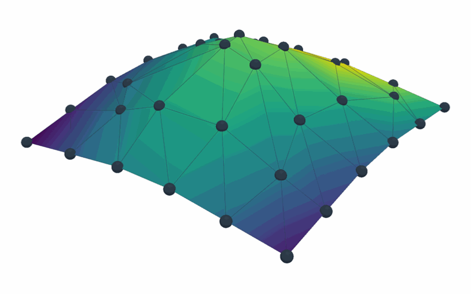
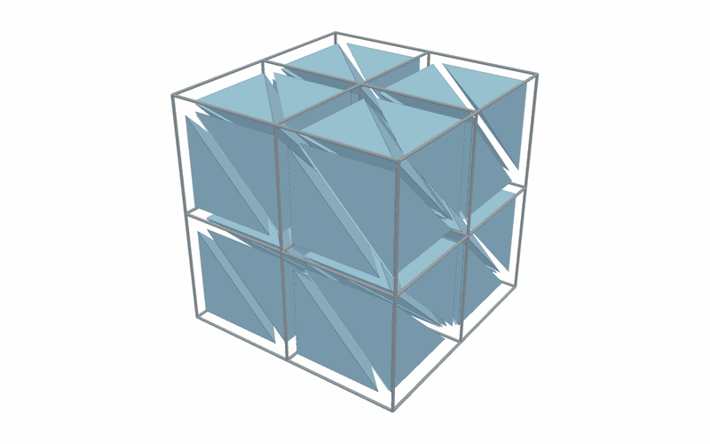
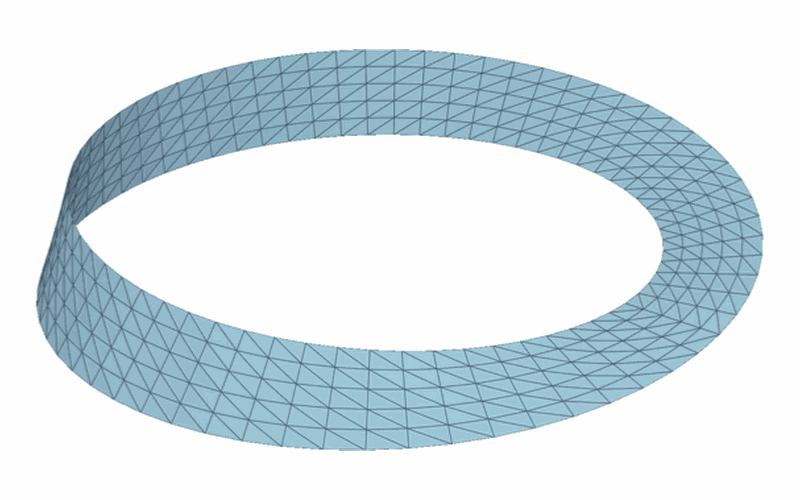
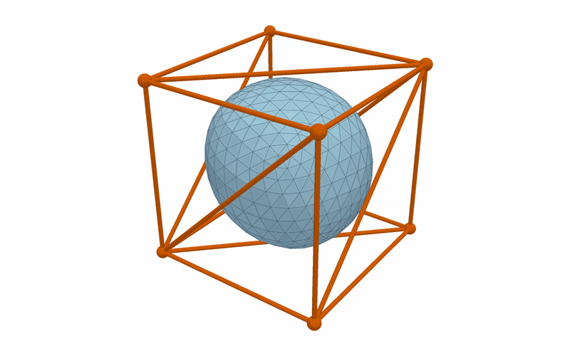
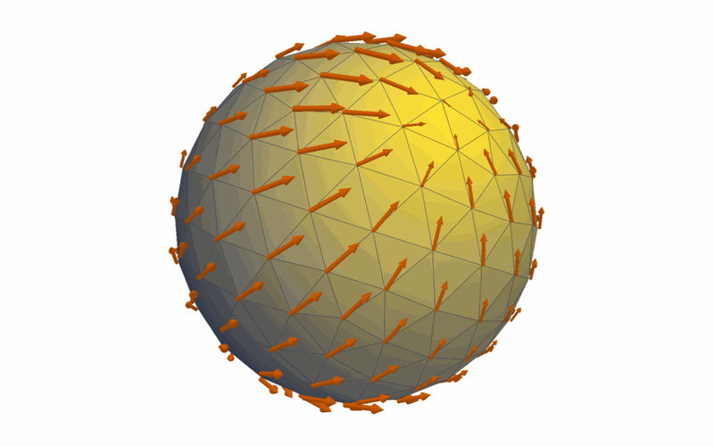
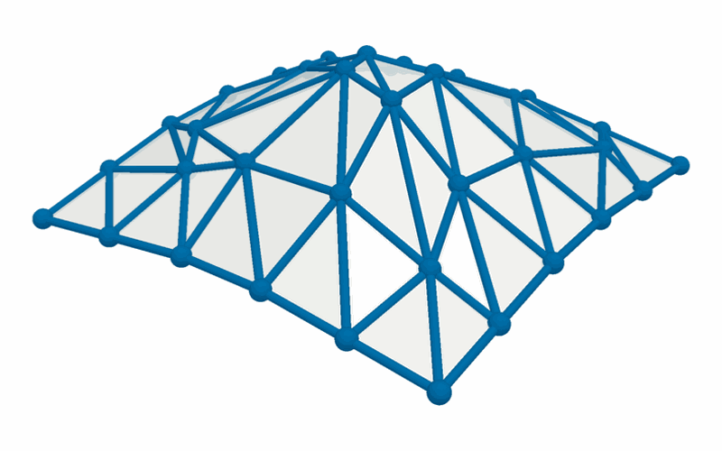
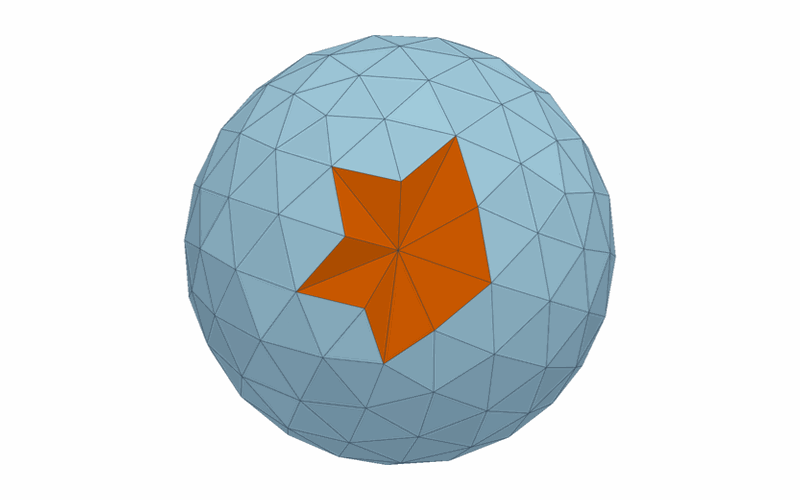
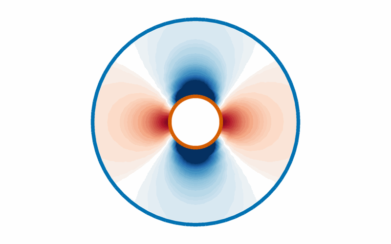
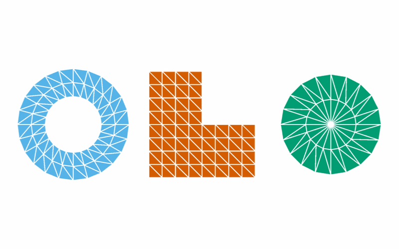

# PhysicsNeMo-Mesh Tutorials

Nine executed notebooks that take you from a first mesh to meshes in a machine
learning (ML) pipeline. PhysicsNeMo-Mesh stores point clouds, curves, surfaces,
and volumes as PyTorch tensors, so operations run on a GPU, and the numerical
ones work with autograd. For an overview of the module, refer to the
[physicsnemo.mesh README](../../../physicsnemo/mesh/README.md).

## The Tutorials

Each picture links to its notebook, and the caption says what you build:

<!-- markdownlint-disable MD013 MD033 -->
<table>
<tr>
<td width="33%" valign="top">
<a href="tutorial_1_getting_started.ipynb"></a><br>
<b>1. <a href="tutorial_1_getting_started.ipynb">Getting Started</a></b><br>
Build a mesh from two tensors, attach fields, draw it, and differentiate its area.
</td>
<td width="33%" valign="top">
<a href="tutorial_2_io_interop.ipynb"></a><br>
<b>2. <a href="tutorial_2_io_interop.ipynb">Loading, Converting, and Saving Meshes</a></b><br>
Convert PyVista and VTK meshes, triangulate polygons, and save to <code>.pmsh</code> and Zarr.
</td>
<td width="33%" valign="top">
<a href="tutorial_3_primitives_generation.ipynb"></a><br>
<b>3. <a href="tutorial_3_primitives_generation.ipynb">Primitives and Mesh Generation</a></b><br>
Load ready-made shapes, and mesh a boundary, an implicit shape, or an isosurface.
</td>
</tr>
<tr>
<td width="33%" valign="top">
<a href="tutorial_4_operations.ipynb"></a><br>
<b>4. <a href="tutorial_4_operations.ipynb">Mesh Operations</a></b><br>
Transform, subdivide, slice, and merge meshes, and extract boundaries and edge graphs.
</td>
<td width="33%" valign="top">
<a href="tutorial_5_calculus.ipynb"></a><br>
<b>5. <a href="tutorial_5_calculus.ipynb">Discrete Calculus and Curvature</a></b><br>
Compute gradients, divergence, curl, and curvature, and backpropagate through them.
</td>
<td width="33%" valign="top">
<a href="tutorial_6_neighbors_spatial.ipynb"></a><br>
<b>6. <a href="tutorial_6_neighbors_spatial.ipynb">Neighbors, Adjacency, and Spatial Queries</a></b><br>
Query adjacency, build graphs for graph networks, and sample fields at any point.
</td>
</tr>
<tr>
<td width="33%" valign="top">
<a href="tutorial_7_quality_repair.ipynb"></a><br>
<b>7. <a href="tutorial_7_quality_repair.ipynb">Quality, Validation, and Repair</a></b><br>
Measure cell quality, find defects, and repair them.
</td>
<td width="33%" valign="top">
<a href="tutorial_8_domain_mesh.ipynb"></a><br>
<b>8. <a href="tutorial_8_domain_mesh.ipynb">Simulation Domains with DomainMesh</a></b><br>
Keep an interior mesh, named boundaries, and case parameters in one object.
</td>
<td width="33%" valign="top">
<a href="tutorial_9_ml_integration.ipynb"></a><br>
<b>9. <a href="tutorial_9_ml_integration.ipynb">Meshes in ML Pipelines</a></b><br>
Batch meshes, train a graph model, compile it, and declare field schemas.
</td>
</tr>
</table>
<!-- markdownlint-enable MD013 MD033 -->

## Learning Path

Each tutorial builds on the ones before it. The nine fall into five steps:

| Step | Tutorials | You Learn |
| ---- | --------- | --------- |
| The data model | 1 and 2 | What a `Mesh` holds, and how meshes get in and out |
| Making meshes | 3 and 4 | Where meshes come from, and how to change them |
| The math | 5 and 6 | Derivatives, curvature, neighbors, and spatial queries |
| Robustness | 7 and 8 | Defects and repairs, and whole simulation domains |
| ML | 9 | Batching, graph models, `torch.compile`, and field schemas |

If you have one goal, you can take a shortcut:

| Your Goal | Read |
| --------- | ---- |
| Build a graph neural network on meshes | 1, 4, 6, and 9 |
| Write a physics loss with mesh derivatives | 1, 5, and 9 |
| Turn computational fluid dynamics (CFD) results into training data | 1, 2, 8, and 9 |
| Clean up scanned or CAD meshes | 1, 2, and 7 |

## Install

The tutorials need PhysicsNeMo with its `mesh-extras` extra (matplotlib,
PyVista, and VTK) and Jupyter. From this directory, install them with:

```bash
pip install -r requirements.txt
```

The tutorials use APIs from PhysicsNeMo 2.3, such as `FieldSchema` in
Tutorial 9. Until version 2.3.0 is released, install PhysicsNeMo from its main
branch or from a clone, as the following block shows.

<!-- markdownlint-disable MD033 -->
<details>
<summary>Install from the main branch or from a clone</summary>
<!-- markdownlint-enable MD033 -->

From the main branch:

<!-- markdownlint-disable MD013 -->
```bash
pip install "nvidia-physicsnemo[mesh-extras] @ git+https://github.com/NVIDIA/physicsnemo.git" \
    jupyter ipykernel ipywidgets
```
<!-- markdownlint-enable MD013 -->

From the root of a clone of the PhysicsNeMo repository:

```bash
pip install -e ".[mesh-extras]" jupyter ipykernel ipywidgets
```

<!-- markdownlint-disable MD033 -->
</details>
<!-- markdownlint-enable MD033 -->

PhysicsNeMo needs Python 3.11 or later. The notebooks run on a CPU, and they use
a CUDA GPU when one is present. Some cells download PyVista example meshes the
first time that they run, so they need internet access once.

## Run

Start Jupyter in this directory, because the notebooks read files from
`assets/` (a coarse Stanford bunny, `bunny.pt`). From the repository root, run:

```bash
cd examples/minimal/mesh
jupyter lab
```

Then open a `tutorial_*.ipynb` file. VS Code and other editors with notebook
support open the files directly.

The notebooks render 3D figures with PyVista as static images
(`pv.set_jupyter_backend("static")`), so that the figures show on GitHub. To
rotate and zoom a 3D figure, install `trame` (`pip install "pyvista[jupyter]"`)
and change the backend to `"trame"`.

## More Information

The following pages have more information:

- [PhysicsNeMo-Mesh User Guide](https://docs.nvidia.com/physicsnemo/latest/user-guide/mesh.html)
- [PhysicsNeMo-Mesh API Reference](https://docs.nvidia.com/physicsnemo/latest/physicsnemo/api/mesh/index.html)
- [physicsnemo.mesh README](../../../physicsnemo/mesh/README.md)
- [TensorDict](https://github.com/pytorch/tensordict) and
  [PyVista](https://pyvista.org/)
