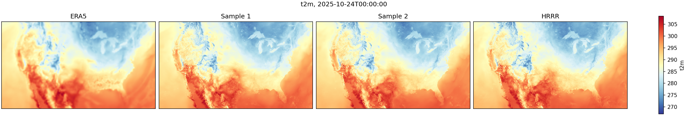
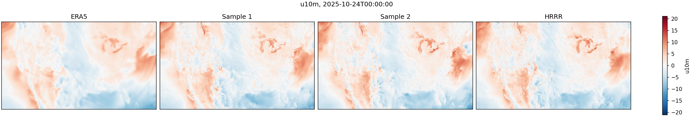
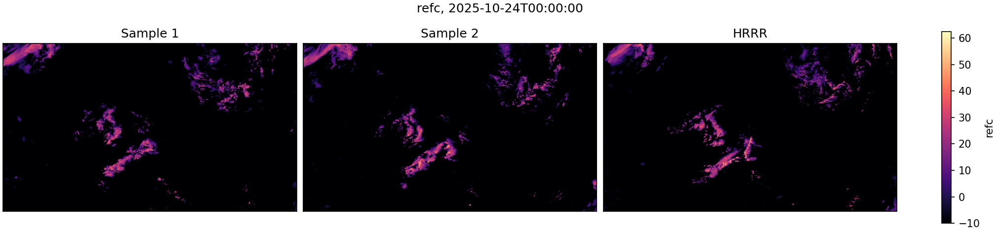

<!-- markdownlint-disable -->
# Corrdiff-ERA5-HRRR: Kilometer-scale downscaling of ERA5 with x-prediction rectified flow matching

## Problem overview

Global reanalyses such as ERA5 describe the atmosphere on a grid of about 25 km. This grid is too
coarse to resolve thunderstorms, winds around mountains and coastlines, or sharp temperature
contrasts. The High-Resolution Rapid Refresh (HRRR) model of NOAA resolves these scales on a 3 km
grid over the contiguous United States (CONUS). But HRRR is expensive to run, and its data cover
only recent years and one region.

This example trains CorrDiff-ERA5-HRRR, a generative model to downscale ERA5 to the 3 km HRRR grid
over CONUS. Given the ERA5 state at one time, the model generates an ensemble of high-resolution
atmospheric states with 99 HRRR variables. They include the 10 m winds, 2 m temperature, mean sea
level pressure, and composite radar reflectivity. They also include the wind, temperature,
humidity, and geopotential height on 16 model levels, and the pressure on 14 of these levels. 

<p align="center">

</p>

The model is a diffusion transformer (DiT) trained with rectified flow matching. The network
predicts the clean HRRR state, an approach called x-prediction, and learns to denoise at different
noise levels from clean data to pure noise. Sampling denoises pure Gaussian noise iteratively to clean data.

## Method

### Rectified flow matching with x-prediction

Rectified flow connects the data to Gaussian noise along straight lines,

$$\mathbf{x}_t = (1 - t)\, \mathbf{x}_0 + t\, \boldsymbol{\epsilon}, \qquad \boldsymbol{\epsilon} \sim \mathcal{N}(0, \mathbf{I}), \qquad t \in [0, 1],$$

where $\mathbf{x}_0$ is the normalized HRRR state, $t = 0$ is clean data, and $t = 1$ is pure noise.
The network $D_\theta$ receives the noisy state, the time, and the ERA5 condition $\mathbf{c}$. It
predicts the clean state, an approach known as [x-prediction](https://arxiv.org/abs/2511.13720).
Training minimizes

$$\mathcal{L} = \mathbb{E}_{t \sim \mathcal{U}[0, 1],\, \boldsymbol{\epsilon}} \left\| D_\theta(\mathbf{x}_t, t, \mathbf{c}) - \mathbf{x}_0 \right\|^2 .$$

To generate a sample, the solver integrates the probability-flow ODE of rectified flow from pure
noise at $t = 1$ to $t = 0$:

$$\frac{d\mathbf{x}}{dt} = \frac{\mathbf{x}_t - D_\theta(\mathbf{x}_t, t, \mathbf{c})}{t} .$$

Both the loss and the right-hand side of the ODE are finite at $t = 1$. The model trains up to
$t = 1$, and sampling starts from the same pure-noise inputs as in training.

The example uses the following PhysicsNeMo components:

| Component | PhysicsNeMo API |
| --- | --- |
| Noise schedule, time sampling, and noisy states | `physicsnemo.diffusion.noise_schedulers.RectifiedFlowNoiseScheduler(t_min=0.0, t_max=1.0)` |
| Training loss | `physicsnemo.diffusion.metrics.losses.WeightedFlowMatchingLoss(prediction_type="x0")` with the identity as `x0_to_flow_fn` |
| Flow from the x0 prediction for sampling | `RectifiedFlowNoiseScheduler.x0_to_flow` |
| ODE solver | `physicsnemo.diffusion.samplers.sample(solver="heun")` |
| Network | `physicsnemo.models.dit.DiT` in a `physicsnemo.diffusion.utils.ConcatConditionWrapper` |

[`utils/trainer.py`](./utils/trainer.py) implements the training, and `sample_flow` in
[`utils/nn.py`](./utils/nn.py) the sampling.

### Model and data

- **Target**: the 99 HRRR variables on the 1024 × 1792 pixel CONUS domain, normalized per variable.
- **Spatial conditions**: 30 channels concatenated with the noisy state. They contain 26 ERA5
  variables interpolated to the HRRR grid and the cosine of the solar zenith angle. Three static
  fields complete them: the mean and standard deviation of the elevation, and the land-sea mask.
  The ERA5 variables are the 10 m winds, 2 m temperature, surface and mean sea level pressure, and
  total column water vapor. They also include the wind, temperature, humidity, and height at four
  pressure levels.
- **Scalar conditions**: four values that reach the DiT through its conditioning embedding. They are
  the sine and cosine of the time of year, and presence flags for the total column water vapor
  (`tcwv`) and the surface pressure (`sp`). During training, the dataset replaces each of these two
  variables by its climatological mean with probability 0.5 and sets its flag to zero. This way, the
  model also works with data that lack these variables.
- **Network**: a DiT with 678M parameters, 28 blocks, a hidden size of 1152, and 18 heads. It embeds
  2 × 2 pixel patches as tokens and uses [NATTEN](https://github.com/SHI-Labs/NATTEN) neighborhood
  attention over 31 × 31 tokens. The attention uses 2D rotary position embeddings and normalized
  queries and keys. `TimeScaledModel` in [`utils/nn.py`](./utils/nn.py) multiplies the times by 999
  before the DiT timestep embedding.
- **Patch training, full-domain sampling**: the model trains on random 256 × 256 patches and samples
  the full domain, which has 28 times more pixels. Larger images need stronger noise to destroy
  their large-scale structure. As in [Stable Diffusion 3](https://arxiv.org/abs/2403.03206),
  inference shifts the sampling times toward the noise end with $t \to a t / (1 + (a - 1) t)$, using
  $a = 32$ on the full domain.

## Getting started

### Preliminaries

1. Install PhysicsNeMo with the `datapipes-extras` optional dependency group, along with the packages
   in `requirements.txt`. The normalization of the attention queries and keys uses
   [NVIDIA Apex](https://github.com/NVIDIA/apex), which the PhysicsNeMo and NGC PyTorch containers
   include.
2. Copy the `examples/weather/corrdiff-era5-hrrr` folder to a system with a GPU.
3. Prepare the [HRRR](https://rapidrefresh.noaa.gov/hrrr/) and
   [ERA5](https://www.ecmwf.int/en/forecasts/dataset/ecmwf-reanalysis-v5) data in the layout
   described in [`datasets/hrrr_era5.py`](./datasets/hrrr_era5.py), and pass its location with
   `dataset.data_path=<path>`. For other data, write a custom dataset as described in
   [Adding custom datasets](#adding-custom-datasets).
4. To run inference without training, place the model checkpoint at
   `checkpoints/corrdiff_era5_hrrr.mdlus`.

To install all requirements beyond those of PhysicsNeMo itself, you can run:

```bash
pip install -r requirements.txt
```

### Testing

The `pytest` test suite in `test_training.py` checks training, checkpointing, and the loss on mock
data. It also checks that sampling from pure noise reproduces a known Gaussian distribution. If the
checkpoint is available, the suite also loads it and samples from it. To run the tests on a single
GPU:

```bash
pytest test_training.py
```

To test distributed data-parallel training, for example with two GPUs:

```bash
torchrun --standalone --nproc_per_node=2 --no-python pytest test_training.py
```

### Configuration basics

`train.py` runs the training and `inference.py` the inference, both configured with
[hydra](https://hydra.cc/docs/intro/) from the files in the `config` directory. The `config`
directory includes the following subdirectories:

 - `dataset`: the dataset class and its parameters, such as the data path, time ranges, and patch shape
 - `model`: the DiT hyperparameters
 - `training`: the optimization hyperparameters, the logging and checkpoint frequencies, and the output location
 - `sampler`: the number of sampling steps, the ODE solver, and the time shift
 - `inference`: the time to downscale, the checkpoint, the ensemble size, and the outputs to save
 - `hydra`: basic hydra settings, like where to store outputs

Each top-level config combines files from these subdirectories:

 - `diffusion.yaml`: training
 - `diffusion_lite.yaml`: a short training run to check the setup
 - `test_diffusion.yaml`: the tests
 - `corrdiff_inference.yaml`: inference

You can override any setting from the command line, for example:

```bash
python train.py --config-name=diffusion_lite dataset.data_path=/path/to/data training.batch_size=8
```

The trainer saves its outputs, including logs, checkpoints, validation plots, and TensorBoard logs,
to `training.rundir`. The following config items define this path:

```yaml
training.outdir: 'rundir' # Root path under which to save training outputs
training.experiment_name: 'corrdiff-era5-hrrr' # Name for the training experiment
training.run_id: '0' # Unique ID to use for this training run
training.rundir: ${training.outdir}/${training.experiment_name}/${training.run_id}
```

The `inference` config has the same options for the outputs of `inference.py`.

## Training

To train the model with 8 GPUs on one node, run:

```bash
torchrun --standalone --nproc_per_node=8 train.py dataset.data_path=/path/to/data
```

The default configuration, `diffusion.yaml`, uses the following settings:

| Setting | Value |
| --- | --- |
| Training data | 2018-07-01 to 2025-09-30, random 256 × 256 patches |
| Validation data | 2025-10-01 to 2025-12-31 |
| Times | $t \sim \mathcal{U}[0, 1]$ |
| Batch size | 64, with 2 samples per GPU and gradient accumulation on fewer than 32 GPUs |
| Optimizer | AdamW, learning rate $10^{-4}$, $\beta = (0.9, 0.99)$, no weight decay |
| Learning rate schedule | linear warmup over 1000 steps, then cosine decay to zero |
| Training length | 781,250 steps, or 50M samples |
| Precision | bf16 mixed precision, gradient norm clipped at 1 |

With 2 samples per GPU, training uses about 68 GB of memory per GPU. On GPUs with less memory, set
`training.batch_size_per_gpu=1`. Gradient accumulation then keeps the batch size at 64. The number
of GPUs must divide `training.batch_size`. The trainer writes checkpoints every 1562 steps, or 100k
samples, to `<rundir>/checkpoints`. Restarting a stopped run with the same configuration resumes it
from the most recent checkpoint. To check the setup on real data before a long run, train for 20
steps with frequent outputs:

```bash
torchrun --standalone --nproc_per_node=8 train.py --config-name=diffusion_lite dataset.data_path=/path/to/data
```

Every `training.validation_freq` steps, the trainer computes the loss on fixed validation patches
and saves plots of a generated sample to `<rundir>/images`.

## Inference

To downscale one time of the validation period, run:

```bash
python inference.py dataset.data_path=/path/to/data inference.time="2025-10-24T00:00:00" inference.num_ensembles=8
```

By default, the script loads `checkpoints/corrdiff_era5_hrrr.mdlus`. To use weights from your own
training run, add `inference.checkpoint=<rundir>/checkpoints/TimeScaledModel.0.<step>.mdlus` to the
command.

The script generates `inference.num_ensembles` samples over the full domain with 50 Heun steps, or
100 network evaluations, and the time shift $a = 32$. A sample takes about 7 minutes on one H100
GPU. The script writes the following outputs to `inference.rundir`:

- `samples.nc`: the variables in `inference.output_variables` for each sample, and the HRRR truth as `<variable>_hrrr`
- `<variable>.png`: the ERA5 input if available, two samples, and HRRR for each variable in `inference.plot_variables`

The log also reports the root mean square error (RMSE) of the ensemble mean against HRRR, and the
ensemble spread. For the command above, the script reports the following values:

| Variable | Ensemble-mean RMSE | Ensemble spread |
| --- | --- | --- |
| `u10m` | 1.05 m/s | 0.88 m/s |
| `v10m` | 1.15 m/s | 0.95 m/s |
| `t2m` | 0.70 K | 0.54 K |
| `mslp` | 49.2 Pa | 36.4 Pa |
| `refc` | 4.70 dBZ | 4.02 dBZ |

The network runs in bf16 precision, so the values can differ slightly between GPUs.

<p align="center">

</p>

<p align="center">

</p>

## Adding custom datasets

To train on other data, write a subclass of `DownscalingDataset` from
[`datasets/dataset.py`](./datasets/dataset.py) in a new file in the `datasets` directory. Select it
with the `dataset.name` setting, in the form `<module>.<class>`. The trainer passes the other
settings of the `dataset` config and a `train` flag to the constructor of the class. Its
`__getitem__` returns a dictionary with normalized arrays: `"background"` holds the low-resolution
conditions on the high-resolution grid, `"state"` the target, and the optional
`"scalar_conditions"` the scalar conditions. A dataset that returns `"scalar_conditions"` must also
name them in `scalar_condition_channels()`, which sets the size of the DiT conditioning. The
docstring of `DownscalingDataset` describes the full interface.
[`datasets/mock.py`](./datasets/mock.py) shows a minimal example, and
[`datasets/hrrr_era5.py`](./datasets/hrrr_era5.py) the dataset of this example.

## References

- [x-prediction for denoising generative models](https://arxiv.org/abs/2511.13720)
- [Rectified flow](https://arxiv.org/abs/2209.03003)
- [Flow matching](https://arxiv.org/abs/2210.02747)
- [Stable Diffusion 3, rectified flow transformers with a resolution-dependent time shift](https://arxiv.org/abs/2403.03206)
- [Diffusion transformers](https://arxiv.org/abs/2212.09748)
- [Neighborhood attention](https://arxiv.org/abs/2204.07143)
- [CorrDiff, residual corrective diffusion for kilometer-scale downscaling](https://arxiv.org/abs/2309.15214)
- [StormCast, kilometer-scale emulation of a convection-allowing model with generative diffusion](https://arxiv.org/abs/2408.10958)
