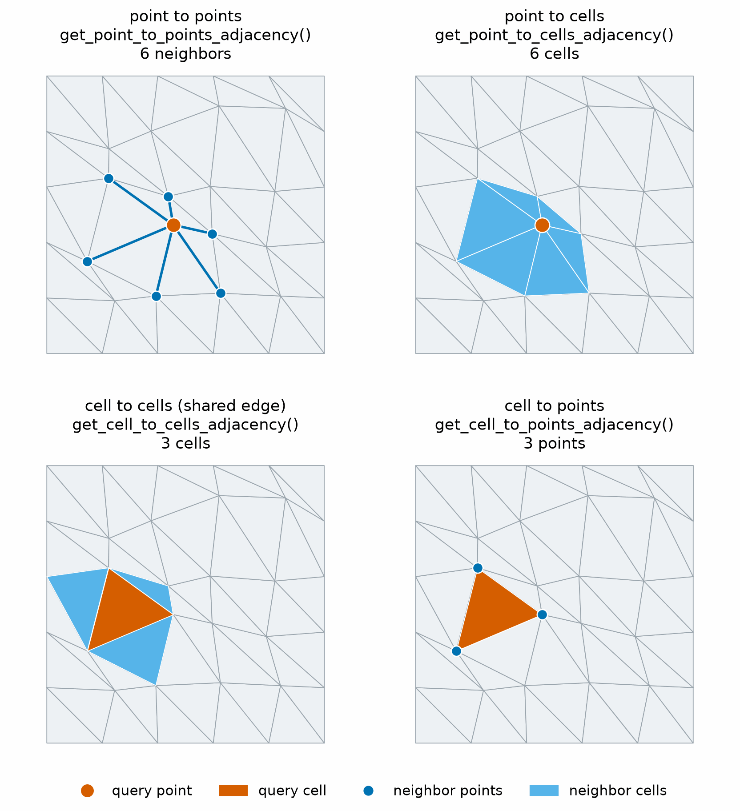

# PhysicsNeMo-Mesh

GPU-accelerated, differentiable meshes for physics AI, in any dimension.

![One blob shown four ways. A point cloud, Mesh[0, 3]. An edge graph,
Mesh[1, 3]. A triangle surface, Mesh[2, 3]. A cut-open tetrahedral volume,
Mesh[3, 3].](../../docs/img/mesh/mesh_hero_strip.png)

PhysicsNeMo-Mesh brings meshes into PyTorch:

- **One class for every mesh.** Point clouds, curves, graphs, surfaces, and
  volumes are all a `Mesh`, with data of any rank on points, cells, and the
  whole mesh.
- **Plain PyTorch underneath.** Mesh data are tensors, so operations run on
  the GPU, and the numerical ones work with autograd and `torch.compile`.
- **From file to model input in one place.** Geometry, calculus, curvature,
  repair, spatial queries, and graphs all work on the same object.

[User Guide](https://docs.nvidia.com/physicsnemo/latest/user-guide/mesh.html)
(concepts and choices) ·
[API Reference](https://docs.nvidia.com/physicsnemo/latest/physicsnemo/api/mesh/index.html)
(one page per submodule) ·
[Tutorials](../../examples/minimal/mesh/) (nine executed notebooks)

## Quick Start

Install PhysicsNeMo with the `mesh-extras` extra, which adds Matplotlib,
PyVista, and VTK for drawing and file I/O:

```bash
pip install "nvidia-physicsnemo[mesh-extras]"
```

`RankSpec` and `FieldSchema` are new in PhysicsNeMo 2.3. Until version 2.3.0
is released, install PhysicsNeMo from its main branch to use them, as the
[tutorials README](../../examples/minimal/mesh/README.md#install) shows.

Load a surface, refine it, and color it by its Gaussian curvature:

```python
import torch
from physicsnemo.mesh.primitives.pyvista_datasets import airplane

mesh = airplane.load()  # Mesh[2, 3]: triangles in 3D space
mesh = mesh.subdivide(levels=2, filter="loop")
mesh.point_data["gaussian_curvature"] = mesh.gaussian_curvature_vertices
mesh.draw(point_scalars="gaussian_curvature", show_edges=False, cmap="RdBu_r")
```


To run the same code on a GPU, move the mesh and all its data with
`mesh.to("cuda")`. The script `docs/img/mesh/airplane_gaussian_curvature.py`
renders this figure, with the curvature smoothed and the color range clipped.

## What a Mesh Is

A mesh has two dimensions. The manifold dimension is the dimension of its
cells, and the spatial dimension is the dimension of the space that holds its
points. `Mesh[m, s]` names both, so one API covers the meshes of computational
fluid dynamics (CFD), finite element analysis, graphics, and point cloud
processing:

![A grid of meshes by manifold dimension in columns and spatial dimension in
rows, each labeled Mesh[m, s]. Panel tints mark codimension 0, 1, and 2 or
more.](../../docs/img/mesh/mesh_dimensions.png)

Cells are always simplices: points, edges, triangles, tetrahedra, and their
higher-dimensional versions. This restriction makes discrete calculus and
curvature work on every mesh, and it keeps the operations fast to vectorize.

A `Mesh` is a [`tensorclass`](https://pytorch.org/tensordict/stable/reference/tensorclass.html)
with five fields:

```text
Mesh(
    points: torch.Tensor,      # (n_points, n_spatial_dims)
    cells: torch.Tensor,       # (n_cells, n_manifold_dims + 1), integer dtype
    point_data: TensorDict,    # Per-vertex data
    cell_data: TensorDict,     # Per-cell data
    global_data: TensorDict,   # Mesh-level data
)
```

Build one from two tensors, and attach data of any rank:

```python
from physicsnemo.mesh import Mesh

points = torch.tensor([[0.0, 0.0], [1.0, 0.0], [0.5, 1.0]])
cells = torch.tensor([[0, 1, 2]])  # One triangle
mesh = Mesh(points=points, cells=cells)

mesh.point_data["temperature"] = torch.tensor([300.0, 350.0, 325.0])
mesh.point_data["velocity"] = torch.tensor([[1.0, 0.5], [0.8, 1.2], [0.0, 0.9]])
mesh.cell_data["reynolds_stress"] = torch.tensor([[[2.1, 0.3], [0.3, 1.8]]])
print(mesh)
```

The printout shows the dimensions and the trailing shape of each field:

```text
Mesh[n_manifold_dims=2, n_spatial_dims=2](n_points=3, n_cells=1)
    point_data: {temperature: (), velocity: (2,)}
    cell_data : {reynolds_stress: (2, 2)}
```

`Mesh[m, s]` also works in type annotations and `isinstance` checks, with
`...` for a dimension that can be anything:

```python
isinstance(mesh, Mesh[2, 2])  # True: triangles in 2D
isinstance(mesh, Mesh[1, ...])  # False: not an edge mesh
```

Data moves with the mesh through `.to("cuda")`. Geometry such as normals and
curvature is computed on first use and cached apart from your data. Two more
classes build on `Mesh`. `DomainMesh` holds an interior mesh with named
boundary meshes for a simulation domain, and `RankSpec` and `FieldSchema`
declare how each field transforms under rotations and reflections. The
[User Guide](https://docs.nvidia.com/physicsnemo/latest/user-guide/mesh.html)
covers both.

## Examples

The examples in this section use one sphere surface with a field on it:

```python
from physicsnemo.mesh.primitives.surfaces import sphere_icosahedral

mesh = sphere_icosahedral.load(subdivisions=4)
x, y, z = mesh.points.unbind(dim=-1)
mesh.point_data["pressure"] = x * y + z
```

### Transformations and Deformation


Rigid and linear maps move vector fields with the geometry when you ask them
to. The deformations are differentiable, so they fit in a shape optimization
loop:

```python
import math

rotated = mesh.rotate(angle=math.pi / 4, axis="z")
scaled = mesh.scale([2.0, 1.0, 0.5])

# Dense displacement, and the same displacement smoothed over the surface
displacement = torch.zeros_like(mesh.points, requires_grad=True)
smooth = mesh.sobolev_deform(displacement, length_scale=0.1)
smooth.points.square().mean().backward()  # Gradients reach displacement

# Sparse morphing: move one control point, and its neighborhood follows
top = mesh.points[mesh.points[:, 2].argmax()].unsqueeze(0)
morphed = mesh.morph(top, torch.tensor([[0.0, 0.0, 0.3]]), radius=0.8)

# Fit the upper half of the sphere onto a larger target surface
target = sphere_icosahedral.load(radius=1.1, subdivisions=4)
fitted = mesh.shrinkwrap(target, point_weights=mesh.points[:, 2] > 0)
```

Radial-basis, free-form lattice, and shrinkwrap options, and the deformation
energies for regularization, are on the
[transformations](https://docs.nvidia.com/physicsnemo/latest/physicsnemo/api/mesh/transformations.html)
and [deformation](https://docs.nvidia.com/physicsnemo/latest/physicsnemo/api/mesh/deformation.html)
pages.

### Subdivision and Remeshing


```python
refined = mesh.subdivide(levels=2, filter="linear")  # Same shape, more cells
smooth = mesh.subdivide(levels=2, filter="loop")  # Approximating, smooth
interp = mesh.subdivide(levels=2, filter="butterfly")  # Interpolating

# Uniform remeshing to about 1000 vertices, carrying a field along
coarse = mesh.remesh(n_clusters=1_000, transfer_point_data=["pressure"])
```

Remeshing runs with Warp on CPU and CUDA and accepts a resolution field.
Refer to the
[remeshing page](https://docs.nvidia.com/physicsnemo/latest/physicsnemo/api/mesh/remeshing.html).

### Discrete Calculus


Gradients, divergence, curl, and the Laplacian come in two methods, least
squares (LSQ) and discrete exterior calculus (DEC), as `Mesh` methods that
take a data key or a tensor:

```python
mesh.point_data["velocity"] = mesh.points.clone()

grad_p = mesh.gradient("pressure")  # Tangent to the surface, (n_points, 3)
div_v = mesh.divergence("velocity")  # (n_points,)
curl_v = mesh.curl("velocity")  # 3D only
lap_p = mesh.laplacian("pressure")  # DEC cotangent Laplacian

# Several fields at once, stored as "<key>_gradient" in point_data
with_grad = mesh.compute_point_derivatives(keys="pressure", method="dec")
```

The [calculus README](./calculus/README.md) explains when to choose each
method.

### Boundaries and Repair


```python
boundary = mesh.get_boundary_mesh()  # Empty for a closed sphere
facets = mesh.get_facet_mesh()  # Every edge of the surface, Mesh[1, 3]
print(mesh.is_watertight(), mesh.is_manifold())  # True True

clean = mesh.clean()  # Merge duplicate points, drop bad and unused cells
```

### Spatial Queries and Sampling


```python
from physicsnemo.mesh.spatial import BVH

query_points = mesh.sample_random_points_on_cells()  # One point per cell
bvh = BVH.from_mesh(mesh)
sampled = mesh.sample_data_at_points(query_points, data_source="points", bvh=bvh)
print(sampled["pressure"].shape)  # torch.Size([5120])
```

A bounding volume hierarchy (BVH) also speeds up point containment and
`signed_distance_field`. Refer to the
[spatial page](https://docs.nvidia.com/physicsnemo/latest/physicsnemo/api/mesh/spatial.html).

### Neighbors

<!-- markdownlint-disable MD033 -->

<!-- markdownlint-enable MD033 -->

Topological neighbors come back as an `Adjacency`, a compact ragged encoding
with `indices` and `offsets`:

```python
point_neighbors = mesh.get_point_to_points_adjacency()
print(point_neighbors.counts[:3])  # Neighbors of the first three points
print(point_neighbors.to_list()[0])  # The neighbor indices of point 0
```

### Graphs

![A curved triangle sheet and its two graphs, each a Mesh[1, 3]. The edge
graph has 36 nodes and 85 edges. The dual graph has 50 nodes at the triangle
centers and 65 edges.](../../docs/img/mesh/mesh_graphs.png)

A `Mesh[1, n]` is an undirected graph with node positions. Points are the
nodes, cells are the edges, and `point_data` and `cell_data` hold node and edge
features. The edge graph of any mesh is one call away, and message passing is
plain tensor indexing:

```python
graph = mesh.to_edge_graph()  # Mesh[1, 3]: 2562 nodes, 7680 edges
graph.cell_data["length"] = graph.cell_areas  # The measure of an edge is its length

src, dst = graph.get_point_to_points_adjacency().expand_to_pairs()
x = graph.point_data["pressure"]
neighbor_sum = torch.zeros_like(x).index_add_(0, src, x[dst])  # One message step

batch = Mesh.merge([graph, graph.translate([3.0, 0.0, 0.0])])  # Two graphs, one Mesh
```

For mesh-based graph work, `Mesh` covers what a deep learning graph library
usually provides: construction, geometric features, batching, augmentation,
and device moves. It has no built-in aggregation layers, neighbor-sampling
loaders, or batch vector. Build a batch vector with `torch.repeat_interleave`.
[Tutorial 6](../../examples/minimal/mesh/tutorial_6_neighbors_spatial.ipynb)
and [Tutorial 9](../../examples/minimal/mesh/tutorial_9_ml_integration.ipynb)
build a graph model this way.

## `torch.compile`

Numerical code on mesh tensors compiles well. Topology queries, such as
boundaries, neighbors, and facets, have data-dependent shapes, so compute them
before the compiled function and pass the tensors in. To reuse compiled
kernels across meshes of different sizes, pad them with
`mesh.pad_to_next_power()`. Tutorial 9 shows both patterns.

## Feature Overview

Each area links to its reference:

<!-- markdownlint-disable MD013 -->
| Area | What It Provides |
| ---- | ---------------- |
| [Core](https://docs.nvidia.com/physicsnemo/latest/physicsnemo/api/mesh/core.html) | `Mesh`, `DomainMesh`, `Mesh.merge`, padding, slicing, saving |
| [Fields](https://docs.nvidia.com/physicsnemo/latest/physicsnemo/api/mesh/fields.html) | `RankSpec` and `FieldSchema`: tensor rank, symmetry, and parity of each field |
| [Primitives](./primitives/README.md) | Ready-made curves, planar meshes, surfaces, volumes, and procedural shapes |
| [I/O](https://docs.nvidia.com/physicsnemo/latest/physicsnemo/api/mesh/io.html) | PyVista and VTK conversion, polygon meshes, Zarr stores |
| [Generation](https://docs.nvidia.com/physicsnemo/latest/physicsnemo/api/mesh/generate.html) and [tessellation](https://docs.nvidia.com/physicsnemo/latest/physicsnemo/api/mesh/tessellation.html) | Marching cubes, implicit-domain meshing, boundary filling, ear clipping |
| [Transformations](https://docs.nvidia.com/physicsnemo/latest/physicsnemo/api/mesh/transformations.html) | Rigid and linear maps, dense, sparse, radial-basis, lattice, and shrinkwrap deformation, projections |
| [Deformation energies](https://docs.nvidia.com/physicsnemo/latest/physicsnemo/api/mesh/deformation.html) | Differentiable strain, measure, inversion, bending, and volume penalties |
| [Subdivision](https://docs.nvidia.com/physicsnemo/latest/physicsnemo/api/mesh/subdivision.html), [smoothing](https://docs.nvidia.com/physicsnemo/latest/physicsnemo/api/mesh/smoothing.html), [remeshing](https://docs.nvidia.com/physicsnemo/latest/physicsnemo/api/mesh/remeshing.html) | Linear, Loop, and Butterfly schemes, Laplacian smoothing, Warp remeshing |
| [Repair](https://docs.nvidia.com/physicsnemo/latest/physicsnemo/api/mesh/repair.html) and [validation](https://docs.nvidia.com/physicsnemo/latest/physicsnemo/api/mesh/validation.html) | Duplicate, degenerate, and isolated elements, orientation, holes, quality metrics |
| [Boundaries](https://docs.nvidia.com/physicsnemo/latest/physicsnemo/api/mesh/boundaries.html) and [geometry](https://docs.nvidia.com/physicsnemo/latest/physicsnemo/api/mesh/geometry.html) | Boundary and facet meshes, watertight and manifold checks, areas, normals, dual volumes |
| [Calculus](./calculus/README.md) and [curvature](https://docs.nvidia.com/physicsnemo/latest/physicsnemo/api/mesh/curvature.html) | Gradient, divergence, curl, Laplacian, integration, Gaussian and mean curvature |
| [Neighbors](https://docs.nvidia.com/physicsnemo/latest/physicsnemo/api/mesh/neighbors.html), [spatial](https://docs.nvidia.com/physicsnemo/latest/physicsnemo/api/mesh/spatial.html), [sampling](https://docs.nvidia.com/physicsnemo/latest/physicsnemo/api/mesh/sampling.html) | Adjacency, edge and dual graphs, BVH queries, signed distance, random sampling, interpolation |
| [Visualization](./visualization/README.md) | `Mesh.draw()` with Matplotlib or PyVista |
<!-- markdownlint-enable MD013 -->

The tests in [`test/mesh/`](../../test/mesh/) show usage patterns for every
submodule.

## Design Principles

PhysicsNeMo-Mesh follows three principles, in order of priority:

1. Correctness first: rigorous mathematical foundations and extensive
   validation.
2. Performance second: vectorized GPU operations, with no Python loops over
   mesh elements.
3. Usability third: simple APIs that still expose the full functionality.

The API takes inspiration from [PyVista](https://pyvista.org/). The core data
structure depends on [PyTorch](https://pytorch.org/) and
[TensorDict](https://github.com/pytorch/tensordict), and some operations use
[Warp](https://github.com/NVIDIA/warp).

## Tutorials

The [tutorials index](../../examples/minimal/mesh/) shows all nine notebooks
with a picture of what each one builds. They run on a CPU and use a GPU when
one is present:

1. [Getting Started](../../examples/minimal/mesh/tutorial_1_getting_started.ipynb)
2. [Loading, Converting, and Saving Meshes](../../examples/minimal/mesh/tutorial_2_io_interop.ipynb)
3. [Primitives and Mesh Generation](../../examples/minimal/mesh/tutorial_3_primitives_generation.ipynb)
4. [Mesh Operations](../../examples/minimal/mesh/tutorial_4_operations.ipynb)
5. [Discrete Calculus and Curvature](../../examples/minimal/mesh/tutorial_5_calculus.ipynb)
6. [Neighbors, Adjacency, and Spatial Queries](../../examples/minimal/mesh/tutorial_6_neighbors_spatial.ipynb)
7. [Quality, Validation, and Repair](../../examples/minimal/mesh/tutorial_7_quality_repair.ipynb)
8. [Simulation Domains with DomainMesh](../../examples/minimal/mesh/tutorial_8_domain_mesh.ipynb)
9. [Meshes in ML Pipelines](../../examples/minimal/mesh/tutorial_9_ml_integration.ipynb)

## Acknowledgments

PhysicsNeMo-Mesh draws on these works for its API design and mathematical foundations:

- The [PyTorch](https://pytorch.org/) team, for the deep learning framework
- The [PyVista](https://pyvista.org/) team, for the 3D visualization and I/O
  library
- Discrete Exterior Calculus: Desbrun, Hirani, Leok, Marsden (2005),
  [arXiv:math/0508341](https://arxiv.org/abs/math/0508341), and the eponymous
  dissertation on
  [Discrete Exterior Calculus by Hirani (2003)](https://www.cs.jhu.edu/~misha/Fall09/Hirani03.pdf)
- Discrete Differential Operators: Meyer, Desbrun, Schröder, Barr (2003),
  [Discrete Differential-Geometry Operators for Triangulated 2-Manifolds](https://www.multires.caltech.edu/pubs/diffGeoOps.pdf)
- Loop Subdivision: Loop (1987),
  [Smooth Subdivision Surfaces Based on Triangles](https://www.microsoft.com/en-us/research/publication/smooth-subdivision-surfaces-based-on-triangles/)
- Butterfly Subdivision: Zorin, Schröder, Sweldens (1996),
  [Interpolating Subdivision for Meshes with Arbitrary Topology](https://cims.nyu.edu/gcl/papers/zorin1996ism.pdf)
